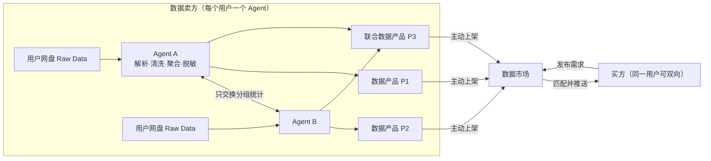
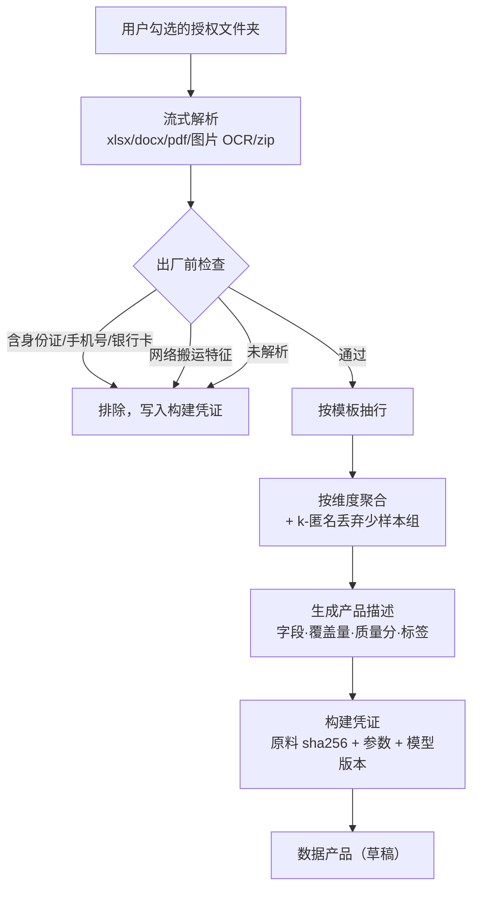
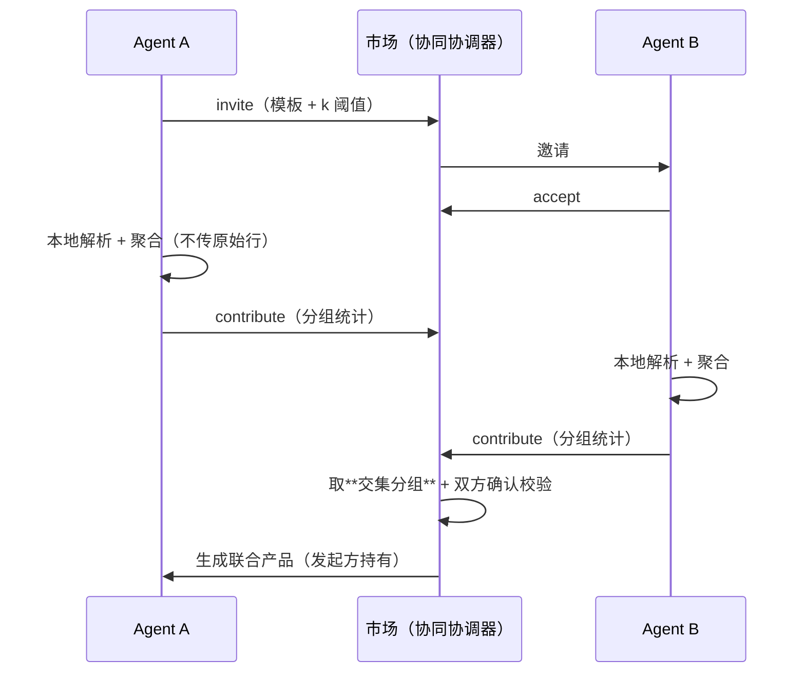
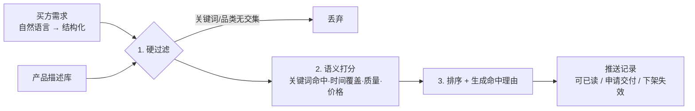
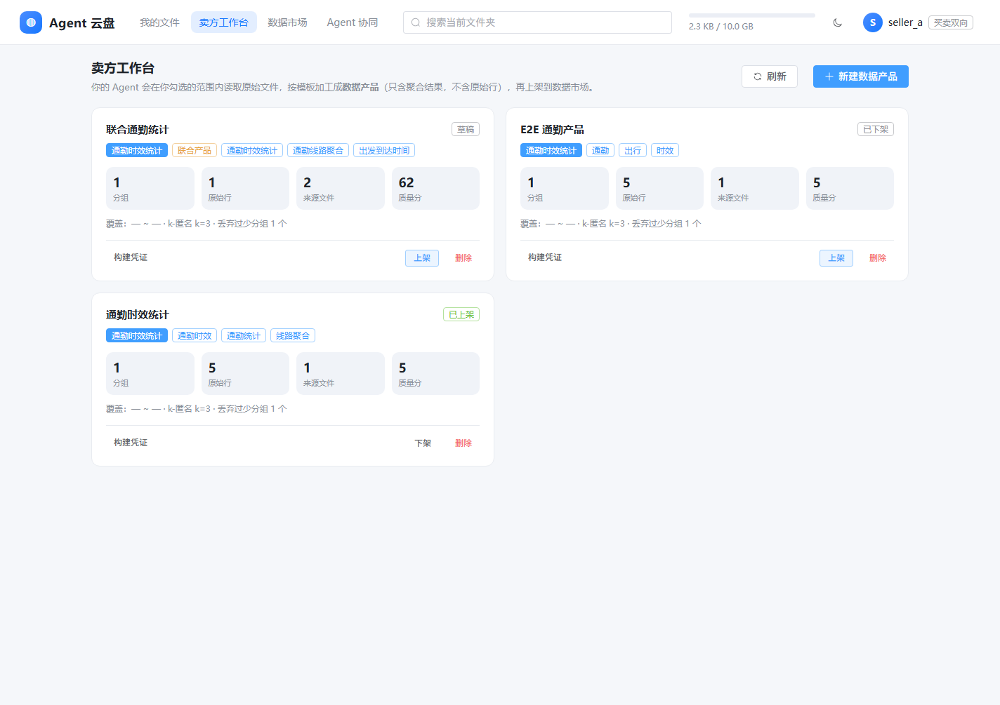
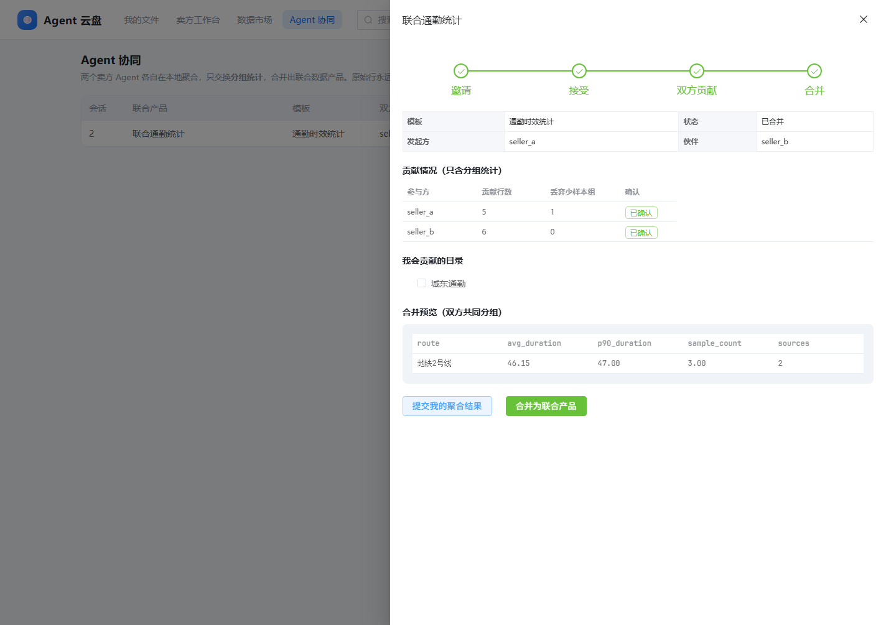

# AgentCloudDisk · 数据卖方 Agent + 数据交易市场（WWW Demo）

> 本 Demo 的重点是 **Agent 这一层**：Agent 如何在卖方网盘内把原始数据加工成可交易的数据产品，以及多个 Agent 如何协同生成联合产品。交易/交付部分只做最小闭环。

## 一、业务模型



关键约束：**市场只见产品描述，不见原始内容**。买方能看到字段、覆盖量、质量分、脱敏样例与构建凭证，看不到任何原始文件。

## 二、Agent 加工链路（核心）



四个内置产品模板：

| 模板 | 维度 | 度量 | 适用数据 |
| --- | --- | --- | --- |
| 通勤时效统计 `commute_stats` | 线路 | 平均/90分位耗时、样本数 | 通勤表格 |
| 家常菜谱库 `recipe_library` | 菜名 | 食材数、步骤数 | 菜谱文档 |
| 宠物喂养记录 `pet_feeding` | 宠物 | 平均体重、记录数 | 喂养表格 |
| 读书笔记主题 `reading_notes` | 书目 | 笔记数、主题多样性 | 读后感/摘抄 |

**为什么只输出聚合**：原始行一旦上架就等于泄露个人数据。聚合 + k-匿名（默认 k=3）保证任何一行的不可区分性，且构建凭证里能查到哪些文件被排除、为什么被排除。

## 三、Agent 协同（联合产品）



防泄露三重设计：
1. 交换的只有分组聚合，从不传原始行；
2. 合并时取**交集**——单边独有的分组不会出现在联合产品里；
3. 联合产品再走一遍 k-匿名，构建凭证记录每个贡献者的分组数与丢弃数。

## 四、市场匹配与推送



- 卖方的原始数据和 Agent **不参与匹配**，只在市场侧比对描述；
- 需求发布后立即匹配一次，体现"主动推送"；
- 卖方下架时，相关推送自动置为"已失效"。

## 五、交付（最小化）

只做状态流转：买方「申请交付」→ 卖方「受理」→ 卖方「标记已交付」。不做真实数据传输，符合 Demo 定位。

## 六、页面

| 页面 | 角色 | 作用 |
| --- | --- | --- |
| 我的文件 / 回收站 | 通用 | 网盘底座（分片上传、秒传、预览、回收站） |
| **卖方工作台** | 卖方 | 选模板 → 勾授权范围 → 看加工进度 → 产品卡 → 构建凭证 → 上架 |
| **数据市场** | 买方 | 货源目录、发布需求、我的推送（含命中理由）、申请交付 |
| **Agent 协同** | 卖方 | 发起邀请、接受、双方贡献、合并联合产品 |
| 管理后台 | 管理员 | 用户/配额、模型管理（AES-GCM 加密 Key + 故障切换）、市场统计 |






## 七、演示账号与流程（约 3 分钟）

| 账号 | 密码 | 说明 |
| --- | --- | --- |
| seller_a | sell1234 | 城东通勤记录，已有一个上架产品 |
| seller_b | sell1234 | 城西通勤记录，已有一个上架产品 |
| buyer | buy12345 | 已发布一条通勤采购需求，已有推送 |
| demo | demo1234 | 13 个混合格式真实文件（docx/xlsx/png/zip/pdf） |
| admin | admin123 | 管理员 |

**推荐动线**：seller_a 登录 → 卖方工作台看产品与构建凭证 → 新建产品（选模板、勾文件夹、看实时加工进度）→ 上架 → 切 buyer → 数据市场看货源（注意看不到原始文件名）→ 我的推送看命中理由 → 申请交付 → 切 seller_a 受理并标记已交付 → Agent 协同页看联合产品与交集合并。

## 八、接口

**卖方（Agent）**

| 方法 | 路径 | 说明 |
| --- | --- | --- |
| GET | `/api/seller/templates` | 产品模板列表 |
| GET | `/api/seller/folders` | 可授权目录树 |
| POST | `/api/seller/products` | 创建产品并异步加工，返回 `{productId, taskId}` |
| GET | `/api/seller/build/{taskId}/progress` | 加工实时进度（逐文件事件） |
| GET | `/api/seller/products`、`/{id}` | 产品列表 / 详情（含构建凭证与用料） |
| POST | `/api/seller/products/{id}/publish`、`/delist` | 上架 / 下架 |
| DELETE | `/api/seller/products/{id}` | 删除产品 |
| GET | `/api/seller/deliveries`、`POST .../accept`、`.../complete` | 卖方履约 |

**市场（买方）**

| 方法 | 路径 | 说明 |
| --- | --- | --- |
| GET | `/api/market/listings`、`/{id}` | 货源目录 / 详情（描述 + 脱敏样例 + 凭证） |
| POST/GET | `/api/market/demands` | 发布采购需求（自动匹配）/ 我的需求 |
| POST | `/api/market/demands/{id}/match` | 重新匹配 |
| GET | `/api/market/pushes`、`POST .../read`、`.../delivery` | 推送列表 / 已读 / 申请交付 |
| GET | `/api/market/deliveries` | 买方交付申请 |
| GET/POST | `/api/market/collab...` | 协同会话：列表/详情/邀请/接受/拒绝/贡献/合并 |
| GET | `/api/market/stats` | 市场统计 |

## 九、数据模型（V8 新增 10 张表）

`agent_peer` · `data_product` · `product_build_task` · `product_build_item` · `product_listing` · `market_demand` · `market_match` · `collab_session` · `collab_contribution` · `delivery_request`

原有 `user` / `file_meta` / `user_file` / `upload_task` / `ai_provider` 完全不动；`data_bounty` 语义迁移为 `market_demand`；角色收敛为「用户 / 管理员」，不再有固定企业角色。

## 十、测试

| 套件 | 覆盖 | 结果 |
| --- | --- | --- |
| `scripts/market-smoke-test.mjs` | **本次重点**：模板、产品加工、构建凭证与原料 sha256、上架/下架与推送失效、需求匹配与命中理由、交付三段流转、协同四步与交集合并、权限隔离 | **45/45 PASS** |
| `scripts/smoke-test.ps1` | 网盘底座：鉴权、分片上传、秒传、容量、回收站、后台 | 27/27 PASS |
| `scripts/scan-progress-test.mjs` | 异步任务与进度、解析不崩溃、预览权限 | 19/19 PASS |
| `scripts/vision-optin-test.mjs` | 大模型开关与图片识图降级 | 19/19 PASS |
| `scripts/ai-provider-smoke-test.mjs` | 多平台模型管理与故障切换 | 29/29 PASS |

## 十一、运行

```powershell
cd backend
.kotlin.bat run          # http://127.0.0.1:8080
```

数据库 `agent_cloud_disk`，首次启动自动执行 V1–V8 迁移并播种演示数据（3 个市场账号 + 13 个混合格式文件 + 2 个已上架产品 + 1 条买方需求与其推送）。

## 十二、已知限制

- 交付只做状态流转，不做真实数据传输与密钥协商（Demo 定位）；
- 产品模板是固定的 4 个，不支持用户自定义模板与字段映射；
- 协同是"双方 + 一轮合并"，不支持三方以上或递增式多方合并；
- 匹配用关键词+规则打分，未接入向量召回；
- 单进程多租户模拟"每卖方一个 Agent"，P3 可拆成独立服务（接口已按 Agent 身份设计）。
