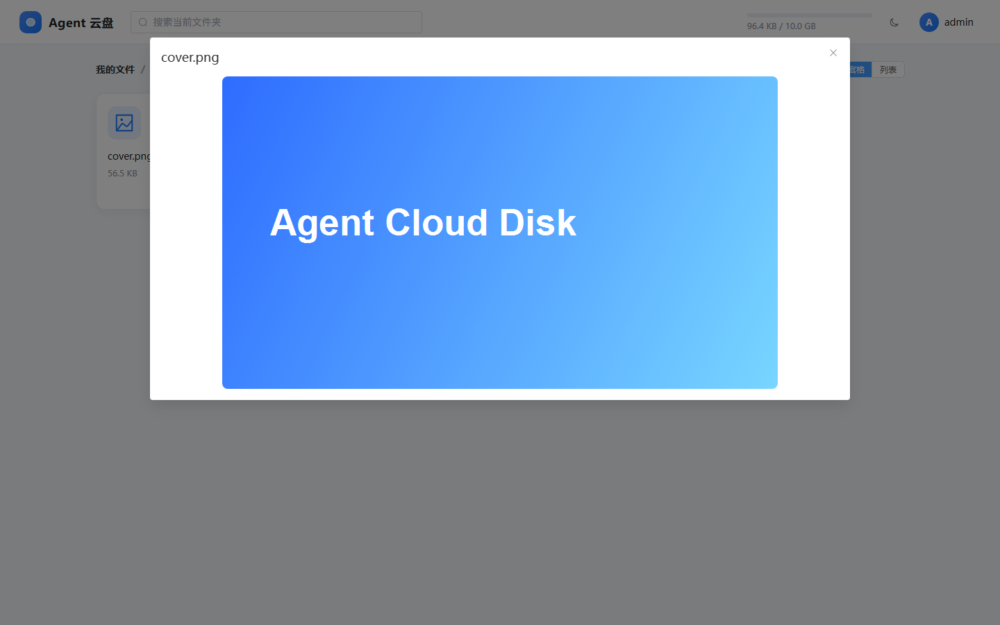
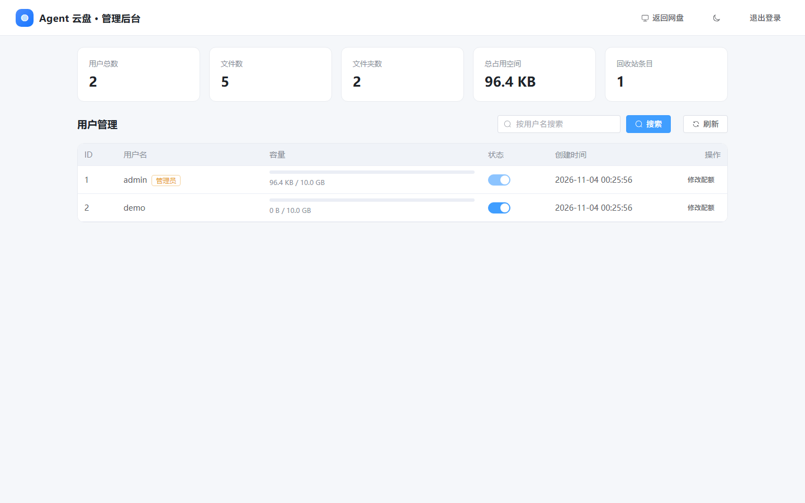
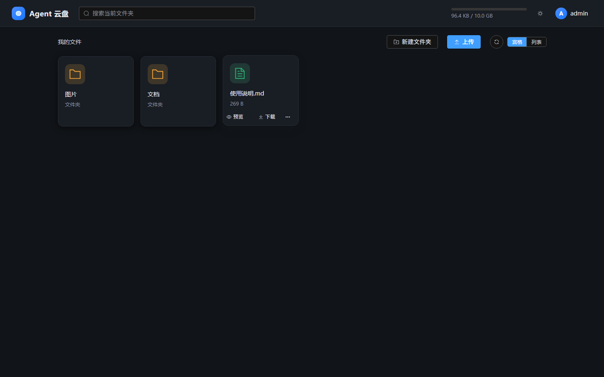

# Agent 云盘 · 最基础 Demo

按 `docs/技术选型.md` 与 `docs/数据库设计.md` 落地的全栈网盘 Demo。

- **后端**：SpringBoot 4.1.1 + Kotlin（Amper / Kotlin Toolchain 构建）+ PostgreSQL + MyBatis + Flyway + BCrypt + JWT
- **前端**：Vue 3 + Vite + Element Plus，仿阿里云盘界面，支持深浅色
- **已覆盖需求**：登录/注册、文件与文件夹浏览（图片/文本预览）、容量计算、上传/删除/回收站、分片上传（含秒传）、管理员后台


## 目录结构

```
backend/                 Spring Boot + Kotlin
  src/                   controller / service / mapper / model / auth / config
  resources/             application.yml、db/migration（Flyway）、static（前端产物）
  module.yaml            Amper 模块定义（依赖与 mainClass）
frontend/                Vue3 + Vite + Element Plus
scripts/                 smoke-test.ps1（接口冒烟）、build.ps1（前端构建同步）、ui-screenshots.mjs
screenshots/             README 截图
docs/                    原始设计文档
```

## 环境要求

- JDK 17 及以上（Amper 会自动准备编译用 JVM）
- Node.js 20+ 与 pnpm
- PostgreSQL 16+（本 Demo 在 PostgreSQL 18 上验证）

## 准备数据库

```sql
CREATE DATABASE agent_cloud_disk;
```

连接信息在 `backend/resources/application.yml`，可用环境变量覆盖：`DB_URL`、`DB_USERNAME`、`DB_PASSWORD`、`JWT_SECRET`、`APP_STORAGE_ROOT`、`APP_TEMP_ROOT`。

表结构由 Flyway 启动时自动迁移（`V1__init.sql` 建表、`V2__admin_role.sql` 追加管理员字段），无需手工建表。

## 启动

```powershell
# 后端（默认 8080，同时托管前端构建产物）
cd backend
.\kotlin.bat run
```

打开 <http://127.0.0.1:8080> 即可使用。

前端开发模式（热更新，`/api` 代理到 8080）：

```powershell
pnpm --dir frontend install
pnpm --dir frontend run dev      # http://127.0.0.1:5173
```

前端改完后同步到后端静态目录（单端口访问）：

```powershell
powershell -File scripts/build.ps1
cd backend; .\kotlin.bat build   # 让静态资源进入后端构建产物
```

## 演示账号

| 账号 | 密码 | 角色 |
| --- | --- | --- |
| admin | admin123 | 管理员 |
| demo | demo1234 | 普通用户 |

首次启动由 `AdminInitializer` 自动创建（BCrypt 加密存储）。

## 功能与需求对照

| 需求 | 实现 |
| --- | --- |
| 1. 登录/注册 | BCrypt 校验密码，登录签发 HS256 JWT；`/api/auth/**` 之外全部要求 `Authorization: Bearer` |
| 2. 文件/文件夹浏览 | 宫格与列表两种视图、面包屑跳转、按名称搜索、重命名；图片与文本在线预览 |
| 3. 账号容量计算 | `user.total_quota/used_size`，入库/彻底删除时原子增减，超配额直接拒绝并返回 400 |
| 4. 上传、删除、回收站 | 小文件直传；删除只打回收站标记（文件夹递归），支持恢复、彻底删除、清空回收站 |
| 5. 分片上传 | `init → chunk → merge` 三段式，默认 5MB/片，合并时计算 sha256；命中 `file_meta` 直接秒传，磁盘按 sha256 去重 |
| 6. 管理员后台 | 统计卡片、用户搜索、启用/禁用账号、调整配额（独立页面，与网盘主界面分开）|

## 接口一览

| 方法 | 路径 | 说明 |
| --- | --- | --- |
| POST | `/api/auth/register` | 注册并返回 token |
| POST | `/api/auth/login` | 登录 |
| GET | `/api/auth/me` | 当前用户信息 |
| GET | `/api/files?parentId=&keyword=` | 列目录（含面包屑） |
| POST | `/api/files/folder` | 新建文件夹 |
| PUT | `/api/files/{id}/rename` | 重命名 |
| DELETE | `/api/files/{id}` | 移入回收站（文件夹递归） |
| GET | `/api/files/quota` | 容量使用情况 |
| GET | `/api/files/recycle` | 回收站列表 |
| POST | `/api/files/recycle/{id}/restore` | 恢复 |
| DELETE | `/api/files/recycle/{id}` | 彻底删除 |
| DELETE | `/api/files/recycle` | 清空回收站 |
| GET | `/api/files/{id}/content?download=true` | 预览 / 下载 |
| POST | `/api/upload/small` | 小文件直传（multipart） |
| POST | `/api/upload/chunk/init` | 初始化分片任务，可带 `sha256` 触发秒传 |
| POST | `/api/upload/chunk?taskId=&index=` | 上传单个分片 |
| GET | `/api/upload/chunk/progress?taskId=` | 断点续传进度 |
| POST | `/api/upload/chunk/merge` | 合并分片并落库 |
| GET | `/api/admin/stats` | 后台统计 |
| GET | `/api/admin/users?keyword=` | 用户列表 |
| PUT | `/api/admin/users/{id}/status?status=0\|1` | 启用 / 禁用 |
| PUT | `/api/admin/users/{id}/quota?totalQuota=` | 调整配额 |

统一响应体：`{ "code": 0, "msg": "ok", "data": ... }`，失败时 `code` 为 HTTP 状态码。

## 存储布局

与 `docs/数据库设计.md` 保持一致，路径全部由 sha256 推演，不额外入库：

```
正式文件  {storage_root}/{sha256[0:2]}/{sha256[2:4]}/{sha256}
分片临时  {temp_root}/{task_id}/{chunk_index}
```

默认根目录为 `backend/data/`（可用 `APP_STORAGE_ROOT`、`APP_TEMP_ROOT` 覆盖）。

## 冒烟测试

```powershell
powershell -File scripts/smoke-test.ps1
```

覆盖注册登录、鉴权、新建文件夹、小文件上传、12MB 分片上传、秒传、容量计算、下载头、删除/恢复/彻底删除/清空回收站、管理员接口与配额上限共 27 项断言。脚本会创建 `tester*`、`quota*` 测试账号，跑完可在管理后台清理。

## 界面

| 网盘（宫格） | 网盘（列表） |
| --- | --- |
|  |  |

| 图片预览 | 文本预览 |
| --- | --- |
|  |  |

| 回收站 | 管理后台 | 深色模式 |
| --- | --- | --- |
|  |  |  |

## 已知限制

- 预览只支持常见文本（txt/md/json/代码等）与图片（png/jpg/gif/webp/bmp/svg），PDF、Office 文档不做解析
- 未做缩略图、分享链接、回收站定时清理；分片临时目录在合并后删除，过期任务依赖 `expire_at` 字段不做后台清理
- 秒传由服务端计算 sha256 判定；前端未预计算 hash，因此上传仍需走一次传输
- `application.yml` 中的数据库口令仅用于本地演示，正式环境请用环境变量注入
