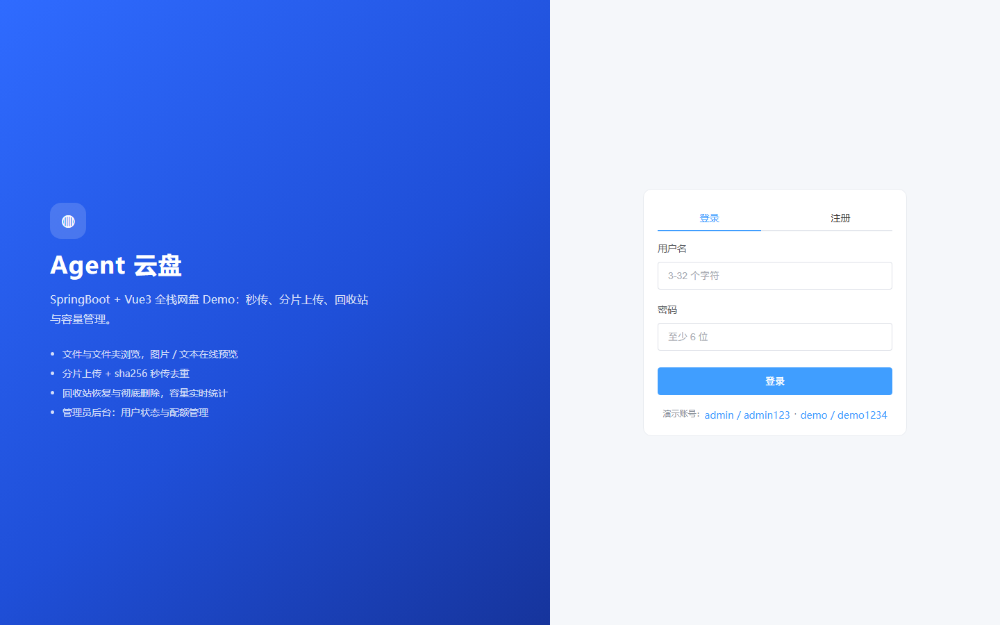
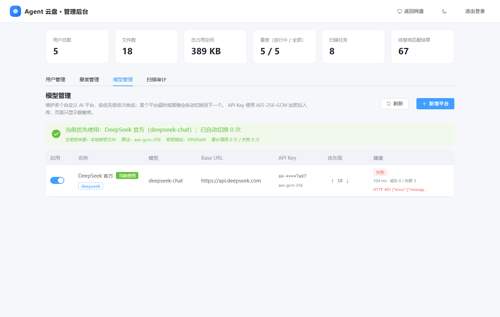
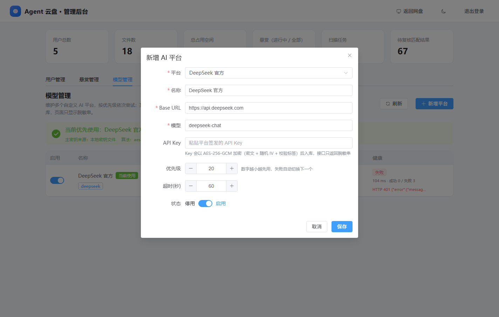
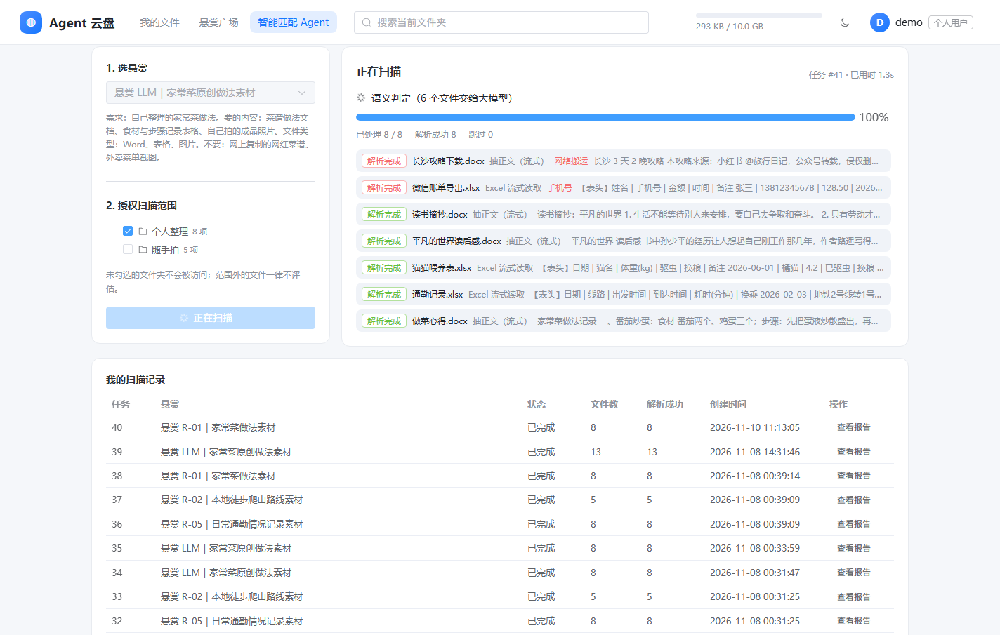
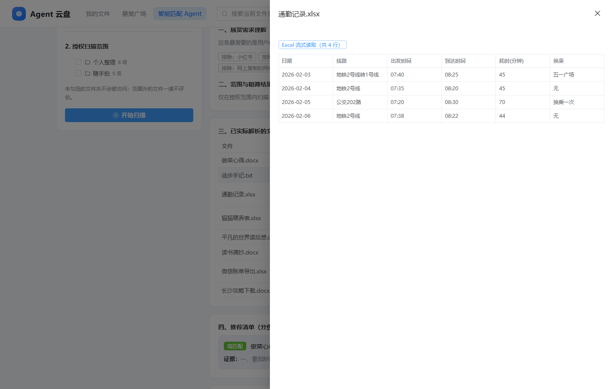
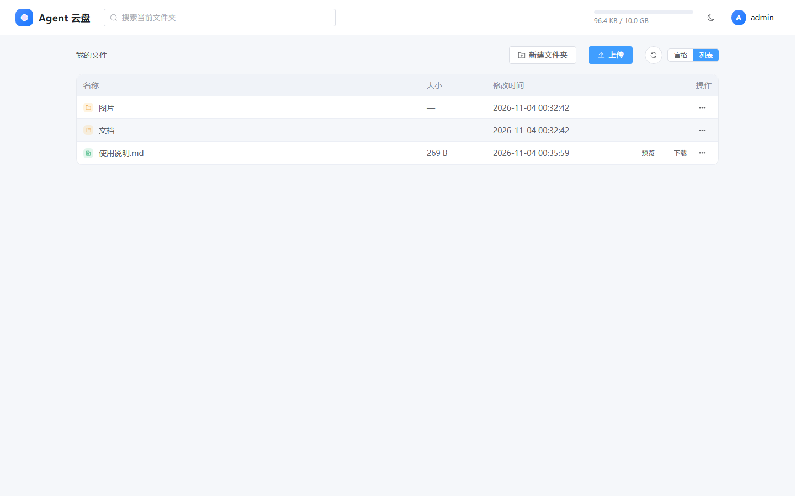

# Agent 云盘 · 数据要素悬赏匹配 Demo（已接入 DeepSeek）

在网盘底座之上，按 `docs/agent协同/` 实现「企业发布悬赏 → 个人授权范围 → Agent 分层扫描 / 真实内容解析 → DeepSeek 语义判定 → 证据化分级推荐 → 人工复核 → 审计」完整闭环。

- **后端**：SpringBoot 4.1.1 + Kotlin（Amper 构建）+ PostgreSQL + MyBatis + Flyway + BCrypt + JWT
- **前端**：Vue 3 + Vite + Element Plus，仿阿里云盘界面，深浅色主题
- **大模型**：多平台可配置（DeepSeek / OpenAI / 通义 / 智谱 / 自建网关），管理后台维护，失败自动切换；API Key 用 AES-256-GCM 加密入库
- **内容解析**：文本/Word/Excel/PDF 抽正文，图片走本机 Windows OCR，压缩包受控解包



## 一、DeepSeek 接入方式（本次实装重点）

| 调用点 | 实现 | 说明 |
| --- | --- | --- |
| 悬赏结构化 | `agent/LlmBountyAnalyzer.kt` | 把自然语言悬赏解析为 domain / formats / matchKeywords / excludeKeywords / yearLimit / understanding，落库 `data_bounty.structured_json`，并记录 `structured_by=llm`、`structured_model=deepseek-chat` |
| 匹配判定 | `agent/LlmMatchJudge.kt` | 每批 6 个文件调用一次，要求模型返回 `{fileId, matchLevel, evidence, riskTag, riskDesc, reason}`；**证据必须能在解析正文中找到**，否则自动退回本地原文片段（防止模型编造） |

设计要点：

1. **JSON 模式**：请求带 `response_format: {"type":"json_object"}`，后端自带极简 JSON 解析器（`agent/Json.kt`），不引入额外依赖。
2. **敏感信息不出网**：先用本机规则检测身份证 / 手机号 / 银行卡 / 网络搬运特征，命中即按规则判为高风险，**这些文件的正文不会发给模型**。
3. **可降级**：未配置 API Key 或调用失败时整体退回本地关键词规则，功能照常可用；前端会显示「DeepSeek」或「本地规则」判定来源。
4. **状态可观测**：`GET /api/agent/llm-status` 返回 enabled/available/model/calls/failures/lastLatencyMs/lastError，前端在 Agent 页顶部提示当前判定模式。

配置（`backend/resources/application.yml`，全部支持环境变量覆盖）：

| 环境变量 | 默认值 | 说明 |
| --- | --- | --- |
| `APP_MASTER_KEY` | 空（自动生成密钥文件） | **推荐配置**：32 字节 AES-GCM 主密钥，Base64 或 64 位十六进制，只放环境变量/配置中心 |
| `APP_MASTER_KEY_FILE` | `./data/master.key` | 未配置 `APP_MASTER_KEY` 时的本地密钥文件位置 |
| `DEEPSEEK_API_KEY` | 空 | 首次启动时播种默认平台用；**配置平台后以管理后台为准** |
| `DEEPSEEK_BASE_URL` / `DEEPSEEK_MODEL` | 官方地址 / `deepseek-chat` | 播种默认平台的地址与模型 |
| `AI_ENABLED` | `true` | 全局关闭 LLM 调用（走本地规则） |
| `AI_COOLDOWN_SECONDS` | `60` | 平台调用失败后的冷却秒数 |
| `APP_OCR_ENABLED` | `true` | 图片 OCR 开关（Windows.Media.Ocr） |
| `DB_URL` / `DB_USERNAME` / `DB_PASSWORD` | 本地库 | 数据库连接 |
| `APP_STORAGE_ROOT` / `APP_TEMP_ROOT` | `./data/...` | 存储目录 |

启动示例（PowerShell）：

```powershell
cd backend
$env:DEEPSEEK_API_KEY = "sk-..."
.\kotlin.bat run          # http://127.0.0.1:8080
```

## 二、多平台模型管理（新增）

管理后台新增「模型管理」页签，管理员可维护任意多个 OpenAI 兼容平台，并按优先级编排故障切换。

| 能力 | 说明 |
| --- | --- |
| 多平台维护 | 平台标识（deepseek/openai/qwen/zhipu/moonshot/custom）、名称、Base URL、模型名、超时、启停 |
| 内置预设 | 选择平台自动填充 Base URL 与默认模型，自定义平台可填自建网关地址 |
| 优先级编排 | 数字越小越先用，支持 ↑↓ 调整；列表中的「当前使用」标签表示实际生效的平台 |
| 连通性测试 | 单平台一键测试，回写最近状态、耗时、成功/失败次数与错误原因 |
| 自动切换 | 调用失败（超时 / 401 / 5xx / 网络不可达）立即尝试下一个平台，失败平台进入 60 秒冷却；恢复后自动清零 |
| 一键轮换 Key | 编辑平台时留空表示不改 Key，填写则重新加密替换 |
| 只显示脱敏 Key | 接口只返回 `sk-****7a07` 形式，明文永不返回浏览器 |

### API Key 加密（AES-256-GCM，自建无云 KMS）

- 主密钥 **32 字节**，来源优先级：环境变量 `APP_MASTER_KEY`（Base64 或 64 位十六进制）→ 本地密钥文件 `backend/data/master.key`（首次启动自动生成，已在 `.gitignore` 忽略）；
- 主密钥 **不进数据库、不写死在代码、不写日志**，日志只打印指纹（SHA-256 前 4 字节）；
- 每次加密生成独立随机 **12 字节 IV**，输出拆成 **密文 / IV / GCM 校验标签** 三列分别入库，并记录 `encrypt_algo = aes-gcm-256` 便于以后换算法；
- 解密只发生在服务端内存中，用于真正发请求的那一瞬间。

表结构（`V5__ai_provider.sql`，与文档示例一致并按需扩展）：

```sql
CREATE TABLE ai_provider (
    id              BIGINT GENERATED BY DEFAULT AS IDENTITY PRIMARY KEY,
    provider        VARCHAR(64)  NOT NULL,          -- deepseek / openai / qwen / ...
    name            VARCHAR(128) NOT NULL,
    base_url        VARCHAR(255) NOT NULL,
    model           VARCHAR(128) NOT NULL,
    encrypted_key   BYTEA        NOT NULL,          -- 密文
    iv              BYTEA        NOT NULL,          -- 12 字节随机 IV
    gcm_tag         BYTEA        NOT NULL,          -- GCM 校验标签
    encrypt_algo    VARCHAR(32)  NOT NULL DEFAULT 'aes-gcm-256',
    priority        INT          NOT NULL DEFAULT 100,
    status          SMALLINT     NOT NULL DEFAULT 1,
    timeout_seconds INT          NOT NULL DEFAULT 60,
    last_status     VARCHAR(16), last_error VARCHAR(500), last_checked_at TIMESTAMP(3),
    last_latency_ms BIGINT, success_count INT, failure_count INT,
    created_at      TIMESTAMP(3), updated_at TIMESTAMP(3)
);
```

生产环境建议：

```powershell
# 32 字节主密钥（Base64），只放在环境变量 / 配置中心里
$env:APP_MASTER_KEY = [Convert]::ToBase64String((1..32 | ForEach-Object { Get-Random -Max 256 }))
```

> 换主密钥等于换加密根，旧密文将无法解密（管理后台会显示「解密失败」，重新填一次 Key 即可）。





## 三、流式内容解析与敏感检测（本次优化）

解析全程**边读边判**，不再整份文件读进内存；敏感信息在解析过程中实时命中，命中即判定为高风险、正文不外发。

| 类型 | 解析方式（流式） | 实现 |
| --- | --- | --- |
| xlsx / xls | **EasyExcel 逐行读取**，每行实时送敏感扫描器，只留表头 + 前 12 行做预览 | `FileContentParser.parseXlsx` + `StreamingSensitiveScanner` |
| docx | **StAX 流式解析** `word/document.xml`，逐段喂扫描器 | `parseDocxStream` |
| txt / md / csv / json / 代码 | 8KB 字符块流式读取 | `parseText` |
| pdf | 抽文本后**分块**扫描 | `PdfTextExtractor` + 分块 |
| png / jpg | Windows.Media.Ocr 本机 OCR，汉字间空格归一 | `OcrService` |
| zip | 受控解包，内层文本流式读、图片按需 OCR（最多 3 张） | `parseZip` |

`StreamingSensitiveScanner` 保留 32 字符尾部重叠窗口，**跨块边界被截断的身份证/手机号/银行卡号也能命中**；同时流式识别小红书/公众号/转载等搬运特征。

> 实测：`微信账单导出.xlsx`（含手机号）与 `长沙攻略下载.docx`（含搬运特征）在扫描过程中就被标记为高风险，不会进入大模型判定，也不会外发正文。

演示文件全部是**真实生成**的可打开文件（`agent/DemoContentFactory.kt`）：docx/xlsx 是标准 OOXML 包，PDF 带正确 xref 且可被抽文本，PNG 用 Java2D 现场绘制并带可 OCR 的文字，ZIP 内含真实图片。

### 扫描过程可见 + 结果可预览（本次新增）

- **异步执行**：`POST /api/agent/scan` 立即返回 `taskId`，扫描在独立线程池跑，接口不再阻塞。
- **实时进度**：前端每 400ms 轮询 `GET /api/agent/tasks/{id}/progress`，显示当前阶段（解析内容 / 语义判定 / 写入结果）、当前正在解析的文件、已处理数量、已完成文件的解析方式与风险标签。
- **完成即预览**：每条结果都能打开预览抽屉——表格还原成带表头的表格，文档/文本显示抽取出的正文，图片直接显示原图，并附带解析方式与风险提示。



| 表格预览 | 文档预览 |
| --- | --- |
|  |  |

## 四、目录结构

```
backend/
  src/agent/                  悬赏解析(LLM)、匹配判定(LLM)、内容解析、OCR、风险识别、扫描编排、演示数据
  src/controller/             auth / files / upload / admin / bounty / agent
  src/service/                网盘底座（文件、上传、存储、认证、后台）
  src/mapper/                 MyBatis 接口
  resources/db/migration/     Flyway：V1 底座、V2 管理员字段、V3 悬赏协同、V4 LLM 来源、V5 模型平台、V6 扫描预览
frontend/src/views/           Drive / Recycle / Bounties / Agent / Admin / Login
scripts/                      smoke-test / agent-smoke-test / llm-smoke-test / ai-provider-smoke-test / scan-progress-test / mock-deepseek / build / ui-screenshots
screenshots/                  README 截图
docs/                         原始设计文档
```

## 五、环境与启动

要求：JDK 17+、Node 20+ 与 pnpm、PostgreSQL 16+（本机 PG 18 验证）。

```sql
CREATE DATABASE agent_cloud_disk;
```

```powershell
# 后端（同时托管前端构建产物，单端口访问）
cd backend
$env:DEEPSEEK_API_KEY = "sk-..."
.\kotlin.bat run                # http://127.0.0.1:8080

# 前端开发模式（可选，/api 代理到 8080）
pnpm --dir frontend install
pnpm --dir frontend run dev      # http://127.0.0.1:5173

# 前端改完同步到后端
powershell -File scripts/build.ps1
cd backend; .\kotlin.bat build
```

演示账号：

| 账号 | 密码 | 角色 | 能力 |
| --- | --- | --- | --- |
| admin | admin123 | 管理员 | 用户/配额、悬赏启停、扫描审计 |
| enterprise | ent12345 | 企业需求方 | 发布/停用悬赏，看统计（看不到个人原始文件）|
| demo | demo1234 | 个人用户 | 网盘文件、授权扫描、报告与复核 |

> 角色沿用既有 `user.role`：0=个人用户、1=管理员（原有）、2=企业需求方（本次新增）。

演示数据（首次启动自动生成，重复启动不会重复造）：

- `demo` 的「个人整理」8 个真实文件：做菜心得.docx、通勤记录.xlsx、猫猫喂养表.xlsx、平凡的世界读后感.docx、读书摘抄.docx、徒步手记.txt、微信账单导出.xlsx（含手机号，本地判高危）、长沙攻略下载.docx（含小红书/转载特征，判搬运）
- `demo` 的「随手拍」5 个真实文件：3 张可 OCR 的 PNG、1 个内含 2 张 PNG 的 ZIP、1 个带身份证与手机号的文本型 PDF
- `enterprise` 的 5 条示例悬赏（配了 Key 时由 DeepSeek 解析成结构化需求）

## 六、验证与测试

五套脚本，均已在本机实际跑通：

| 脚本 | 覆盖 | 结果 |
| --- | --- | --- |
| `scripts/smoke-test.ps1` | 网盘底座：注册登录、鉴权、文件夹、小文件/分片上传、秒传、容量、下载、回收站、管理员、配额上限 | **27/27 PASS** |
| `scripts/agent-smoke-test.ps1` | Agent 链路：角色限制、企业发布、授权扫描、内容解析（OCR/PDF/ZIP）、证据、风险与搬运排除、复核、越权 403、后台审计 | **29/29 PASS** |
| `scripts/llm-smoke-test.ps1` | LLM 链路：llm-status、悬赏由 LLM 结构化、调用计数、匹配判定走 LLM、证据接地、敏感文件仍走本地规则 | **10/10 PASS**（用可用平台验证） |
| `scripts/ai-provider-smoke-test.mjs` | 模型管理：多平台增删改查、Key 加密与脱敏、连通性测试、不可达平台自动切换、冷却与健康记录、停用/排序、非管理员 403、参数校验 | **29/29 PASS** |
| `scripts/scan-progress-test.mjs` | 扫描过程与预览：异步返回 taskId、轮询到 running 状态、实时事件流、表格/文档预览、流式敏感检测、越权预览 403 | **17/17 PASS** |

```powershell
powershell -File scripts/smoke-test.ps1
powershell -File scripts/agent-smoke-test.ps1
node scripts/ai-provider-smoke-test.mjs        # 自包含：会自己拉起 mock 平台
powershell -File scripts/llm-smoke-test.ps1    # 需要至少一个连通正常的平台
node scripts/scan-progress-test.mjs            # 异步扫描进度 + 结果预览
```

`llm-smoke-test.ps1` 会先逐个测试已启用平台：全部不可用时直接给出「请到模型管理更新 Key」的提示并跳过断言，而不是抛一串失败。

没有可用 Key 也能验证 LLM 链路：`node scripts/mock-deepseek.mjs 9099` 起一个 OpenAI 兼容 mock，然后在管理后台「新增平台」填 `http://127.0.0.1:9099` 即可。

真实 LLM 判定样例（`llm-smoke-test.ps1` 输出）：

```
[高匹配] 做菜心得.docx | 正文为家常菜原创做法记录，含食材与步骤，直接满足需求。
         证据：家常菜做法记录 一、番茄炒蛋：食材 番茄两个、鸡蛋三个；步骤：先把蛋液炒散盛出…
[不推荐] 徒步手记.txt | 内容为徒步路线记录，与烹饪领域无关。
```

## 七、接口一览

网盘底座：

| 方法 | 路径 | 说明 |
| --- | --- | --- |
| POST | `/api/auth/register` `/api/auth/login`、GET `/api/auth/me` | 注册 / 登录 / 当前用户 |
| GET | `/api/files?parentId=&keyword=` | 列目录（含面包屑） |
| POST | `/api/files/folder`、PUT `/api/files/{id}/rename` | 新建文件夹 / 重命名 |
| DELETE | `/api/files/{id}` | 移入回收站 |
| GET | `/api/files/quota` | 容量 |
| GET/POST/DELETE | `/api/files/recycle...` | 回收站列表 / 恢复 / 彻底删除 / 清空 |
| GET | `/api/files/{id}/content?download=` | 预览 / 下载 |
| POST | `/api/upload/small`、`/api/upload/chunk/init`、`/api/upload/chunk`、`/api/upload/chunk/merge` | 小文件直传 / 分片上传 |
| GET/PUT | `/api/admin/stats`、`/api/admin/users`、`/api/admin/users/{id}/status`、`/api/admin/users/{id}/quota` | 后台用户与统计 |

Agent 协同：

| 方法 | 路径 | 说明 |
| --- | --- | --- |
| GET | `/api/bounty?status=`、POST `/api/bounty`、GET `/api/bounty/{id}`、PUT `/api/bounty/{id}/status` | 悬赏列表 / 发布（LLM 结构化）/ 详情 / 启停 |
| GET | `/api/agent/folders` | 本人文件夹树（授权范围） |
| GET | `/api/agent/llm-status` | DeepSeek / OCR 能力状态 |
| POST | `/api/agent/scan` | `{bountyId, scopeFileIds}` 发起扫描，立即返回 `taskId`（异步执行） |
| GET | `/api/agent/tasks`、GET `/api/agent/tasks/{id}` | 我的任务 / 六段式报告 |
| GET | `/api/agent/tasks/{id}/progress` | 扫描实时进度：阶段、当前文件、已处理数、逐文件事件 |
| GET | `/api/agent/results/{id}/preview` | 结果预览：表格行 / 文本正文 / 图片标记 |
| PUT | `/api/agent/results/{id}/review` | 复核 `{review:1确认/2驳回, note}` |
| GET | `/api/admin/bounties`、PUT `/api/admin/bounties/{id}/status`、GET `/api/admin/scan-tasks` | 后台悬赏管理与扫描审计 |
| GET | `/api/admin/ai-providers`、GET `/api/admin/ai-providers/status` | 模型列表（Key 脱敏）/ 链路状态（当前平台、冷却、切换次数、主密钥来源） |
| POST/PUT/DELETE | `/api/admin/ai-providers`、`/api/admin/ai-providers/{id}` | 新增 / 编辑（可轮换 Key）/ 删除平台 |
| POST | `/api/admin/ai-providers/{id}/test` | 真实连通性测试 |
| PUT | `/api/admin/ai-providers/{id}/status?status=`、`/api/admin/ai-providers/{id}/priority?priority=` | 启停 / 调整优先级 |

统一响应体：`{ "code": 0, "msg": "ok", "data": ... }`。

## 八、界面

| 网盘（宫格） | 网盘（列表） |
| --- | --- |
|  |  |

| 图片预览（OCR 可识别内容） | 文本预览 | 回收站 |
| --- | --- | --- |
|  |  |  |

| 悬赏广场（大模型解析） | 智能匹配 Agent（报告 + 判定来源） |
| --- | --- |
|  |  |

| 扫描过程实时可见 | 完成后可直接预览 |
| --- | --- |
|  |  |

| 推荐清单与证据 | 高风险与复核提醒 |
| --- | --- |
|  |  |

| 管理后台 | 悬赏管理 | 扫描审计 |
| --- | --- | --- |
|  |  |  |

| 模型管理（多平台 + 加密 Key） | 新增平台（Key 加密入库） |
| --- | --- |
|  |  |

## 九、已知限制

- 图片 OCR 依赖 Windows 自带识别引擎（本机离线可用），只识别画面文字，不做图像语义理解；扫描件类 PDF 仍需先转图片再 OCR
- 文件摘要向量召回（`file_embedding`）未实现：Demo 用「授权范围全量遍历 + LLM/关键词判定」，授权范围是几十个文件的量级
- 扫描已异步化并支持实时进度，但进度状态存在进程内存里：服务重启后正在跑的任务会丢失进度（任务表状态仍是"扫描中"），需要重新发起
- 表格预览最多保留前 12 行（检测是流式的，预览不占用额外内存）；超大文件（>20MB）仍直接跳过
- 大模型判定仍是"解析全部文件后批量送审"，因此进度条后半段停在「语义判定」，没有做到逐文件流式判定
- 大模型只看文本，图片判定依赖 OCR 出来的文字；纯画面（如无文字照片）仍需人工看图
- 复核结果只落库，未实现脱敏、打包、导出与交付链路（文档也明确演示阶段不做真实交易对接）
- 演示用数据库口令写在 `application.yml` 默认值中，正式环境请用环境变量注入
- 多平台切换是「调用失败后切换」，不是主动健康巡检：失败平台进入冷却期（默认 60 秒）后才重新参与，冷却结束由下一次调用自然恢复
- 主密钥更换后旧密文不可解密，需在「模型管理」里重新填写一次 Key；Demo 未做多主密钥版本化轮换
- 模型管理只覆盖 OpenAI 兼容协议；若平台协议不同（如某些私有厂商签名鉴权），需要另加 adapter
