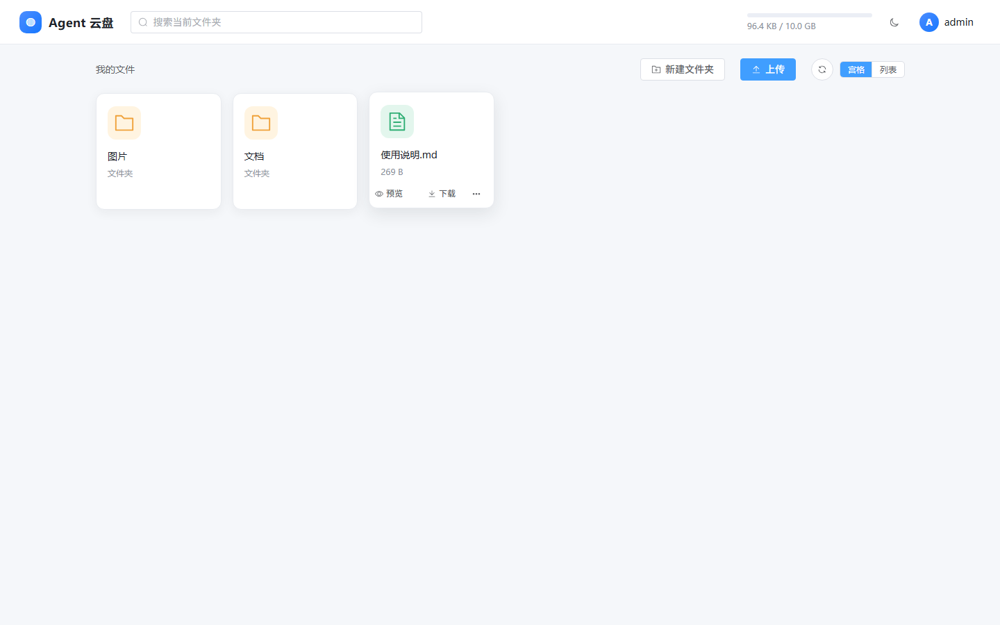
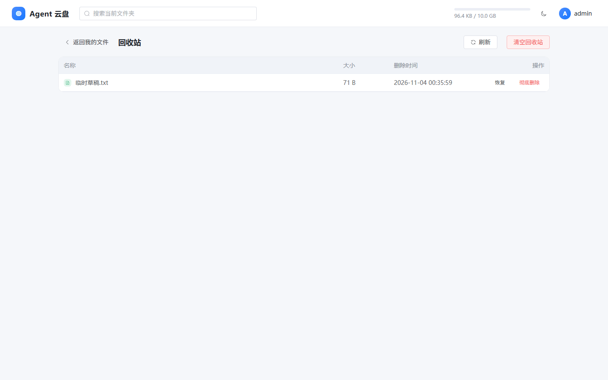
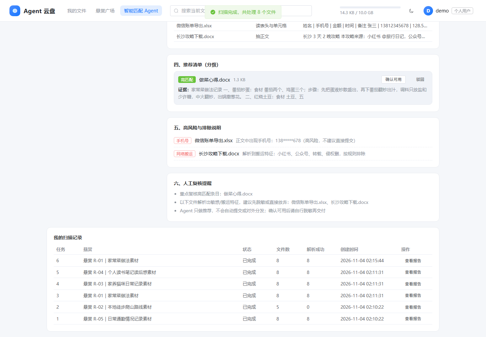
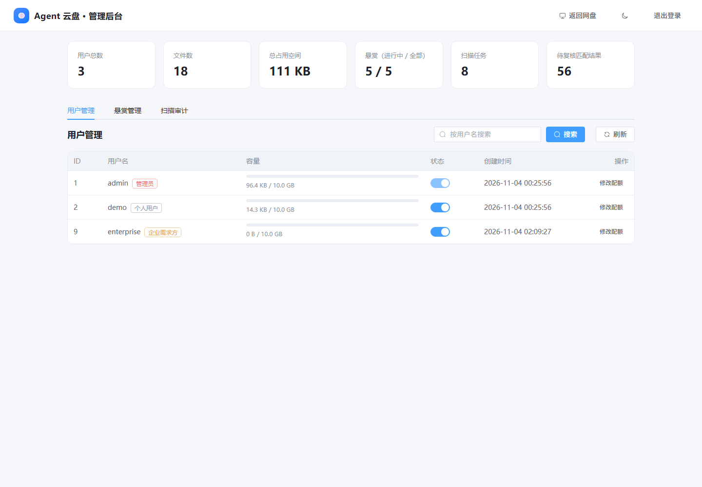

# Agent 云盘 · 数据要素悬赏匹配 Demo

在已完成的网盘底座上，按 `docs/agent协同/` 新增「企业发布悬赏 → 个人授权范围 → Agent 分层扫描 / 真实内容解析 → 证据化分级推荐 → 人工复核」闭环。

- **后端**：SpringBoot 4.1.1 + Kotlin（Amper / Kotlin Toolchain 构建）+ PostgreSQL + MyBatis + Flyway + BCrypt + JWT
- **前端**：Vue 3 + Vite + Element Plus，仿阿里云盘界面，支持深浅色
- **网盘底座**：登录注册、文件浏览与预览、容量统计、上传/删除/回收站、分片上传（含秒传）、管理后台
- **Agent 协同**：悬赏结构化解析、授权范围控制、逐文件内容解析、敏感/搬运识别、分级推荐、证据留痕、复核与审计


## 目录结构

```
backend/                      Spring Boot + Kotlin
  src/agent/                  Agent 链路：悬赏解析、内容解析、风险识别、扫描编排、演示数据
  src/controller/             auth / files / upload / admin / bounty / agent
  src/service/                网盘底座服务（文件、上传、存储、认证、后台）
  src/mapper/                 MyBatis 接口
  resources/db/migration/     Flyway：V1 底座建表、V2 管理员字段、V3 悬赏协同三张表
  resources/static/           前端构建产物（单端口访问）
frontend/                     Vue3 + Vite + Element Plus
  src/views/                  Drive / Recycle / Bounties / Agent / Admin / Login
scripts/                      smoke-test.ps1、agent-smoke-test.ps1、build.ps1、ui-screenshots.mjs
screenshots/                  README 截图
docs/                         原始设计文档
```

## 环境要求

- JDK 17 及以上（Amper 会自动准备编译用 JVM）
- Node.js 20+ 与 pnpm
- PostgreSQL 16+（本 Demo 在 PostgreSQL 18 上验证）

## 准备数据库

```sql
CREATE DATABASE agent_cloud_disk;
```

连接信息在 `backend/resources/application.yml`，可用环境变量覆盖：`DB_URL`、`DB_USERNAME`、`DB_PASSWORD`、`JWT_SECRET`、`APP_STORAGE_ROOT`、`APP_TEMP_ROOT`。

表结构由 Flyway 启动时自动迁移；演示账号、示例悬赏与样本文件由 `AdminInitializer` / `AgentDemoSeeder` 首次启动时自动创建。

## 启动

```powershell
cd backend
.\kotlin.bat run        # 打开 http://127.0.0.1:8080
```

前端开发模式（热更新，`/api` 代理到 8080）：

```powershell
pnpm --dir frontend install
pnpm --dir frontend run dev      # http://127.0.0.1:5173
```

前端改完同步到后端静态目录：

```powershell
powershell -File scripts/build.ps1
cd backend; .\kotlin.bat build
```

## 演示账号

| 账号 | 密码 | 角色 | 能做什么 |
| --- | --- | --- | --- |
| admin | admin123 | 管理员 | 用户/配额管理、悬赏启停、Agent 扫描审计 |
| enterprise | ent12345 | 企业需求方 | 发布/停用悬赏，查看扫描统计（看不到个人原始文件）|
| demo | demo1234 | 个人用户 | 网盘文件管理、授权范围发起扫描、查看报告与复核 |

> 角色沿用已有 `user.role`：**0=个人用户、1=管理员（原有）**，本次新增 **2=企业需求方**。
> 文档里写的是「1=企业、2=管理员」，为了不改动已落地的管理员数据，这里沿用既有编号，仅新增 2。

## 演示流程（一条闭环）

1. `enterprise` 登录 → **悬赏广场** → 发布悬赏（自然语言：要什么内容、什么格式、不要什么）→ 系统解析成结构化需求
2. `demo` 登录 → **智能匹配 Agent** → 选悬赏 → 勾选授权扫描的文件夹（未勾选的不访问）
3. 点「开始扫描」→ Agent 逐文件打开解析真实内容 → 输出六段式报告：
   悬赏需求理解 / 范围与粗筛 / 已实际解析清单 / 分级推荐（附证据） / 高风险与排除说明 / 人工复核提醒
4. 对推荐条目点「确认可用 / 驳回」→ 记录复核状态与备注
5. `admin` 登录 → 管理后台「悬赏管理」「扫描审计」查看全部悬赏与每次扫描的范围、解析数量、发起人

## 已实现能力

### 网盘底座（此前已完成）

| 需求 | 实现 |
| --- | --- |
| 登录/注册 | BCrypt + HS256 JWT，`/api/auth/**` 之外全部鉴权 |
| 文件浏览 | 宫格/列表、面包屑、搜索、重命名、图片与文本预览 |
| 容量计算 | `used_size` 原子增减，超配额拒绝上传 |
| 上传/删除/回收站 | 小文件直传、递归删除、恢复、彻底删除、清空回收站 |
| 分片上传 | init → chunk → merge，5MB/片，sha256 秒传与磁盘去重 |
| 管理员 | 统计、用户搜索、启停账号、调整配额 |

### Agent 协同（本次新增）

| 文档要求 | 实现方式 |
| --- | --- |
| 悬赏结构化解析 | `BountyStructureParser`：从自然语言中解析领域、可用格式、匹配关键词、排除项、时间倾向，落库 `data_bounty.structured_json` |
| 最小授权 | 只扫描用户勾选的文件夹/文件（递归展开），范围外不访问；任务记录 `auth_scope_json` |
| 实际内容解析 | `FileContentParser`：txt/md/csv/json 抽正文；docx 解包抽 `word/document.xml`；xlsx 读表头与单元格；图片/PDF/压缩包如实标记「未解析」 |
| 敏感信息检测 | `RiskDetector`：身份证、手机号、银行卡规则命中 → 高风险，直接排除出推荐并说明 |
| 网络搬运识别 | 解析正文中的小红书/公众号/转载/侵权删等特征 → 判为搬运，排除 |
| 语义匹配分级 | 领域关键词命中数 ≥3 高匹配、=2 中匹配、=1 低匹配；命中证据截取原文片段 |
| 证据可追溯 | 每条结果保存 `parse_method`、`parsed_summary`、`evidence_text`、风险标签与说明 |
| 分级推荐 | 推荐清单只包含 level>0 的条目，按等级排序，附建议 |
| 人工复核 | 每条结果可标记「确认可用 / 驳回」并写备注 |
| 仅推荐不自动提交 | 全程无对外发送能力，报告明确提示由用户脱敏后自行交付 |
| 审计留痕 | `agent_scan_task` 记录范围、状态、文件数、解析成功/失败数、发起人、时间；管理后台可查 |
| 企业看不到原始文件 | 企业只能看悬赏与统计，读取个人扫描详情直接 403 |

新增表（`V3__agent_collab.sql`，不改动原有表）：`data_bounty`、`agent_scan_task`、`agent_scan_result`。
在文档三张表基础上补充了 `parse_status`、`parse_method`、`parsed_summary` 三个字段，用于展示「怎么解析的、解析出了什么」。

## 接口一览

网盘底座：

| 方法 | 路径 | 说明 |
| --- | --- | --- |
| POST | `/api/auth/register` `/api/auth/login` | 注册 / 登录 |
| GET | `/api/auth/me` | 当前用户 |
| GET | `/api/files?parentId=&keyword=` | 列目录（含面包屑） |
| POST | `/api/files/folder`、PUT `/api/files/{id}/rename` | 新建文件夹 / 重命名 |
| DELETE | `/api/files/{id}` | 移入回收站 |
| GET | `/api/files/quota` | 容量 |
| GET/POST/DELETE | `/api/files/recycle...` | 回收站列表 / 恢复 / 彻底删除 / 清空 |
| GET | `/api/files/{id}/content?download=` | 预览 / 下载 |
| POST | `/api/upload/small`、`/api/upload/chunk/init`、`/api/upload/chunk`、`/api/upload/chunk/merge` | 小文件直传 / 分片上传 |
| GET/PUT | `/api/admin/stats`、`/api/admin/users`、`/api/admin/users/{id}/status`、`/api/admin/users/{id}/quota` | 后台用户与统计 |

Agent 协同：

| 方法 | 路径 | 说明 |
| --- | --- | --- |
| GET | `/api/bounty?status=` | 悬赏列表（个人只看进行中，企业看自己发布，管理员看全部）|
| POST | `/api/bounty` | 企业发布悬赏并结构化解析 |
| GET | `/api/bounty/{id}` | 悬赏详情 |
| PUT | `/api/bounty/{id}/status?status=` | 启用/停用（发布方或管理员）|
| GET | `/api/agent/folders` | 本人文件夹树（供勾选授权范围）|
| POST | `/api/agent/scan` | `{bountyId, scopeFileIds}` 发起扫描并返回报告 |
| GET | `/api/agent/tasks` | 我的扫描记录 |
| GET | `/api/agent/tasks/{id}` | 扫描报告详情（六段式）|
| PUT | `/api/agent/results/{id}/review` | 复核：`{review: 1确认/2驳回, note}` |
| GET | `/api/admin/bounties`、PUT `/api/admin/bounties/{id}/status` | 后台悬赏管理 |
| GET | `/api/admin/scan-tasks?bountyId=` | 后台扫描审计 |

统一响应体：`{ "code": 0, "msg": "ok", "data": ... }`，失败时 `code` 为 HTTP 状态码。

## 存储布局

```
正式文件  {storage_root}/{sha256[0:2]}/{sha256[2:4]}/{sha256}
分片临时  {temp_root}/{task_id}/{chunk_index}
```

默认根目录 `backend/data/`（可用 `APP_STORAGE_ROOT`、`APP_TEMP_ROOT` 覆盖）。

## 冒烟测试

```powershell
powershell -File scripts/smoke-test.ps1        # 网盘底座 27 项
powershell -File scripts/agent-smoke-test.ps1  # Agent 协同 26 项
```

Agent 脚本覆盖：角色限制（个人不能发布）、企业发布与结构化解析、授权扫描、内容确实被解析、证据与风险/搬运识别、排除项不进推荐、无法解析的文件如实说明、复核确认与驳回、越权读取 403、管理员统计与审计。脚本会创建一条测试悬赏并在结束时停用。

## 界面

| 网盘（宫格） | 网盘（列表） |
| --- | --- |
|  |  |

| 图片预览 | 文本预览 | 回收站 |
| --- | --- | --- |
|  |  |  |

| 悬赏广场 | 智能匹配 Agent（报告） |
| --- | --- |
|  |  |

| 推荐清单与证据 | 高风险与复核提醒 |
| --- | --- |
|  |  |

| 管理后台 | 悬赏管理 | 扫描审计 |
| --- | --- | --- |
|  |  |  |

深色模式：[网盘](screenshots/09-drive-dark.png)、[回收站](screenshots/07-recycle.png)。

## 已知限制

- **没有接入真实 LLM**：悬赏解析用可解释的关键词规则（`BountyStructureParser`），形态与 LLM 输出一致，替换实现即可接大模型
- **图片没有 OCR/识图**：服务端未内置识别引擎，图片仅登记元信息并如实标注「未解析」，不参与内容判定；PDF、压缩包同理
- **没有向量召回与 file_embedding 表**：Demo 阶段用授权范围全量遍历 + 关键词语义打分，文件数量为几十级
- **扫描同步执行**：任务状态仍按 排队/扫描中/完成 记录，未做异步队列与进度推送
- 复核结果只落库，未实现脱敏、打包、导出交付链路（文档也明确演示阶段不做真实交易对接）
- `application.yml` 中的数据库口令仅用于本地演示，正式环境请用环境变量注入
