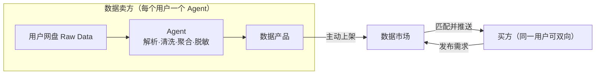
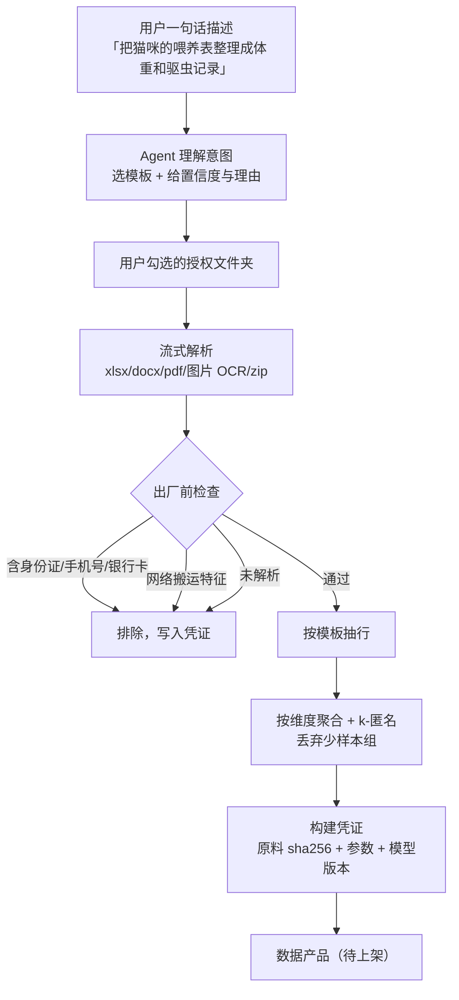
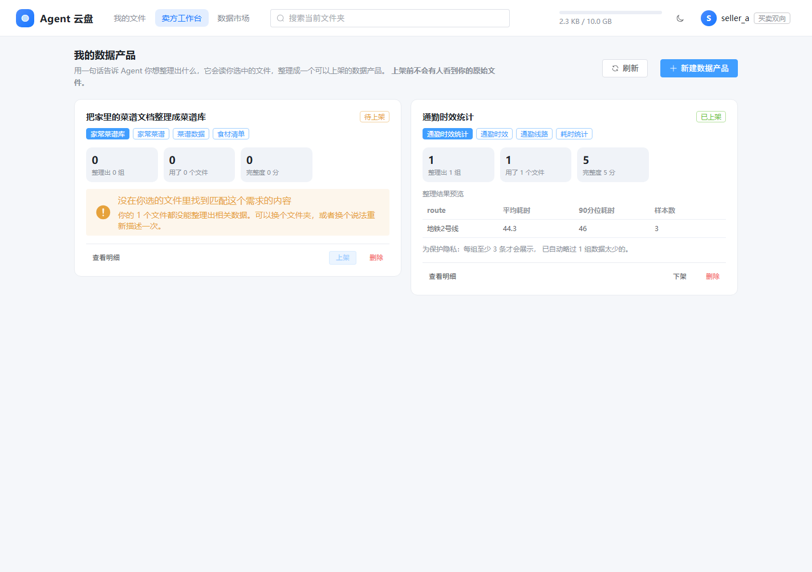
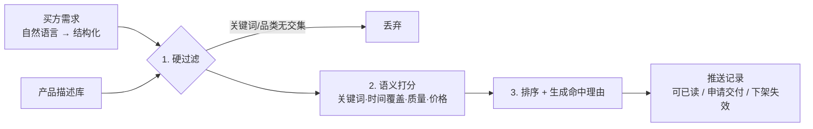
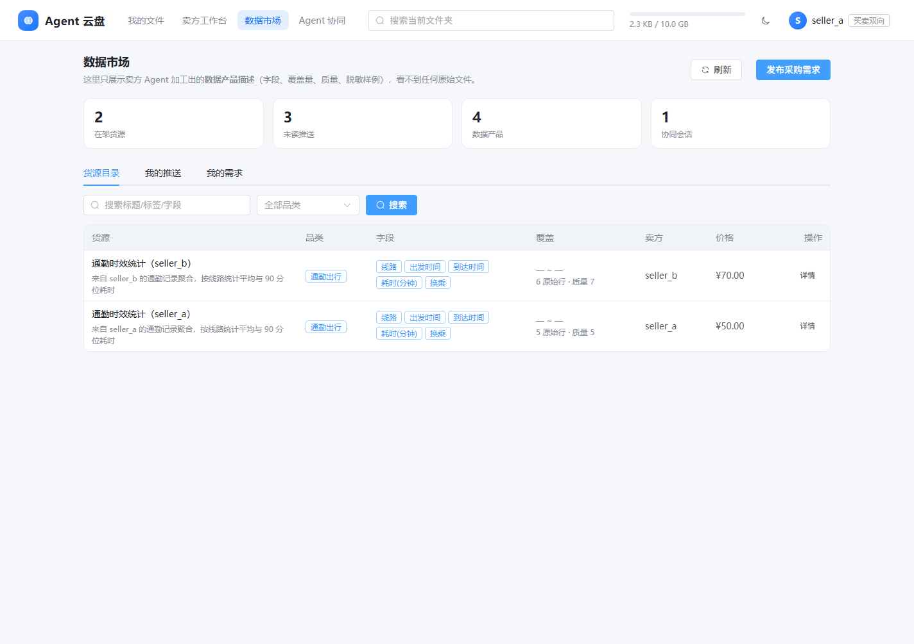

# AgentCloudDisk · 数据卖方 Agent + 数据交易市场（WWW Demo）

> 重点在 **Agent 这一层**：Agent 如何在卖方网盘内把原始数据加工成可交易的数据产品。交易/交付只做最小闭环。

## 一、业务模型



**市场只见产品描述，不见原始内容。** 买方能看到字段、覆盖量、质量分、脱敏样例与构建凭证，看不到任何原始文件。

## 二、Agent 加工链路（核心）



四个内置模板：通勤时效统计、家常菜谱库、宠物喂养记录、读书笔记主题。

**为什么只输出聚合**：原始行上架即泄露个人数据。聚合 + k-匿名（默认 k=3）保证任何一行不可区分，且构建凭证可查哪些文件被排除、为什么。

## 三、面向普通用户的交互（本次重点改造）

普通用户不该被迫理解「模板 / 字段 / 聚合维度」这些概念，所以：

| 旧 | 新 |
| --- | --- |
| 从下拉框里选「通勤时效统计」这类模板 | **用一句话描述想要什么**，Agent 自己选 |
| 要理解「分组维度 / 度量」 | Agent 回显「会整理出：线路、出发时间、到达时间…」 |
| 需要判断「质量分 / k-匿名」 | 卡片直接说「整理出 5 组 · 用了 1 个文件 · 完整度 62 分」，并用表格展示整理结果预览 |
| 要理解「PII 排除 / 引用计数」 | 一句话说明「每组至少 3 条才展示，已自动略过 1 组数据太少的」 |
| 大模型开关要用户选 | **默认开启且不暴露**（`aiEnabled` 缺省为 true） |
| 协同功能需要理解协议 | **已隐藏**（后端保留能力，前端无入口） |

意图识别有两条路径，都落到确定的内置模板，保证产出稳定可核对：

1. **规则兜底**：关键词命中，永远可用；
2. **大模型**：读描述做语义判断，返回模板 + 置信度 + 一句话理由 + 还缺什么信息。

实测：输入「把家里的菜谱文档整理成菜谱库」→ **家常菜谱库，已理解 98%**，理由「用户明确要把家里的菜谱文档整理成菜谱库，与家常菜谱库模板抽取菜名、食材与步骤并按菜名聚合完全匹配」。


当描述与所选文件不匹配（例如要求做菜谱、却选了通勤表格），产品卡会直接告警：

> ⚠ 没在你选的文件里找到匹配这个需求的内容 —— 你的 1 个文件都没能整理出相关数据。可以换个文件夹，或者换个说法重新描述一次。



## 四、市场匹配与推送



卖方的原始数据和 Agent **不参与匹配**，只在市场侧比对描述。需求发布后立即匹配（主动推送），卖方下架时相关推送自动失效。

## 五、交付（最小化）

只做状态流转：买方「申请交付」→ 卖方「受理」→ 卖方「标记已交付」。不做真实数据传输。

## 六、页面

| 页面 | 作用 |
| --- | --- |
| 我的文件 / 回收站 | 网盘底座（分片上传、秒传、预览、回收站） |
| **我的数据产品**（卖方） | 一句话描述 → 看 Agent 理解 → 勾文件 → 实时整理进度 → 产品卡（含结果预览）→ 上架 |
| **数据市场**（买方） | 货源目录、发布需求、我的推送（含命中理由）、申请交付 |
| 管理后台 | 用户/配额、模型管理（AES-GCM 加密 Key + 故障切换）、市场统计 |

> 「Agent 协同（联合产品）」按需求暂时隐藏：后端 `CollabCoordinator` 与 `collab_*` 表仍保留，路由与导航入口已移除。




## 七、演示账号与动线（约 3 分钟）

| 账号 | 密码 | 说明 |
| --- | --- | --- |
| seller_a | sell1234 | 城东通勤记录，已有一个在架产品 |
| seller_b | sell1234 | 城西通勤记录，已有一个在架产品 |
| buyer | buy12345 | 已发布一条通勤采购需求，已有推送 |
| demo | demo1234 | 13 个混合格式真实文件（docx/xlsx/png/zip/pdf） |
| admin | admin123 | 管理员 |

**动线**：seller_a →「我的数据产品」→ 新建 → 输入一句话看 Agent 理解 → 勾文件夹 → 看实时整理 → 卡片看整理结果预览 → 上架 → 切 buyer →「数据市场」看货源（注意看不到原始文件名）→ 我的推送看命中理由 → 申请交付 → 切回 seller_a 受理并标记已交付。

## 八、接口

**卖方（Agent）**

| 方法 | 路径 | 说明 |
| --- | --- | --- |
| POST | `/api/seller/intent` | **一句话描述 → Agent 选模板**，返回模板、置信度、理由、字段、是否需确认 |
| GET | `/api/seller/folders` | 可授权目录树 |
| POST | `/api/seller/products` | 创建并异步加工（`description` 或 `templateKey` 二选一；`aiEnabled` 缺省开启） |
| GET | `/api/seller/build/{taskId}/progress` | 加工实时进度（逐文件事件） |
| GET | `/api/seller/products`、`/{id}` | 产品列表 / 详情（含用料与凭证） |
| POST | `/api/seller/products/{id}/publish`、`/delist` | 上架 / 下架 |
| DELETE | `/api/seller/products/{id}` | 删除产品 |
| GET | `/api/seller/deliveries`、`POST .../accept`、`.../complete` | 卖方履约 |

**市场（买方）**

| 方法 | 路径 | 说明 |
| --- | --- | --- |
| GET | `/api/market/listings`、`/{id}` | 货源目录 / 详情（描述 + 脱敏样例 + 凭证） |
| POST/GET | `/api/market/demands` | 发布需求（自动匹配）/ 我的需求 |
| GET | `/api/market/pushes`、`POST .../read`、`.../delivery` | 推送 / 已读 / 申请交付 |
| GET | `/api/market/deliveries` | 买方交付申请 |
| GET | `/api/market/stats` | 市场统计 |

（协同接口 `/api/market/collab*` 保留但前端不再暴露。）

## 九、数据模型（V8 新增 10 张表）

`agent_peer` · `data_product` · `product_build_task` · `product_build_item` · `product_listing` · `market_demand` · `market_match` · `collab_session` · `collab_contribution` · `delivery_request`

原有 `user` / `file_meta` / `user_file` / `upload_task` / `ai_provider` 不动；角色收敛为「用户 / 管理员」。

## 十、测试

| 套件 | 覆盖 | 结果 |
| --- | --- | --- |
| `scripts/seller-intent-test.mjs` | **一句话描述 → 模板识别**（4 类场景）、模糊描述兜底、用描述直接建产品、`aiEnabled` 缺省开启 | **10/10 PASS** |
| `scripts/market-smoke-test.mjs` | 产品加工、构建凭证与原料 sha256、上架/下架与推送失效、需求匹配与命中理由、交付三段流转、权限隔离 | **45/45 PASS** |
| `scripts/smoke-test.ps1` | 网盘底座：鉴权、分片上传、秒传、容量、回收站、后台 | 27/27 PASS |
| `scripts/scan-progress-test.mjs` | 异步任务与进度、解析不崩溃、预览权限 | 19/19 PASS |
| `scripts/vision-optin-test.mjs` | 大模型开关与图片识图降级 | 19/19 PASS |
| `scripts/ai-provider-smoke-test.mjs` | 多平台模型管理与故障切换 | 29/29 PASS |

## 十一、运行

```powershell
cd backend
.\kotlin.bat run          # http://127.0.0.1:8080
```

数据库 `agent_cloud_disk`，首次启动自动执行 V1–V8 迁移并播种演示数据（3 个市场账号 + 13 个混合格式文件 + 2 个已上架产品 + 1 条买方需求与其推送）。

## 十二、已知限制

- Agent 协同（联合产品）前端已隐藏，后端能力保留；
- 交付只做状态流转，不做真实数据传输与密钥协商；
- 产品模板固定 4 个：用户可以用自然语言描述，但最终落到这 4 个模板之一，不支持自定义字段映射；
- 意图识别在置信度低于 55% 时仍会选一个模板并标注"需确认"，不会阻断流程；
- 匹配用关键词+规则打分，未接入向量召回；
- 单进程多租户模拟"每卖方一个 Agent"。
