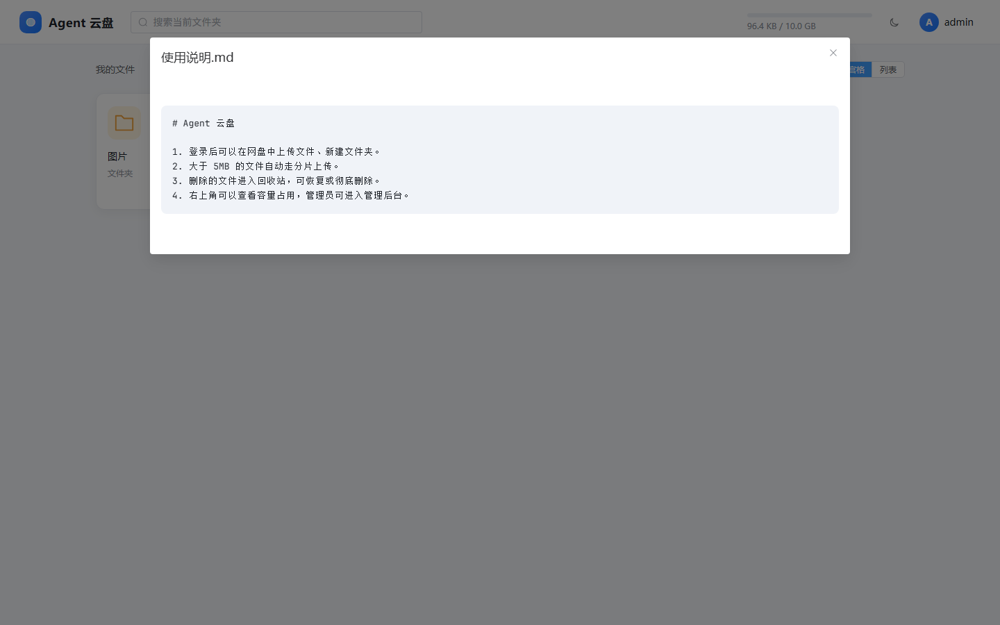
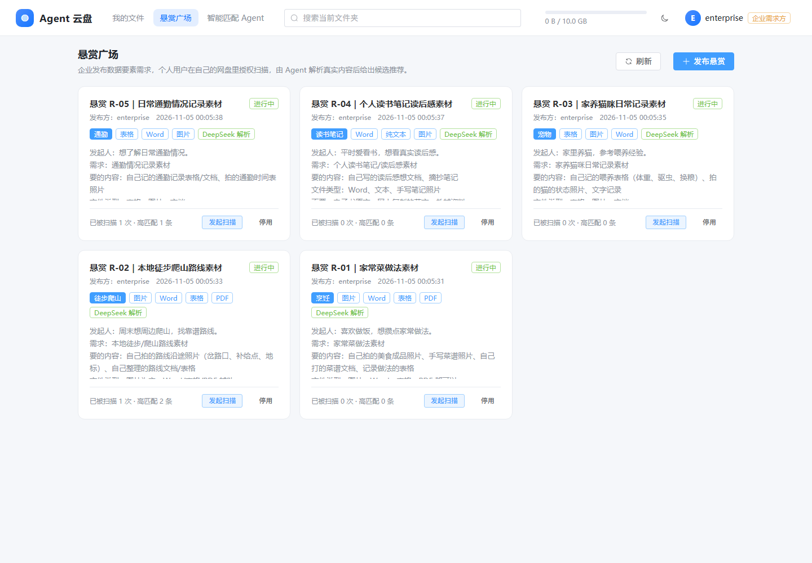
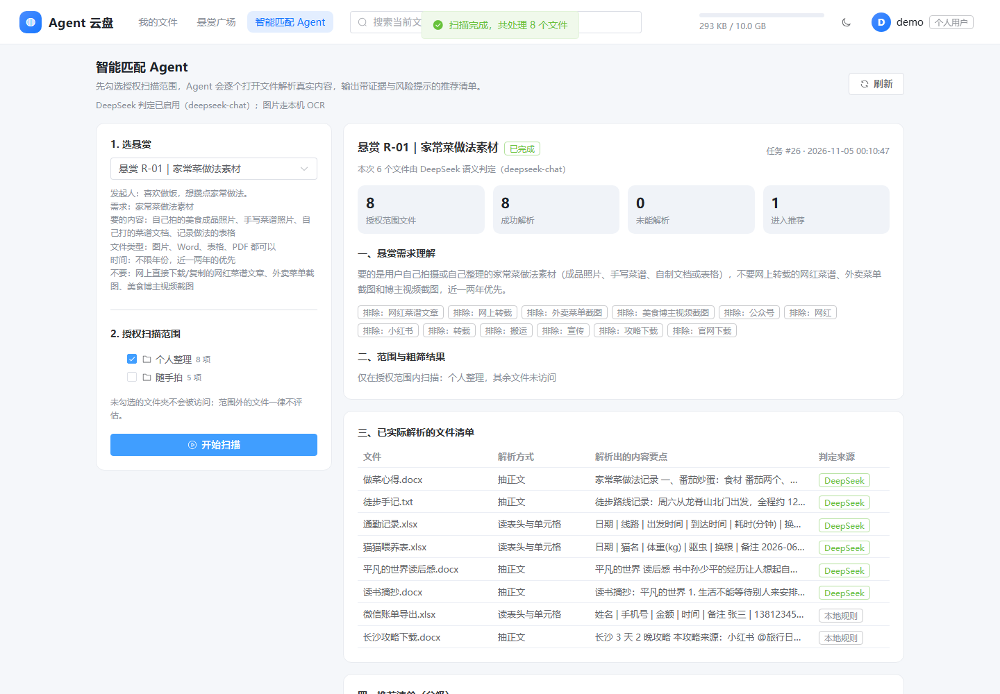
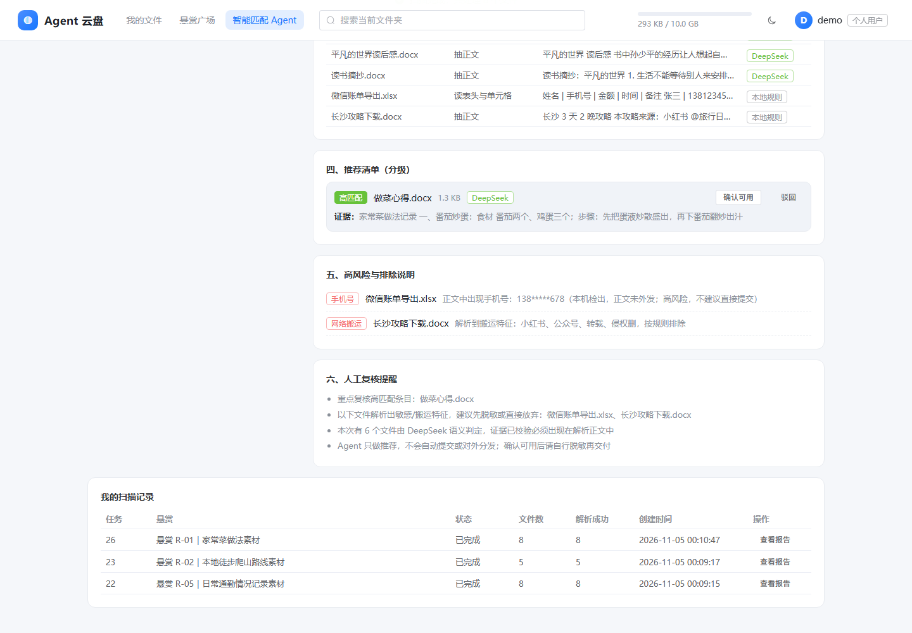
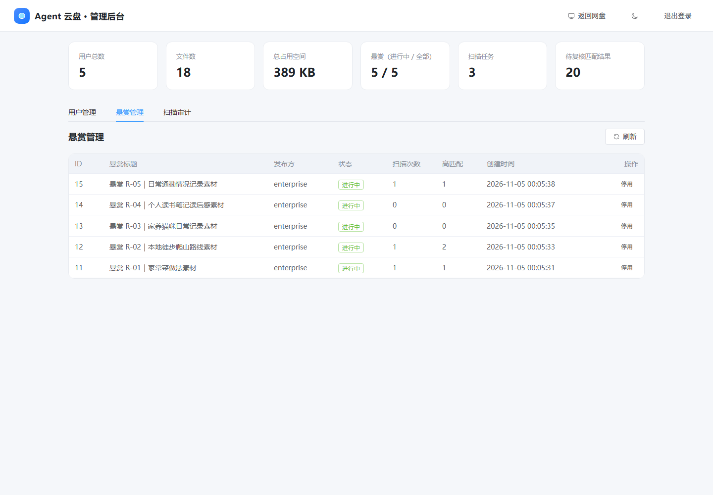
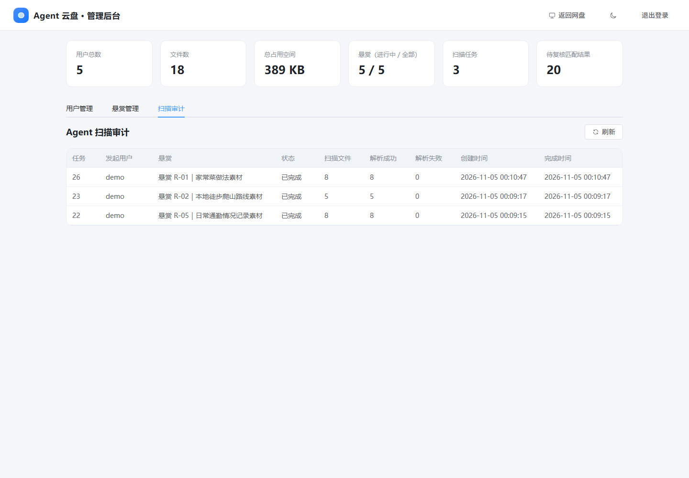

# Agent 云盘 · 数据要素悬赏匹配 Demo（已接入 DeepSeek）

在网盘底座之上，按 `docs/agent协同/` 实现「企业发布悬赏 → 个人授权范围 → Agent 分层扫描 / 真实内容解析 → DeepSeek 语义判定 → 证据化分级推荐 → 人工复核 → 审计」完整闭环。

- **后端**：SpringBoot 4.1.1 + Kotlin（Amper 构建）+ PostgreSQL + MyBatis + Flyway + BCrypt + JWT
- **前端**：Vue 3 + Vite + Element Plus，仿阿里云盘界面，深浅色主题
- **大模型**：DeepSeek `deepseek-chat`（JSON 模式），用于悬赏结构化解析与文件匹配判定
- **内容解析**：文本/Word/Excel/PDF 抽正文，图片走本机 Windows OCR，压缩包受控解包


## 一、DeepSeek 接入方式（本次实装重点）

| 调用点 | 实现 | 说明 |
| --- | --- | --- |
| 悬赏结构化 | `agent/LlmBountyAnalyzer.kt` | 把自然语言悬赏解析为 domain / formats / matchKeywords / excludeKeywords / yearLimit / understanding，落库 `data_bounty.structured_json`，并记录 `structured_by=llm`、`structured_model=deepseek-chat` |
| 匹配判定 | `agent/LlmMatchJudge.kt` | 每批 6 个文件调用一次，要求模型返回 `{fileId, matchLevel, evidence, riskTag, riskDesc, reason}`；**证据必须能在解析正文中找到**，否则自动退回本地原文片段（防止模型编造） |

设计要点：

1. **JSON 模式**：请求带 `response_format: {"type":"json_object"}`，后端自带极简 JSON 解析器（`agent/Json.kt`），不引入额外依赖。
2. **敏感信息不出网**：先用本机规则检测身份证 / 手机号 / 银行卡 / 网络搬运特征，命中即按规则判为高风险，**这些文件的正文不会发给模型**。
3. **可降级**：未配置 API Key 或调用失败时整体退回本地关键词规则，功能照常可用；前端会显示「DeepSeek」或「本地规则」判定来源。
4. **状态可观测**：`GET /api/agent/llm-status` 返回 enabled/available/model/calls/failures/lastLatencyMs/lastError，前端在 Agent 页顶部提示当前判定模式。

配置（`backend/resources/application.yml`，全部支持环境变量覆盖）：

| 环境变量 | 默认值 | 说明 |
| --- | --- | --- |
| `DEEPSEEK_API_KEY` | 空 | **必填**，填写后自动启用 LLM 判定 |
| `DEEPSEEK_BASE_URL` | `https://api.deepseek.com` | 可指向本地 mock 或代理 |
| `DEEPSEEK_MODEL` | `deepseek-chat` | 模型名 |
| `DEEPSEEK_ENABLED` | `true` | 设为 false 可强制走本地规则 |
| `APP_OCR_ENABLED` | `true` | 图片 OCR 开关（Windows.Media.Ocr） |
| `DB_URL` / `DB_USERNAME` / `DB_PASSWORD` | 本地库 | 数据库连接 |
| `APP_STORAGE_ROOT` / `APP_TEMP_ROOT` | `./data/...` | 存储目录 |

启动示例（PowerShell）：

```powershell
cd backend
$env:DEEPSEEK_API_KEY = "sk-..."
.\kotlin.bat run          # http://127.0.0.1:8080
```

## 二、真实内容解析

| 类型 | 解析方式 | 实现 |
| --- | --- | --- |
| txt / md / csv / json / 代码 | 抽正文 | 直接读取文本 |
| docx | 解包读 `word/document.xml` | `FileContentParser.parseDocx` |
| xlsx | 读 sharedStrings + sheet1 单元格 | `parseXlsx` |
| pdf | 解析内容流（含 FlateDecode）抽文本 | `PdfTextExtractor` |
| png / jpg | **Windows.Media.Ocr 本机 OCR**，汉字间空格自动归一 | `OcrService`（PowerShell 调用 WinRT） |
| zip | 受控解包，逐个内层文件抽正文 / OCR（最多 3 张） | `parseZip` |

演示文件全部是**真实生成**的可打开文件（`agent/DemoContentFactory.kt`）：docx/xlsx 是标准 OOXML 包，PDF 带正确 xref 且可被抽文本，PNG 用 Java2D 现场绘制并带可 OCR 的文字，ZIP 内含真实图片。

## 三、目录结构

```
backend/
  src/agent/                  悬赏解析(LLM)、匹配判定(LLM)、内容解析、OCR、风险识别、扫描编排、演示数据
  src/controller/             auth / files / upload / admin / bounty / agent
  src/service/                网盘底座（文件、上传、存储、认证、后台）
  src/mapper/                 MyBatis 接口
  resources/db/migration/     Flyway：V1 底座、V2 管理员字段、V3 悬赏协同、V4 LLM 来源字段
frontend/src/views/           Drive / Recycle / Bounties / Agent / Admin / Login
scripts/                      smoke-test / agent-smoke-test / llm-smoke-test / mock-deepseek / build / ui-screenshots
screenshots/                  README 截图
docs/                         原始设计文档
```

## 四、环境与启动

要求：JDK 17+、Node 20+ 与 pnpm、PostgreSQL 16+（本机 PG 18 验证）。

```sql
CREATE DATABASE agent_cloud_disk;
```

```powershell
# 后端（同时托管前端构建产物，单端口访问）
cd backend
$env:DEEPSEEK_API_KEY = "sk-..."
.\kotlin.bat run                # http://127.0.0.1:8080

# 前端开发模式（可选，/api 代理到 8080）
pnpm --dir frontend install
pnpm --dir frontend run dev      # http://127.0.0.1:5173

# 前端改完同步到后端
powershell -File scripts/build.ps1
cd backend; .\kotlin.bat build
```

演示账号：

| 账号 | 密码 | 角色 | 能力 |
| --- | --- | --- | --- |
| admin | admin123 | 管理员 | 用户/配额、悬赏启停、扫描审计 |
| enterprise | ent12345 | 企业需求方 | 发布/停用悬赏，看统计（看不到个人原始文件）|
| demo | demo1234 | 个人用户 | 网盘文件、授权扫描、报告与复核 |

> 角色沿用既有 `user.role`：0=个人用户、1=管理员（原有）、2=企业需求方（本次新增）。

演示数据（首次启动自动生成，重复启动不会重复造）：

- `demo` 的「个人整理」8 个真实文件：做菜心得.docx、通勤记录.xlsx、猫猫喂养表.xlsx、平凡的世界读后感.docx、读书摘抄.docx、徒步手记.txt、微信账单导出.xlsx（含手机号，本地判高危）、长沙攻略下载.docx（含小红书/转载特征，判搬运）
- `demo` 的「随手拍」5 个真实文件：3 张可 OCR 的 PNG、1 个内含 2 张 PNG 的 ZIP、1 个带身份证与手机号的文本型 PDF
- `enterprise` 的 5 条示例悬赏（配了 Key 时由 DeepSeek 解析成结构化需求）

## 五、验证与测试

三套脚本，均已在本机实际跑通：

| 脚本 | 覆盖 | 结果 |
| --- | --- | --- |
| `scripts/smoke-test.ps1` | 网盘底座：注册登录、鉴权、文件夹、小文件/分片上传、秒传、容量、下载、回收站、管理员、配额上限 | **27/27 PASS** |
| `scripts/agent-smoke-test.ps1` | Agent 链路：角色限制、企业发布、授权扫描、内容解析（OCR/PDF/ZIP）、证据、风险与搬运排除、复核、越权 403、后台审计 | **29/29 PASS** |
| `scripts/llm-smoke-test.ps1` | DeepSeek 接入：llm-status、悬赏由 LLM 结构化、调用计数、匹配判定走 LLM、证据接地、敏感文件仍走本地规则 | **10/10 PASS** |

```powershell
powershell -File scripts/smoke-test.ps1
powershell -File scripts/agent-smoke-test.ps1
powershell -File scripts/llm-smoke-test.ps1     # 需要 DEEPSEEK_API_KEY
```

没有 Key 也能验证 LLM 链路：`node scripts/mock-deepseek.mjs 9099` 起一个 OpenAI/DeepSeek 兼容的 mock，然后

```powershell
cd backend
$env:DEEPSEEK_API_KEY = "mock-key"
$env:DEEPSEEK_BASE_URL = "http://127.0.0.1:9099"
$env:DEEPSEEK_MODEL = "deepseek-mock"
.\kotlin.bat run
```

真实 DeepSeek 判定样例（`llm-smoke-test.ps1` 输出）：

```
[高匹配] 做菜心得.docx | 正文为家常菜原创做法记录，含食材与步骤，直接满足需求。
         证据：家常菜做法记录 一、番茄炒蛋：食材 番茄两个、鸡蛋三个；步骤：先把蛋液炒散盛出…
[不推荐] 徒步手记.txt | 内容为徒步路线记录，与烹饪领域无关。
```

## 六、接口一览

网盘底座：

| 方法 | 路径 | 说明 |
| --- | --- | --- |
| POST | `/api/auth/register` `/api/auth/login`、GET `/api/auth/me` | 注册 / 登录 / 当前用户 |
| GET | `/api/files?parentId=&keyword=` | 列目录（含面包屑） |
| POST | `/api/files/folder`、PUT `/api/files/{id}/rename` | 新建文件夹 / 重命名 |
| DELETE | `/api/files/{id}` | 移入回收站 |
| GET | `/api/files/quota` | 容量 |
| GET/POST/DELETE | `/api/files/recycle...` | 回收站列表 / 恢复 / 彻底删除 / 清空 |
| GET | `/api/files/{id}/content?download=` | 预览 / 下载 |
| POST | `/api/upload/small`、`/api/upload/chunk/init`、`/api/upload/chunk`、`/api/upload/chunk/merge` | 小文件直传 / 分片上传 |
| GET/PUT | `/api/admin/stats`、`/api/admin/users`、`/api/admin/users/{id}/status`、`/api/admin/users/{id}/quota` | 后台用户与统计 |

Agent 协同：

| 方法 | 路径 | 说明 |
| --- | --- | --- |
| GET | `/api/bounty?status=`、POST `/api/bounty`、GET `/api/bounty/{id}`、PUT `/api/bounty/{id}/status` | 悬赏列表 / 发布（LLM 结构化）/ 详情 / 启停 |
| GET | `/api/agent/folders` | 本人文件夹树（授权范围） |
| GET | `/api/agent/llm-status` | DeepSeek / OCR 能力状态 |
| POST | `/api/agent/scan` | `{bountyId, scopeFileIds}` 发起扫描并返回报告 |
| GET | `/api/agent/tasks`、GET `/api/agent/tasks/{id}` | 我的任务 / 六段式报告 |
| PUT | `/api/agent/results/{id}/review` | 复核 `{review:1确认/2驳回, note}` |
| GET | `/api/admin/bounties`、PUT `/api/admin/bounties/{id}/status`、GET `/api/admin/scan-tasks` | 后台悬赏管理与扫描审计 |

统一响应体：`{ "code": 0, "msg": "ok", "data": ... }`。

## 七、界面

| 网盘（宫格） | 网盘（列表） |
| --- | --- |
|  |  |

| 图片预览（OCR 可识别内容） | 文本预览 | 回收站 |
| --- | --- | --- |
|  |  |  |

| 悬赏广场（DeepSeek 解析） | 智能匹配 Agent（报告 + 判定来源） |
| --- | --- |
|  |  |

| 推荐清单与证据 | 高风险与复核提醒 |
| --- | --- |
|  |  |

| 管理后台 | 悬赏管理 | 扫描审计 |
| --- | --- | --- |
|  |  |  |

## 八、已知限制

- 图片 OCR 依赖 Windows 自带识别引擎（本机离线可用），只识别画面文字，不做图像语义理解；扫描件类 PDF 仍需先转图片再 OCR
- 文件摘要向量召回（`file_embedding`）未实现：Demo 用「授权范围全量遍历 + LLM/关键词判定」，授权范围是几十个文件的量级
- 扫描同步执行：任务状态照常记录（排队/扫描中/完成），但没有异步队列与实时进度推送
- 大模型只看文本，图片判定依赖 OCR 出来的文字；纯画面（如无文字照片）仍需人工看图
- 复核结果只落库，未实现脱敏、打包、导出与交付链路（文档也明确演示阶段不做真实交易对接）
- 演示用数据库口令写在 `application.yml` 默认值中，正式环境请用环境变量注入；API Key 只从环境变量读取，不写盘
