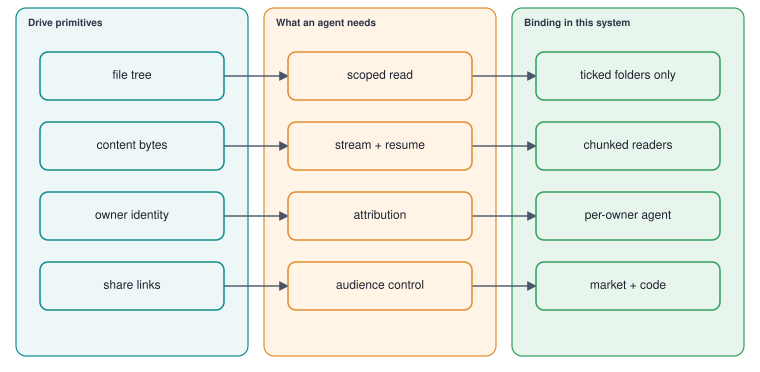
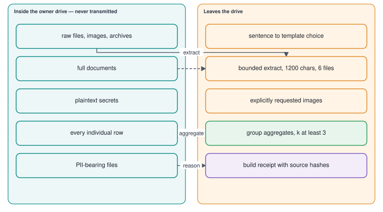

# AgentCloudDisk: Binding an LLM Agent to a Personal Cloud Drive for Data-Product Construction

**Demo Paper — WWW '26 Companion (Demo Track)**

> Authors and affiliations omitted for double-blind review.
> Contact: *demo@example.org*

## CCS Concepts

• **Information systems** → *Data management systems*; *Data exchange*. • **Computing methodologies** → *Knowledge representation and reasoning*; *Information extraction*. • **Security and privacy** → *Data anonymization and sanitization*. • **Human-centered computing** → *Interactive systems and tools*.

## Keywords

Cloud drive; LLM agent; agent-drive binding; scoped data access; multi-agent collaboration; data products

## ACM Reference Format

Anonymous Author(s). 2026. AgentCloudDisk: Binding an LLM Agent to a Personal Cloud Drive for Data-Product Construction. In *Companion Proceedings of the ACM Web Conference 2026 (WWW Companion '26)*, April 13–17, 2026, Dubai, United Arab Emirates. ACM, New York, NY, USA, 4 pages.

## Abstract

A cloud drive stores a person's data but understands none of it: it can return a file by name, never a fact by meaning. An LLM agent can understand the content, yet an agent placed next to a drive has no principled way to reach the right files, to prove what it read, or to keep the rest private. We argue that the interesting problem is neither building a drive nor building an agent, but binding the two, that is, giving an agent a scoped, attributable and revocable view of an owner's drive. We present AgentCloudDisk, a runnable system that realises this binding across three surfaces: an authority surface, which restricts an agent to the folders its owner has ticked and to the identity of that owner; an exposure surface, which keeps file bytes and their reduction on the drive's host so that a model receives only a bounded extract and a buyer receives only a k-anonymous aggregate; and a provenance surface, which attaches to every product a receipt binding it to the source hashes it read and the files it refused. The binding also composes across owners through a short session code, so that several drives contribute group statistics rather than files and a joint product grows with each member. Visitors describe a product in one sentence from their own folder, observe the agent's scoped reads, and join a joint product with a code.

## 1 Introduction

Personal and enterprise cloud drives hold a large share of the world's data, yet they remain passive stores. A drive knows paths, sizes and timestamps, and it will return a file when asked by name, but it does not know that one column of a spreadsheet records commute durations, that a folder of photographs is a set of receipts, or that twelve files together describe a habit. Large language models (LLMs) understand precisely these things, and recent work on LLM-based agents has shown that such models can plan, use tools and act on a user's behalf [10]. Placing an agent next to a drive is therefore a natural step, and it is where the present problem begins.

An agent with unrestricted access to a drive is a liability, because it would read everything, retain everything and forward excerpts to a model provider. An agent with no access is useless. Existing systems resolve this tension implicitly rather than explicitly. File assistants inherit the permission model of the drive, which was designed for sharing with people rather than for delegating to a process that calls a third-party service. Data-marketplace systems assume a curated warehouse and sidestep the question of how the warehouse was assembled. Federated learning addresses exposure [13] but produces models rather than inspectable products. The design space between unrestricted and useless access is consequently underexplored, and we characterise it by three questions that a drive-agent system must answer explicitly: which files an agent may open, on whose behalf and for how long; what physically crosses the drive's boundary; and whether anyone can later verify what the agent read and discarded.

To address these questions, we propose AgentCloudDisk, a system whose contribution is a binding layer between one agent and one drive rather than a drive with agent features added. The binding comprises three surfaces. The authority surface defines access by a per-owner scope that is persisted and re-checked per file, so that anything outside the scope is denied rather than degraded. The exposure surface performs parsing, de-identification and aggregation inside the drive's host, so that a model sees only a character-bounded extract and a market sees only an aggregate. The provenance surface produces a build receipt that binds a product to its source file hashes, its aggregation parameters and its exclusions. Finally, the same binding composes across owners: a session code admits collaborators who each run their own scoped binding and exchange group statistics rather than files.

We implement the system as a runnable demonstration rather than a mock-up, and we verify it with six scripted suites that assert user-visible behaviour over the REST interface. Our contributions can be summarised as follows:

• We identify the agent-drive binding as the central design problem for turning drive contents into data products, and we decompose it into authority, exposure and provenance.

• We realise the binding in a working system in which a model never receives file bytes by default, and in which every product carries a receipt that a buyer can check without access to the drive.

• We show that the binding composes across owners, so that several drives contribute to one joint product without any file leaving its owner's machine.

The remainder of this paper describes the design and implementation of the system (Section 2), the demonstration itself (Section 3), implementation notes and ethical considerations (Section 4), verification (Section 5), limitations (Section 6) and conclusions (Section 7).

## 2 Design and Implementation of System

## 2.1 Three Binding Surfaces

The drive is the substrate, the agent stands on it, and three surfaces connect the two, as shown in Figure 1. The authority surface is what the owner sees: a sentence that describes the desired product, which the agent turns into a template choice, together with a folder tree in which the owner ticks what may be read. The agent does not receive a path prefix but a scope record persisted per owner, and every file open is checked against that record. The exposure surface is handled by the drive itself: parsing, sensitive-information scanning and aggregation all execute inside the drive's host, so that the model receives a bounded extract and the buyer receives an aggregate. The provenance surface is the receipt, written as the agent works and published together with the product.

*Figure 1. The binding between one agent and one drive has three surfaces, of which only the exposure and provenance surfaces produce anything observable outside the drive.*

## 2.2 What an Agent Needs from a Drive

It is worth being precise about which drive primitives are relevant to an agent, because this explains why the binding cannot simply reuse share links. As shown in Figure 2, a file tree maps onto a scoped read, content bytes map onto a streaming read, owner identity maps onto attribution, and share links map onto audience control.

*Figure 2. Drive primitives project onto agent needs: a file tree becomes a scoped read, content bytes become a streaming read, owner identity becomes attribution, and share links become audience control.*

A file tree corresponds to a scoped read, since the agent must enumerate only the subtree it was granted and must be able to rely on enumeration not widening that subtree. Content bytes correspond to a streaming read, since agents must handle files larger than memory and formats that a model cannot ingest directly. Owner identity corresponds to attribution, since every product must be traceable to one accountable party, which is why the publication of a joint product is reserved for its initiator. Share links correspond to audience control: a link grants a human broad access to one file, whereas an agent requires narrow access to a computed result. The system therefore exposes neither share links nor path prefixes to agents, but a scope record, a streaming reader and a receipt writer.

## 2.3 Access Lifecycle

Figure 3 traces a single request across five lanes. The agent binds to a scope, asks the model for a template, and then reads strictly inside that scope. Every chunk passes an on-host scanner before it can be used, and a file that trips the scanner is excluded with its reason recorded in the receipt. Rows that survive are aggregated, and only the aggregate leaves the drive. The agent then unbinds, which releases the scope and closes the receipt.

*Figure 3. The access lifecycle of one request across five lanes. The drive opens bytes only inside the bound scope, the model never receives bytes, and the receipt is written on the drive side.*

Two properties of this lifecycle matter for the demonstration. First, the model is not in the data path: it advises on the template and assists in describing the result, but no file content is routed through it by default. Second, the receipt is written where the data resides, so that it cannot be rewritten by the party under audit.

## 2.4 Guarding the Boundary

The binding is credible only if its checks are explicit rather than emergent, so we implement them as a guard chain, shown in Figure 4. A file open is rejected when it falls outside the ticked scope, when the caller is not the owner of record, or when the on-host scan detects identifiers. A file that passes but exceeds the per-call model budget is trimmed rather than dropped, and the trim is recorded. Every branch writes an outcome, so that a denied read remains as visible as a successful one.

*Figure 4. The guard chain in front of every file open. Denials and exclusions are recorded rather than silent.*

## 2.5 Exposure Boundary

Figure 5 states the boundary as an explicit list. The left column never leaves the drive, including raw files, images and archives, complete documents, plaintext secrets, individual rows, and any file that already carries identifiers. The right column is what may cross, namely the owner's sentence, a character-bounded extract, images the owner explicitly requested, group aggregates and the receipt.

*Figure 5. What stays inside the drive and what may leave it. The dividing line follows from the design rather than from configuration.*

The bounded extract deserves a note, since it is the only channel through which file-derived text can reach a model. It is capped at 1 200 characters per file and six files per call, and files whose content carries an identity card number, a phone number, a bank card or repost markers are filtered before any call is issued, so that the cap applies to text that is already clean.

## 2.6 Extending the Binding across Owners

A single owner's drive often holds too little to be worth listing, so the same binding composes horizontally, as shown in Figure 6. Several owners each retain their own scope, perform their own host-side reduction, and exchange only group statistics. The initiator receives an eight-character session code and a six-character password, whose alphabet omits the characters `0`, `O`, `1` and `I` so that the code can be dictated; a collaborator who redeems both sees an invite preview before committing anything. Merging takes the union over group keys, and a field recording the number of supporting drives accompanies each group, which is what allows the joint product to grow as members join.

*Figure 6. Collaboration applies the same binding per owner. Each drive reduces locally, and the hub observes group statistics only.*

Publication remains with the initiator, because attribution must stay with one accountable party even when data originates from several. The market consequently lists a joint product exactly as it lists a single-owner product, distinguished only by a provenance marker and by the contributor list in its receipt.

## 3 Demonstration

The demonstration is organised around the three surfaces of the binding, and a visitor can move from one surface to the next without leaving the browser.

## 3.1 Product Authoring

A visitor begins at the authority surface by typing a sentence such as "turn my commute records into average duration per line". The agent answers with a template, a confidence value, one sentence of reasoning and the fields it intends to produce. Template selection proceeds in two passes: a rule-based matcher scores each built-in template by keyword overlap and always returns an answer, and an LLM pass then re-ranks the candidates when a model is configured. Four templates ship with the system, namely commute timeliness, a home-recipe library, pet-feeding records and reading notes. Fixing the template set is deliberate, since products must remain comparable across owners.

## 3.2 Scoped Access

The visitor then ticks one or more folders and starts a build, at which point the exposure surface becomes observable. A dialog streams per-file events such as read, parsed, skipped and excluded with reason, and ends with a product card that reports the number of groups, the number of contributing files and a quality score, together with a four-row preview of the aggregate. Files whose content carries identifiers are excluded before any model call, and the card states the privacy rule in plain language. If the sentence and the ticked folders disagree, the card reports the mismatch rather than presenting an empty product.

## 3.3 Collaboration

To exercise the cross-owner binding, the presenter creates a joint product and hands an eight-character code to a visitor, who redeems it together with the password. Before committing any data the visitor sees an invite preview listing the title, the initiator, the current members and the fields the product will contain. After ticking a folder and joining, the group count rises immediately and is visible to both parties, while only the initiator's view carries a publication control.

## 3.4 Boundary Verification

A buyer posts a demand in natural language, and the market returns ranked pushes accompanied by human-readable reasons. The audience can then open a listing to check that it contains no source filename and no individual row, and that its receipt records hashes matching the files the seller contributed. A three-state handshake closes the loop, in which the buyer requests delivery, the seller accepts and the seller marks the product as delivered, without any payload transfer.

## 4 Implementation and Ethics

The binding is realised inside a single Spring Boot and Kotlin process, and the surfaces described above correspond to modules rather than to deployment units.

Three implementation choices shaped the design. Scopes are stored as records rather than as path prefixes. A scope is persisted per owner and per collaboration member and is echoed back in the collaboration view, which costs one additional table but makes revocation and audit straightforward and allows a member's contribution to be recomputed from its own scope. Streaming is what makes host-side reduction affordable: spreadsheets are read row by row, Word documents through a streaming XML pull parser, PDF files through a hand-written literal parser, images through on-device optical character recognition, and archives through controlled unpacking. The sensitive-information scanner retains a 32-character tail across chunk boundaries, so that an identifier split between two reads is still detected, a detail that matters only because the reads are streamed. Finally, the receipt acts as the product's contract, recording source hashes, aggregation parameters, the model version when a model was consulted, and each exclusion together with its reason, so that a buyer can check a listing against evidence without access to the drive.

All demonstration data are synthetic, and the system is designed so that only ticked subtrees are opened and that scopes are persisted and shown back to their owners. Aggregates are k-anonymous with a default of three. Files that already carry personal identifiers are filtered on the host before any model call, and evidence returned by a model must appear verbatim in the parsed text, failing which a local snippet is substituted. Provider keys are encrypted with AES-256-GCM under a master key held outside the database, and collaboration passwords are hashed, displayed once and never returned by any endpoint.

## 5 Verification

Rather than offline benchmarks we provide six executable suites that a reviewer can run against the live system, as summarised in Table 1. Each suite asserts user-visible behaviour over the REST interface, so that a passing run implies that the demonstrated flow functions end to end.

**Table 1: Scripted end-to-end suites provided with the artefact.**

| Suite | Scope | Checks |
| --- | --- | --- |
| `collab-code-test` | code, join, publish, isolation | 29 |
| `market-smoke-test` | receipt, listing, matching, delivery | 37 |
| `seller-intent-test` | phrasing to template, build | 11 |
| `drive-smoke-test` | auth, quota, upload, dedup | 27 |
| `scan-progress-test` | async build, progress, preview | 18 |
| `ai-provider-test` | providers, keys, failover | 28 |

On the demonstration laptop with a cloud model, a five-row spreadsheet becomes a product in 4.5 seconds end to end, a joint product shows its first growth within one second of the second member joining, and the guard chain adds no measurable latency because it operates on chunks that are already buffered.

## 6 Limitations

Three limitations deserve to be stated plainly. The template set is closed, so that a request outside the four built-in schemas resolves to the nearest template with a low confidence rather than to a new extraction rule, which means that the system sells aggregated tables rather than arbitrary data products. The union merge is a pragmatic rather than a formal privacy guarantee: it prevents record exchange and discards sparse groups, but an adversary who joins repeatedly with overlapping scopes could in principle narrow a group by differencing, which motivates a differentially private estimator in future work. Finally, the binding is per-request rather than continuous, since an agent holds a scope for the duration of a build and then releases it, so that there is neither a standing grant nor an agent that observes a folder over time.

## 7 Conclusion and Future Work

In this paper we have argued that the engineering of interest lies between the drive and the agent rather than in either of them. We showed that a drive needs to lend an agent exactly three things, namely a scoped authority, a host-side reduction boundary and a receipt, and that these three suffice for an agent to read personal files, to collaborate across drives and to publish an auditable product without any file leaving its owner's machine. In future work we intend to open the template layer so that owners can define their own aggregation schemas, to replace the union merge with a differentially private estimator, and to study continuous bindings in which an agent observes a folder over time under a standing grant.

## References

[1] DeepSeek-AI, Aixin Liu, Bei Feng, et al. 2024. DeepSeek-V3 Technical Report. arXiv:2412.19437.

[2] Bin Wang, Chao Xu, Xiaomeng Zhao, et al. 2024. MinerU: An Open-Source Solution for Precise Document Content Extraction. arXiv:2409.18839.

[3] Haoran Wei, Yaofeng Sun, and Yukun Li. 2025. DeepSeek-OCR: Contexts Optical Compression. arXiv:2510.18234.

[4] Brandon Smock, Rohith Pesala, and Robin Abraham. 2021. PubTables-1M: Towards Comprehensive Table Extraction from Unstructured Documents. arXiv:2110.00061.

[5] Ildikó Pilán, Pierre Lison, Lilja Øvrelid, et al. 2022. The Text Anonymization Benchmark (TAB): A Dedicated Corpus and Evaluation Framework for Text Anonymization. arXiv:2202.00443.

[6] Jordi Soria-Comas. 2013. Improving Data Utility in Differential Privacy and k-Anonymity. arXiv:1307.0966.

[7] Jian Pei. 2020. A Survey on Data Pricing: From Economics to Data Science. arXiv:2009.04462.

[8] Mengxiao Zhang, Fernando Beltran, and Jiamou Liu. 2023. A Survey of Data Pricing for Data Marketplaces. arXiv:2303.04810.

[9] Khanh-Tung Tran, Dung Dao, Minh-Duong Nguyen, et al. 2025. Multi-Agent Collaboration Mechanisms: A Survey of LLMs. arXiv:2501.06322.

[10] Lei Wang, Chen Ma, Xueyang Feng, et al. 2023. A Survey on Large Language Model based Autonomous Agents. arXiv:2308.11432.

[11] Yunfan Gao, Yun Xiong, Xinyu Gao, et al. 2023. Retrieval-Augmented Generation for Large Language Models: A Survey. arXiv:2312.10997.

[12] Zicun Cong, Xuan Luo, Jian Pei, et al. 2021. Data Pricing in Machine Learning Pipelines. arXiv:2108.07915.

[13] Di Chai, Leye Wang, Liu Yang, et al. 2023. A Survey for Federated Learning Evaluations: Goals and Measures. arXiv:2308.11841.
