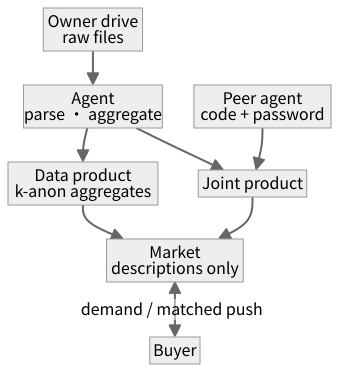
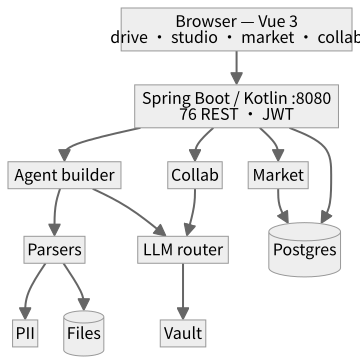
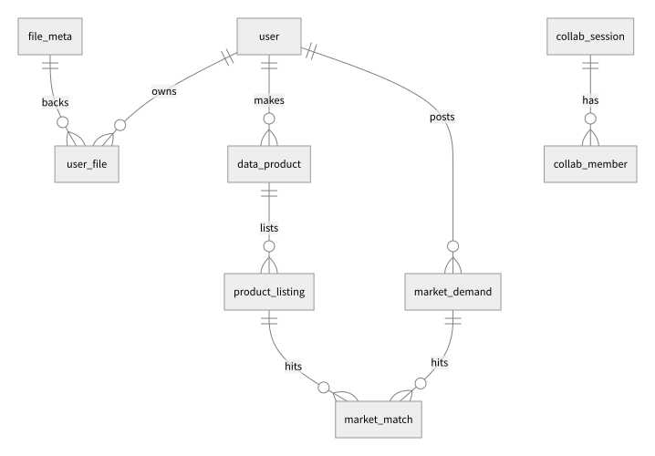
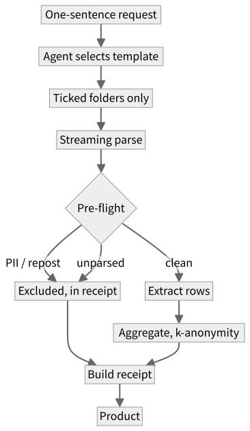
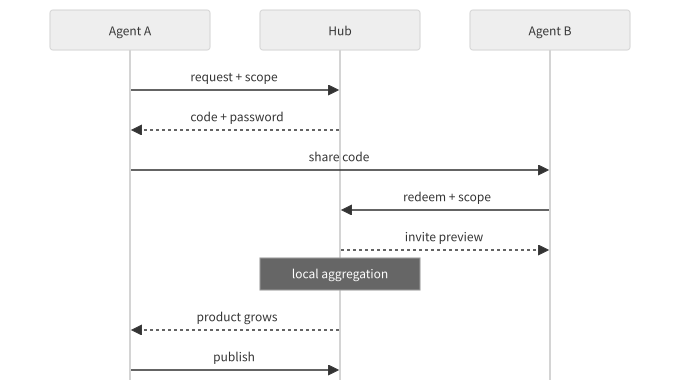
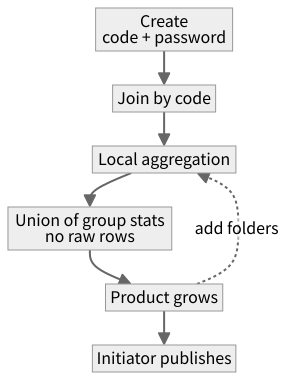

# AgentCloudDisk: Turning Cloud-Drive Files into Tradeable Data Products with Collaborative LLM Agents

**Demo Paper — WWW '26 Companion (Demo Track)**

> Authors and affiliations omitted for double-blind review.
> Contact: *demo@example.org*

## CCS Concepts

• **Information systems** → *Data management systems*; *Data exchange*.
• **Computing methodologies** → *Knowledge representation and reasoning*; *Information extraction*.
• **Security and privacy** → *Data anonymization and sanitization*.
• **Human-centered computing** → *Interactive systems and tools*.

## Keywords

Data elements; cloud drive; LLM agent; multi-agent collaboration; privacy-preserving data publishing; data marketplaces

## ACM Reference Format

Anonymous Author(s). 2026. AgentCloudDisk: Turning Cloud-Drive Files into Tradeable Data Products with Collaborative LLM Agents. In *Companion Proceedings of the ACM Web Conference 2026 (WWW Companion '26)*, April 13–17, 2026, Dubai, United Arab Emirates. ACM, New York, NY, USA, 4 pages.

## Abstract

Valuable data sits dormant inside personal and enterprise cloud drives — commute logs, recipe notes, feeding tables, reading records — yet conventional drives offer only metadata search, so owners cannot turn this material into anything sellable. We present **AgentCloudDisk**, a runnable cloud-drive system in which an LLM Agent acts on behalf of each owner: given a one-sentence product request it selects an aggregation template, parses the owner's authorized files with streaming readers, aggregates into a k-anonymous product, and publishes it to a data market where buyers post demands and receive matched listings. Two mechanisms carry the demo: **multi-agent collaboration**, where owners join a joint product with a short session code and password and the product grows as members contribute; and **host-confined privacy**, where sensitive files are filtered before any model call and only aggregate statistics ever leave a member's drive. A visitor can describe a product from their own folder and watch a joint product grow by redeeming a code, end-to-end, on one laptop.

## 1 Introduction

Data elements have become a production factor, and marketplaces increasingly let demanders post *demands* while suppliers list *products*. In practice the suppliers are not curated warehouses: the raw material lies in ordinary **cloud drives** as heterogeneous files — commute spreadsheets, hand-written recipe photos, feeding logs, PDF reports.

Three gaps motivate this demo:

1. **Drives stop at metadata.** A request such as "aggregate my commute time by line" cannot be answered by a filename search, and a drive offers no way to become a *product*.
2. **Turning files into a product requires understanding content, but not uploading it.** Content-based aggregation implies reading files; shipping raw documents to a third party is unacceptable for personal data.
3. **Individual drives are too small to be valuable, yet naive collaboration leaks.** One person's commute log is thin; combining several owners' logs gives a statistically meaningful product, but naive combination exchanges raw records and enables cross-referencing attacks.

Our demo answers these with a **working system**, not a mock-up. Contributions:

- **C1 — Agents that produce products, not search results.** Each owner's Agent converts authorized raw files into an aggregated *data product* with schema, coverage, quality score, masked samples and a reproducible build receipt.
- **C2 — Natural-language product authoring.** Users describe what they want in one sentence; the Agent selects a template, states its confidence and reasoning, and shows the fields it will produce.
- **C3 — Code-based multi-agent collaboration.** An initiator creates a joint project and receives a short **session code** plus **password**; other owners redeem them to join, contributing only group-level statistics, and the joint product grows with each member.
- **C4 — Host-confined, verifiable privacy.** Sensitive content is filtered on the host before any network call; the market exposes only aggregate descriptions; a per-product receipt binds the product to its source file hashes.

**On-site goal:** a visitor should be able to describe one product in plain language, watch the Agent parse and aggregate, then join a joint project with a code and see the product grow — in under three minutes.

## 2 Design and Implementation of System

## 2.1 Architecture Overview

*Figure 1. The seller-side loop. Owners' Agents produce products; the market only ever sees descriptions, never file content.*

AgentCloudDisk is a three-layer system (Figure 2). The **browser layer** is a Vue 3 single-page application with four surfaces: the drive, the seller studio, the market and the collaboration panel. The **service layer** is one Spring Boot / Kotlin process exposing 76 REST endpoints behind JWT authentication. The **agent core** implements the two capabilities this demo is about — product construction and collaboration — and delegates storage, model access and key management to infrastructure modules.

*Figure 2. Component view. Everything except the optional model call runs inside one JVM.*

Persistence is PostgreSQL 18 with 19 tables managed by nine Flyway migrations; file content lives in a content-addressed store keyed by SHA-256, so identical files uploaded by different owners are stored once and shared through `file_meta`.

*Figure 3. Core relations among the 19 tables. `file_meta` deduplicates content across owners; `collab_member` tracks per-member scope and contribution.*

## 2.2 Seller Agent: from Files to a Product

The seller agent is the part a visitor interacts with first. It exposes a **natural-language authoring** surface rather than a template picker: the owner types a sentence such as *"turn my commute records into average duration per line"*, and after a 500 ms debounce the agent returns an interpretation inline — template, confidence, one sentence of reasoning, and the list of fields it will produce.

Template selection runs in two passes. A **rule-based matcher** scores each built-in template by keyword and cue overlap; this pass always returns an answer, so the demo works with no model configured. When a model is available, an **LLM pass** receives the owner's sentence plus the template catalogue and returns a template key, a confidence in `[0,100]`, a rationale and, optionally, what information is missing. The LLM answer is accepted only if its key resolves to a real template; otherwise the rule result stands. Four templates ship today: commute timeliness, home-recipe library, pet-feeding records and reading notes. Fixing the templates is deliberate — products must stay comparable and verifiable across owners.

*Figure 4. The seller-side pipeline. Products contain only aggregates, so listing cannot leak individual records.*

Construction then proceeds as a streaming pipeline (Figure 4). Each file is opened with a format-specific streaming reader — EasyExcel row-by-row for spreadsheets, StAX over `word/document.xml` for Word, a hand-written literal parser for PDF, on-device OCR for images, controlled unpacking for archives — and every chunk is fed to a **boundary-safe sensitive-information scanner** that keeps a 32-character tail, so an identifier split across two chunks is still matched. Files that trip the scanner are excluded before any model call and recorded in the receipt with a reason.

Surviving rows are aggregated by the template's grouping dimension, and groups smaller than `k` (default 3) are dropped. The product therefore contains group-level statistics only; no individual row is ever written to a product, a listing or a collaboration payload.

## 2.3 Collaboration: Joint Products by Session Code

A single owner's log is often too thin to be worth listing. Collaboration lets several owners merge their statistics without merging their files (Figure 5).

*Figure 5. Code-based collaboration. Only the initiator may publish; members can view and extend their own scope.*

The initiator describes the joint product exactly as in the single-owner flow, ticks a folder, and receives an 8-character **session code** and a 6-character **password**. The code is drawn from an alphabet with `0/O/1/I` removed so it can be dictated over the phone or written on a booth card; uniqueness is enforced by a database index and the password is stored as a BCrypt hash and shown exactly once.

A peer redeems both values and — before committing anything — sees an **invite preview**: the title, the initiator, the current members and the fields the product will contain. On joining, the peer ticks their own folder and their agent aggregates locally, uploading only the resulting group statistics. The merge is a **union**: a group is kept if any member covers it, and a `sources` field records how many members support each group, which is exactly what makes the product grow as members join rather than shrink to an intersection.

*Figure 6. Collaboration state machine. Publishing is terminal: once published, joining is refused.*

Publishing is reserved for the initiator and is terminal: after publication the session stops accepting members, and the resulting product is listed with `source_kind = joint` so buyers can see it was assembled from several owners. This division keeps the accountability of a listing with exactly one party while allowing many parties to contribute data.

## 2.4 Market and Delivery

The market side is deliberately thin, because the demo's contribution is on the agent side. A buyer posts a demand in natural language; the market parses it into the same structured representation used for products, hard-filters active listings by keyword and domain, scores the survivors on keyword overlap, temporal coverage, quality and price, and pushes the top matches with human-readable reasons such as *"matched keywords: commute, duration; coverage until 2026-03"*. Listings expose fields, coverage, quality, a masked sample and the build receipt — never a source filename.

Delivery is a three-state handshake: the buyer requests, the seller accepts, the seller marks delivered. No payload is transferred, matching the demo's scope.

## 3 Demonstration Scenarios

The booth tour runs in about three minutes across three pages using two accounts; every account is bidirectionally capable.

**S1 — Describe a product in one sentence (30 s).** The owner types a sentence and watches the interpretation appear beside the form. *Input:* free text up to 200 characters. *Output:* template, confidence, reasoning and field list. All four built-in templates are reachable from natural phrasing; vague input such as *"I want to sell some data"* still resolves, with a low confidence that flags the assumption.

**S2 — Watch the Agent parse and aggregate (30 s).** The owner ticks folders and starts the build. The dialog streams per-file events — parsed, streamed Excel, skipped — and ends with a product card reporting the number of groups, the number of contributing files and a quality score, plus a four-row preview of the aggregated result. A five-row spreadsheet becomes a product in about 4.5 s. If the description and the chosen files disagree, the card says so explicitly instead of presenting an empty product.

**S3 — Join a joint product with a code (45 s).** The presenter creates a joint project and hands the code to a visitor, who redeems it, inspects the invite preview, ticks their own folder and joins. The group count increases immediately and is visible to both parties; members may later add folders to grow the product further. The owner and member views differ exactly where they should: only the owner sees a publish button.

**S4 — Market matching and push (30 s).** A buyer posts a demand; the market returns ranked pushes with reasons. The audience can check that no raw filename appears anywhere in the listing.

**S5 — Minimal delivery handshake (15 s).** Buyer requests, seller accepts, seller marks delivered.

## 4 Verification and Ethical Considerations

## 4.1 Scripted End-to-End Verification

Rather than offline benchmarks, we ship six executable suites that a reviewer can run against the live system (Table 1). Each asserts user-visible behaviour over the REST surface, so a passing run means the demonstrated flow actually works.

**Table 1: Scripted end-to-end suites shipped with the artifact.**

| Suite | Scope | Checks |
| --- | --- | --- |
| `collab-code-test` | code/password format, invite preview, wrong password, product growth on join, idempotent rejoin, non-initiator publish refusal, no join after publish, outsider isolation | 29 |
| `market-smoke-test` | build receipt with source hashes, list/delist with push invalidation, demand matching with reasons, delivery states, joint product provenance | 37 |
| `seller-intent-test` | four natural-language phrasings map to intended templates, vague input resolves, product built from description, model on by default | 11 |
| `smoke-test` | authentication, quota, chunked upload, deduplication, recycle bin, administration | 27 |
| `scan-progress-test` | asynchronous build, live progress, previews, crash-free parsing, preview authorization | 18 |
| `ai-provider-smoke-test` | provider CRUD, key masking, connectivity test, failover with cooldown | 28 |

**Observed behaviour.** On the demo laptop with a cloud model, a five-row spreadsheet becomes a product in **4.5 s** end to end (parse, aggregate, describe), and a joint product shows its first growth within one second of the second member joining. Failover between model providers completes in under one second, after which the interface labels judgments as rule-based rather than silently degrading.

## 4.2 Privacy and Ethical Considerations

**Explicit, minimal authorization.** Only ticked folders are opened; scope is persisted per member and echoed in the collaboration view. Accounts are self-service and all demonstration data is synthetic.

**Aggregation by construction.** Products contain group-level statistics only, with k-anonymity dropping sparse groups. Individual rows are never written to a product, a listing or a collaboration payload, so listing cannot leak a record even if the buyer is adversarial.

**Data minimisation towards third parties.** Files whose content already carries an ID card, phone number, bank card or repost markers are filtered on the host; only the remaining text (at most 1200 characters per file, six files per call) or an explicitly requested image is sent to a model. The model never receives images, archives or whole documents that were not asked for.

**Traceability over fluency.** Model-returned evidence must appear verbatim in the parsed text; unverifiable quotes are replaced by a local snippet. Build receipts bind each product to its source file hashes and are shown to buyers, so a listing can be checked against what was actually read.

**Secret handling.** Provider keys are encrypted with AES-256-GCM under a master key held outside the database and outside version control. Collaboration passwords are BCrypt hashed, displayed exactly once, and stripped from every response by a dedicated view object — an automated assertion checks that no response contains a password hash.

**Human oversight and honest limits.** Agents recommend and assemble; publishing a joint product is reserved for its initiator and delivery is a human handshake. Every product states whether a model participated, and files that cannot be parsed are listed with a reason rather than silently dropped.

## 4.3 Relation to Existing Systems

**Table 2: AgentCloudDisk against the three families of systems it draws on.**

| System family | Where data lives | What is produced | Multi-party | Raw files leave owner |
| --- | --- | --- | --- | --- |
| Consumer cloud drives | user drive | files | no | yes (server side) |
| Commercial data marketplaces | curated warehouses | datasets | no | yes |
| Federated learning platforms | owner device | model updates | yes | no |
| **AgentCloudDisk** | user drive | aggregated products | yes (session code) | no (aggregates only) |

Table 2 positions the system. Relative to consumer drives it adds a *product* abstraction and an agent that can build one from a sentence. Relative to commercial marketplaces it removes the requirement that a supplier already holds a curated warehouse: the supplier is an ordinary owner whose agent does the curating. Relative to federated learning it targets a different artefact — instead of a model, the parties exchange group-level statistics that a non-expert buyer can inspect before paying. What no row of the table captures is the combination we consider the contribution: an agent that constructs the product, a short code that admits collaborators, and a receipt that lets a buyer check both.

## 4.4 Limitations

Three limitations are worth stating plainly. First, the template set is closed: a request for a product family outside the four built-in schemas resolves to the nearest template with a low confidence rather than to a new extraction rule, so the system currently sells aggregated *tables*, not arbitrary data products. Second, the union merge is a pragmatic rather than a formal privacy guarantee: it prevents raw-record exchange and drops sparse groups, but a member who joins repeatedly with overlapping but slightly different scopes could in principle narrow a group through differencing, which is why we plan to move to a differentially private estimator. Third, collaborative sessions are single-initiator and single-use: there is no way to rotate a leaked password, and a session cannot be forked into a second product without creating a new one from scratch.

## 5 Conclusion

AgentCloudDisk shows that an ordinary cloud drive can participate in a data-element market without surrendering its contents: streaming parsing plus on-host privacy filtering decides what may be shown and what may leave the machine, an LLM Agent turns authorized files into k-anonymous products from a one-sentence request, and a short session code lets several owners pool their statistics into a joint product that grows with each member. The whole loop — describe, build, collaborate, list, match, deliver — runs on one laptop, with or without Internet. In future work we intend to open the template layer so that owners can define their own aggregation schemas, and to replace the union merge with a differentially private estimator so that joint products remain useful under stronger formal guarantees.

## References

[1] DeepSeek-AI, Aixin Liu, Bei Feng, et al. 2024. DeepSeek-V3 Technical Report. arXiv:2412.19437.

[2] Bin Wang, Chao Xu, Xiaomeng Zhao, et al. 2024. MinerU: An Open-Source Solution for Precise Document Content Extraction. arXiv:2409.18839.

[3] Haoran Wei, Yaofeng Sun, and Yukun Li. 2025. DeepSeek-OCR: Contexts Optical Compression. arXiv:2510.18234.

[4] Brandon Smock, Rohith Pesala, and Robin Abraham. 2021. PubTables-1M: Towards Comprehensive Table Extraction from Unstructured Documents. arXiv:2110.00061.

[5] Ildikó Pilán, Pierre Lison, Lilja Øvrelid, et al. 2022. The Text Anonymization Benchmark (TAB): A Dedicated Corpus and Evaluation Framework for Text Anonymization. arXiv:2202.00443.

[6] Jordi Soria-Comas. 2013. Improving Data Utility in Differential Privacy and k-Anonymity. arXiv:1307.0966.

[7] Jian Pei. 2020. A Survey on Data Pricing: From Economics to Data Science. arXiv:2009.04462.

[8] Mengxiao Zhang, Fernando Beltran, and Jiamou Liu. 2023. A Survey of Data Pricing for Data Marketplaces. arXiv:2303.04810.

[9] Khanh-Tung Tran, Dung Dao, Minh-Duong Nguyen, et al. 2025. Multi-Agent Collaboration Mechanisms: A Survey of LLMs. arXiv:2501.06322.

[10] Lei Wang, Chen Ma, Xueyang Feng, et al. 2023. A Survey on Large Language Model based Autonomous Agents. arXiv:2308.11432.

[11] Yunfan Gao, Yun Xiong, Xinyu Gao, et al. 2023. Retrieval-Augmented Generation for Large Language Models: A Survey. arXiv:2312.10997.

[12] Zicun Cong, Xuan Luo, Jian Pei, et al. 2021. Data Pricing in Machine Learning Pipelines. arXiv:2108.07915.
