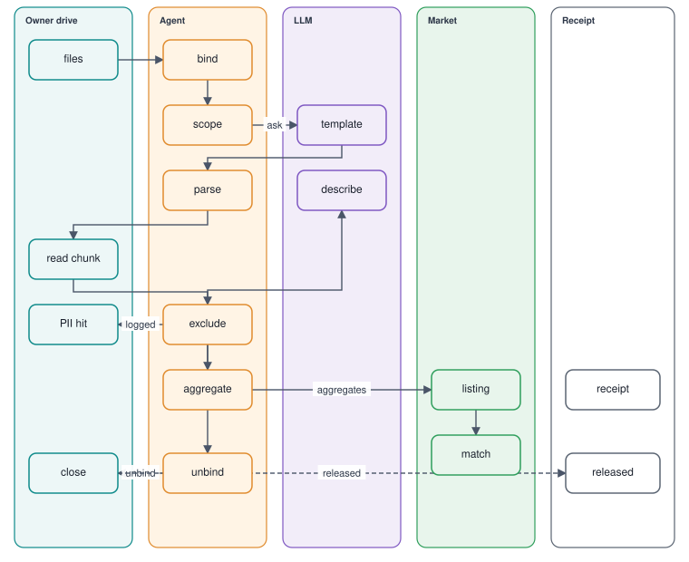
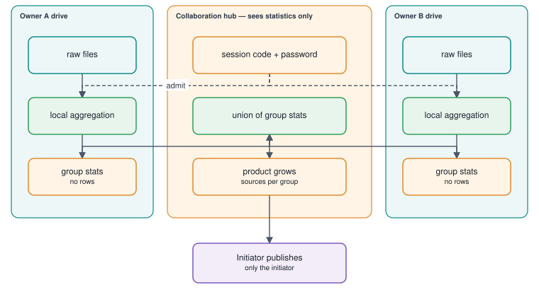

# AgentCloudDisk: Binding an LLM Agent to a Personal Cloud Drive for Data-Product Construction

**Demo Paper — WWW '26 Companion (Demo Track)**

> Authors and affiliations omitted for double-blind review.
> Contact: *demo@example.org*

## CCS Concepts

• **Information systems** → *Data management systems*; *Data exchange*.
• **Computing methodologies** → *Knowledge representation and reasoning*; *Information extraction*.
• **Security and privacy** → *Data anonymization and sanitization*.
• **Human-centered computing** → *Interactive systems and tools*.

## Keywords

Cloud drive; LLM agent; agent-drive binding; scoped data access; multi-agent collaboration; data products

## ACM Reference Format

Anonymous Author(s). 2026. AgentCloudDisk: Binding an LLM Agent to a Personal Cloud Drive for Data-Product Construction. In *Companion Proceedings of the ACM Web Conference 2026 (WWW Companion '26)*, April 13–17, 2026, Dubai, United Arab Emirates. ACM, New York, NY, USA, 4 pages.

## Abstract

A cloud drive stores a person's data but understands none of it: it can return a file by name, never a fact by meaning. An LLM agent can understand the content, yet an agent placed next to a drive has no principled way to reach the right files, prove what it read, or keep the rest private. We argue that the interesting problem is not building a drive nor building an agent, but **binding the two**: giving an agent a scoped, attributable, revocable view of an owner's drive. We present **AgentCloudDisk**, a runnable system that implements this binding in three surfaces — *authority* (an agent may open only folders the owner ticked, and only as that owner), *exposure* (file bytes are read and reduced on the drive's host, so what crosses to a model is a bounded extract and what crosses to a buyer is a k-anonymous aggregate), and *provenance* (every product carries a receipt binding it to the source hashes it read and the files it refused). The binding also composes across owners: a short session code admits collaborators who exchange group statistics rather than files, so a joint product grows with each member. Visitors can describe a product in one sentence from their own folder, watch the agent's scoped reads, and join a joint product with a code, in under three minutes.

## 1 Introduction

A personal cloud drive is a passive store. It knows paths, sizes and timestamps, and it will hand back a file if asked by name; it does not know that one spreadsheet column is a commute duration, that a folder of photographs is a set of receipts, or that twelve files together describe a habit worth selling. An LLM agent knows precisely these things. The natural move is to put an agent next to the drive — and that is where the difficulty starts.

An agent with unrestricted access to a drive is a liability: it would read everything, remember everything, and send excerpts to a model provider. An agent with no access is useless. The design space between them is where this demo lives, and we summarise it as three questions that a drive-agent system must answer explicitly:

- **Authority.** Which files may this agent open, on whose behalf, for how long, and for which purpose?
- **Exposure.** What physically leaves the drive's boundary — file bytes, extracted spans, aggregates, or only descriptions?
- **Provenance.** Can anyone later verify what the agent actually read and what it discarded?

We argue that existing systems answer these questions implicitly rather than explicitly. File assistants inherit the drive's own permission model, which was designed for *sharing with people*, not for *delegating to a process that calls a third-party model*. Data-marketplace systems sidestep the problem by assuming a curated warehouse. Federated learning answers exposure but produces models, not inspectable products. Meanwhile a large share of the world's personal data never becomes useful at all.

**Contributions.** Rather than a drive with agent features bolted on, AgentCloudDisk is an explicit binding layer between one agent and one drive:

- **C1 — A scoped read authority.** The agent's access is defined by a persisted per-owner scope (the folders the owner ticked) and re-checked per file; anything outside is denied, not degraded.
- **C2 — Host-side reduction as the exposure boundary.** Parsing, de-identification and aggregation all run on the drive's host; the model sees a character-bounded extract, and the market sees a k-anonymous aggregate. Neither ever sees the file.
- **C3 — Provenance as a first-class artefact.** Each product ships a build receipt binding it to source file hashes, aggregation parameters and exclusions with reasons, so a listing is auditable by a buyer who never touches the drive.
- **C4 — The same binding across owners.** A short session code admits collaborators who each run their own scoped binding and exchange group statistics only, so the joint product grows without any file moving between drives.

**On-site goal.** A visitor describes one product in one sentence from their own folder, watches the agent's scoped reads stream by, and joins a joint product with a code — in under three minutes.

## 2 The Agent–Drive Binding

## 2.1 Three binding surfaces

Figure 1 shows the binding we implemented. The drive is the substrate; the agent stands on it; three surfaces connect them.

*Figure 1. The binding between one agent and one drive has three surfaces — authority (scope), exposure (host-side reduction), and provenance (receipt) — and only the last two produce anything observable outside the drive.*

The **authority** surface is what the owner sees: a sentence describing the product, which the agent turns into a template choice, and a folder tree in which the owner ticks what may be read. The agent does not get a path prefix; it gets a persisted scope record per owner, and every file open is checked against that record. The **exposure** surface is where the drive's own machinery does the work: parsing, sensitive-information scanning and aggregation all run inside the drive's host, so what reaches a model is a bounded extract and what reaches a buyer is an aggregate. The **provenance** surface is the receipt, written as the agent works and published alongside the product.

## 2.2 What an agent needs from a drive

It is worth being precise about which drive primitives actually matter to an agent, because it explains why the binding cannot simply reuse share links (Figure 2).

*Figure 2. Drive primitives project onto agent needs: a file tree becomes a scoped read, content bytes become a streaming read, owner identity becomes attribution, and share links become audience control.*

A file tree maps to *scoped read*: the agent needs to enumerate only the subtree it was granted, plus the guarantee that enumeration does not widen that subtree. Content bytes map to *streaming read*: agents must handle files larger than memory and formats the model cannot ingest directly. Owner identity maps to *attribution*: every product must be traceable to one accountable owner, which is exactly why publishing a joint product is reserved for its initiator. Share links map to *audience control*: a link grants a human broad access to one file, whereas the agent needs narrow access to a computed result. The system therefore does not expose share links to agents at all; it exposes a scope record, a streaming reader and a receipt writer.

## 2.3 The access lifecycle

Figure 3 traces one request. The agent binds to a scope, asks the model for a template, and then reads strictly inside that scope. Each chunk passes an on-host scanner before it can be used; a file that trips the scanner is excluded and the reason is written to the receipt. Rows that survive are aggregated, and only the aggregate leaves the drive. The agent then unbinds: the scope is released, and the receipt records both what was read and what was refused.

*Figure 3. One request's access lifecycle across five lanes. The drive opens bytes only inside the bound scope; the model never receives bytes; the receipt is written in the drive's lane.*

Two properties of this lifecycle matter at the booth. First, **the model is not in the data path**: it advises on the template and helps describe the result, but no file content is ever routed through it by default. Second, **the receipt is written where the data is**, on the drive side, so it cannot be rewritten by the party being audited.

## 2.4 Guarding the boundary

The binding is only credible if the checks are explicit rather than emergent, so we implement them as a guard chain (Figure 4). A file open is rejected if it falls outside the ticked scope, if the caller is not the owner of record, or if the on-host scan finds identifiers. A file that passes but exceeds the per-call model budget is trimmed rather than dropped, and the trim is recorded. Every branch writes an outcome, so a denied read is as visible as a successful one.

*Figure 4. The guard chain in front of every file open. Denials and exclusions are recorded, not silent.*

## 2.5 The exposure boundary

Figure 5 states the boundary as a list, which is the form reviewers and visitors ask for. The left column never leaves the drive: raw files, images and archives, full documents, plaintext secrets, individual rows, and any file that already carries identifiers. The right column is what may cross: the owner's sentence, a character-bounded extract, images the owner explicitly requested, group aggregates, and the receipt.

*Figure 5. What stays inside the drive and what may leave it. The dividing line is a product of design, not of configuration.*

The bounded extract deserves a note: it is the only place where file-derived text can reach a model, and it is capped at 1 200 characters per file and six files per call. Files whose content carries an ID card number, a phone number, a bank card or repost markers are filtered before any call is made, so the cap applies to already-clean text.

## 2.6 Extending the binding across owners

A single owner's drive often holds too little to be worth listing. The same binding therefore composes horizontally (Figure 6): several owners each keep their own scope, run their own host-side reduction, and exchange only group statistics. The initiator receives an 8-character session code and a 6-character password — the alphabet omits `0/O/1/I` so the code can be dictated — and a collaborator who redeems both sees an invite preview before committing anything. Merging is a union over group keys, and a `sources` field records how many drives support each group, which is what makes the joint product grow with each member.

*Figure 6. Collaboration is the same binding applied per owner. Each drive reduces locally; the hub sees group statistics only.*

Publishing remains with the initiator, because attribution must stay with one accountable party even when data comes from many. The market therefore lists a joint product exactly like a single-owner one, distinguished only by a provenance marker and the contributor list in its receipt.

## 3 Demonstration Scenarios

The booth tour runs in about three minutes across three surfaces; every account can both sell and buy.

**S1 — Describe a product in one sentence (30 s).** The owner types *"turn my commute records into average duration per line"*. Within a second the agent answers with a template, a confidence, one sentence of reasoning, and the fields it will produce. A rule-based pass guarantees an answer even with no model configured, so the demo never stalls on network.

**S2 — Watch the scoped reads (30 s).** The owner ticks folders and starts the build. The dialog streams per-file events — read, parsed, skipped, excluded with reason — and ends with a product card reporting group count, contributing files and a quality score, plus a four-row preview of the aggregate. A five-row spreadsheet becomes a product in about 4.5 s. If the sentence and the ticked folders disagree, the card says so instead of presenting an empty product.

**S3 — Join a joint product with a code (45 s).** The presenter creates a joint product and hands an 8-character code to a visitor. The visitor redeems the code and password, inspects the invite preview, ticks their own folder, and joins; the group count rises immediately and is visible to both parties. Only the initiator's view carries a publish button.

**S4 — Check the boundary (30 s).** A buyer posts a demand; the market returns ranked pushes with reasons. The audience can then open a listing and verify that it contains no source filename, no individual row, and a receipt whose hashes match the files the seller added.

**S5 — Minimal delivery (15 s).** Buyer requests, seller accepts, seller marks delivered. Three states, no payload transfer.

## 4 Implementation Notes

The binding is realised inside a single Spring Boot / Kotlin process; the surfaces above correspond to modules rather than to deployment units. Three implementation choices are worth reporting because they shaped the binding.

**Scopes are records, not paths.** A scope is persisted per owner and per collaboration member, and echoed back in the collaboration view. This costs an extra table but makes revocation and audit trivial, and it lets a member's contribution be recomputed from its own scope without consulting the initiator.

**Streaming is what makes host-side reduction affordable.** Spreadsheets are read row by row, Word documents through a streaming XML pull parser, PDFs through a hand-written literal parser, images through on-device OCR, archives through controlled unpacking. The sensitive-information scanner keeps a 32-character tail across chunk boundaries, so an identifier split between two reads is still caught — a detail that only matters because we stream.

**The receipt is the product's contract.** It records source hashes, aggregation parameters, the model version if a model was consulted, and each exclusion with its reason. A buyer can therefore check a listing against evidence without ever gaining access to the drive.

**Ethics.** All demonstration data is synthetic. Only ticked subtrees are opened; scopes are persisted and shown back to the owner. Aggregates are k-anonymous with k = 3. Files that already carry personal identifiers are filtered on the host before any model call, and model-returned evidence must appear verbatim in the parsed text or it is replaced by a local snippet. Provider keys are encrypted with AES-256-GCM under a master key held outside the database, and collaboration passwords are hashed, shown once, and never returned by any endpoint.

## 5 Verification

Rather than offline benchmarks, we ship six executable suites that a reviewer can run against the live system (Table 1). Each asserts user-visible behaviour on the REST surface, so a passing run means the demonstrated flow actually works.

**Table 1: Scripted end-to-end suites shipped with the artifact.**

| Suite | Scope | Checks |
| --- | --- | --- |
| `collab-code-test` | code and password format, invite preview, wrong password, product growth on join, idempotent rejoin, non-initiator publish refusal, no join after publish, outsider isolation | 29 |
| `market-smoke-test` | receipt with source hashes, listing and delisting, demand matching with reasons, delivery states, provenance of a joint product | 37 |
| `seller-intent-test` | four natural-language phrasings map to intended templates, vague input resolves, product built from a description | 11 |
| `drive-smoke-test` | authentication, quota, chunked upload, deduplication, recycle bin | 27 |
| `scan-progress-test` | asynchronous build, live progress, crash-free parsing, preview authorization | 18 |
| `ai-provider-test` | provider CRUD, key masking, connectivity, failover with cooldown | 28 |

Measured on the demo laptop with a cloud model: a five-row spreadsheet becomes a product in **4.5 s** end to end; a joint product shows its first growth within one second of the second member joining; the guard chain adds no measurable latency because it runs on already-buffered chunks.

## 6 Limitations

Three limitations are worth stating plainly. First, the template set is closed: a request outside the four built-in schemas resolves to the nearest template with low confidence rather than to a new extraction rule, so the system sells aggregated tables rather than arbitrary products. Second, the union merge is a pragmatic rather than a formal privacy guarantee — it prevents record exchange and drops sparse groups, but an adversary who joins repeatedly with overlapping scopes could in principle narrow a group by differencing, which is why we plan a differentially private estimator. Third, the binding is per-request rather than continuous: an agent holds a scope for the duration of a build and then unbinds, so there is no standing grant, and no notion of an agent that watches a folder over time.

## 7 Conclusion

AgentCloudDisk is an argument that the interesting engineering sits between the drive and the agent rather than in either one. We showed that a drive can lend an agent exactly three things — a scoped authority, a host-side reduction boundary, and a receipt — and that these three are sufficient to let an agent read personal files, collaborate across drives, and publish an auditable product without any file leaving its owner's machine. The whole loop runs on one laptop, with or without Internet. We invite WWW attendees to bring a folder and a code.

## References

[1] DeepSeek-AI, Aixin Liu, Bei Feng, et al. 2024. DeepSeek-V3 Technical Report. arXiv:2412.19437.

[2] Bin Wang, Chao Xu, Xiaomeng Zhao, et al. 2024. MinerU: An Open-Source Solution for Precise Document Content Extraction. arXiv:2409.18839.

[3] Haoran Wei, Yaofeng Sun, and Yukun Li. 2025. DeepSeek-OCR: Contexts Optical Compression. arXiv:2510.18234.

[4] Brandon Smock, Rohith Pesala, and Robin Abraham. 2021. PubTables-1M: Towards Comprehensive Table Extraction from Unstructured Documents. arXiv:2110.00061.

[5] Ildikó Pilán, Pierre Lison, Lilja Øvrelid, et al. 2022. The Text Anonymization Benchmark (TAB): A Dedicated Corpus and Evaluation Framework for Text Anonymization. arXiv:2202.00443.

[6] Jordi Soria-Comas. 2013. Improving Data Utility in Differential Privacy and k-Anonymity. arXiv:1307.0966.

[7] Jian Pei. 2020. A Survey on Data Pricing: From Economics to Data Science. arXiv:2009.04462.

[8] Mengxiao Zhang, Fernando Beltran, and Jiamou Liu. 2023. A Survey of Data Pricing for Data Marketplaces. arXiv:2303.04810.

[9] Khanh-Tung Tran, Dung Dao, Minh-Duong Nguyen, et al. 2025. Multi-Agent Collaboration Mechanisms: A Survey of LLMs. arXiv:2501.06322.

[10] Lei Wang, Chen Ma, Xueyang Feng, et al. 2023. A Survey on Large Language Model based Autonomous Agents. arXiv:2308.11432.

[11] Yunfan Gao, Yun Xiong, Xinyu Gao, et al. 2023. Retrieval-Augmented Generation for Large Language Models: A Survey. arXiv:2312.10997.

[12] Zicun Cong, Xuan Luo, Jian Pei, et al. 2021. Data Pricing in Machine Learning Pipelines. arXiv:2108.07915.
