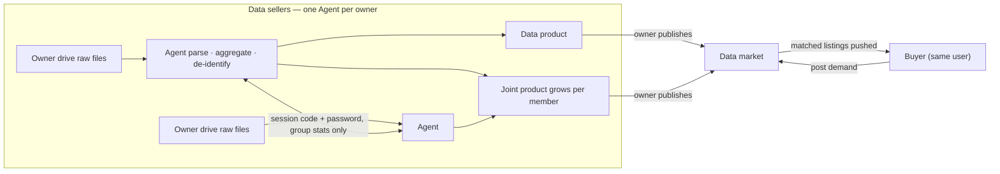
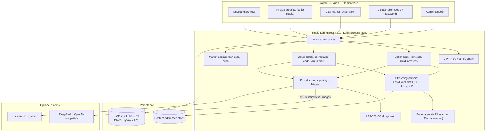
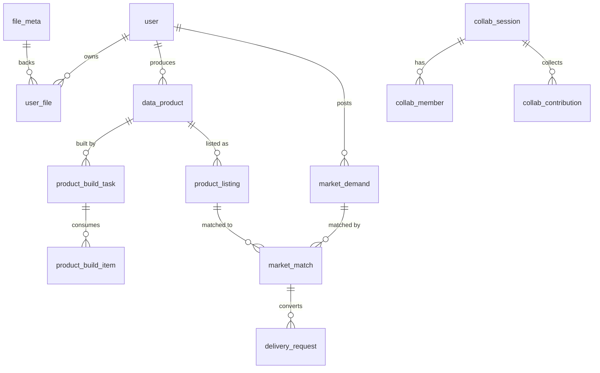
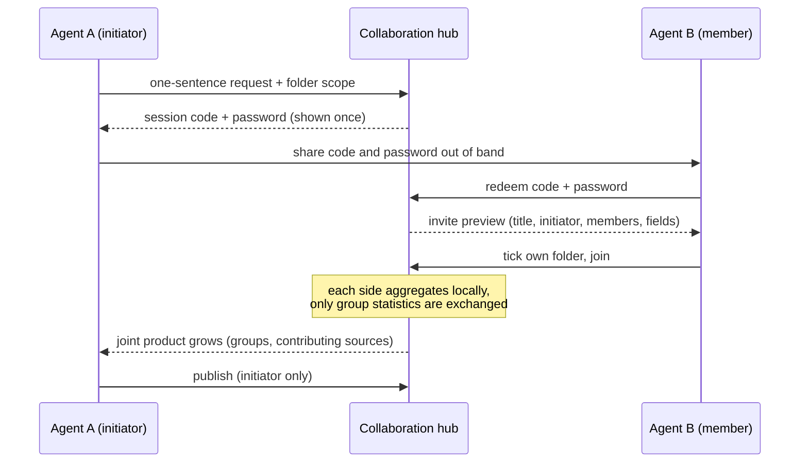
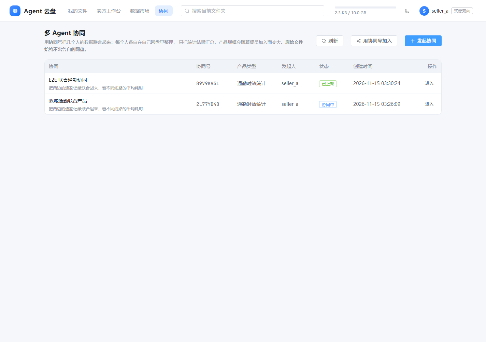
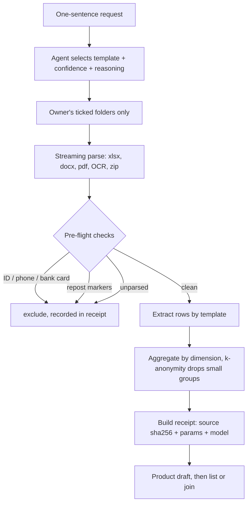
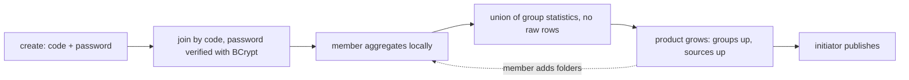
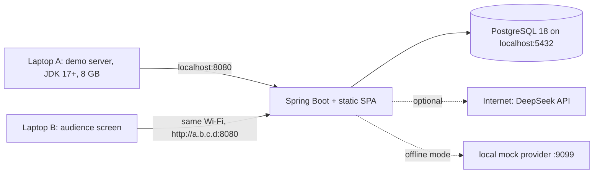

# AgentCloudDisk: A Multi-Agent Cloud-Drive System for Turning Personal Data into Tradeable Data Products

**Demo Paper — WWW '26 Companion (Demo Track)**

> Authors and affiliations omitted for double-blind review.
> Contact: *demo@example.org* · Artifact: runnable system + seeded demo data (released upon acceptance)

---

## Abstract

Valuable data sits dormant inside personal and enterprise cloud drives — commute logs, recipe notes, feeding tables, reading records — yet conventional drives offer only metadata search, so owners cannot turn this material into anything sellable. We present **AgentCloudDisk**, a runnable cloud-drive system in which an LLM Agent acts on behalf of each owner: given a one-sentence product request it selects an aggregation template, parses the owner's *authorized* files with streaming readers (row-streaming spreadsheets, StAX-based Word, a hand-written non-recursive PDF parser, on-device OCR, controlled archive unpacking), aggregates into a k-anonymous product, and publishes it to a data market where buyers post demands and receive matched listings. Two mechanisms carry the demo: **multi-agent collaboration**, where owners join a joint product with a short session code and password and the product grows monotonically as members contribute; and **host-confined privacy**, where sensitive files are filtered before any model call, model-produced evidence is verified against parsed text, and only aggregate statistics ever leave a member's drive. A visitor can describe a product from their own folder and watch a joint product grow by redeeming a code, on one laptop.

**Keywords:** data elements; cloud drive; LLM agent; multi-agent collaboration; privacy-preserving data publishing; data marketplaces

---

## 1. Introduction

Data elements have become a production factor, and marketplaces increasingly let demanders post *demands* while suppliers list *products*. In practice the suppliers are not curated warehouses: the raw material lies in ordinary **cloud drives** as heterogeneous files — commute spreadsheets, hand-written recipe photos, feeding logs, PDF reports.

Three gaps motivate this demo:

1. **Drives stop at metadata.** A request such as "aggregate my commute time by line" cannot be answered by a filename search, and a drive offers no way to become a *product*.
2. **Turning files into a product requires understanding content, but not uploading it.** Content-based aggregation implies reading files; shipping raw documents to a third party is unacceptable for personal data.
3. **Individual drives are too small to be valuable, yet naive collaboration leaks.** One person's commute log is thin; combining several owners' logs gives a statistically meaningful product, but naive combination exchanges raw records and enables cross-referencing attacks.

Our demo answers these with a **working system**, not a mock-up. Contributions:

- **C1 — Agents that produce products, not search results.** Each owner's Agent converts authorized raw files into an aggregated *data product* with schema, coverage, quality score, masked samples and a reproducible build receipt.
- **C2 — Natural-language product authoring.** Users describe what they want in one sentence; the Agent selects a template, states its confidence and reasoning, and shows the fields it will produce — no template vocabulary required.
- **C3 — Code-based multi-agent collaboration.** An initiator creates a joint project and receives a short **session code** plus **password**; other owners redeem them to join, contributing only group-level statistics, and the joint product grows with each member.
- **C4 — Host-confined, verifiable privacy.** Sensitive content is filtered on the host before any network call; the market exposes only aggregate descriptions; a per-product receipt binds the product to its source file hashes.

**On-site goal:** a visitor should be able to describe one product in plain language, watch the Agent parse and aggregate, then join a joint project with a code and see the product grow — in under three minutes.

---

## 2. System Overview and Architecture

### 2.1 Roles and loop

Every account is bidirectionally capable (buyer and seller); an administrator handles models, users and audits.

*Figure 1. Seller-side agents produce products; the market only ever sees descriptions.*

### 2.2 Architecture

*Figure 2. Component view. Everything except the optional model call runs inside one JVM.*

| Layer | Technology | Note |
| --- | --- | --- |
| Backend | Spring Boot 4.1.1, Kotlin, Amper/Kotlin Toolchain | one process, port 8080 |
| Persistence | PostgreSQL 18, MyBatis 4.1, Flyway 13.12 | 9 versioned migrations, 19 tables |
| Files | content-addressed local store, SHA-256 dedup | 5 MB resumable chunks |
| Parsing | EasyExcel 4.0.3, StAX, custom PDF reader, Windows.Media.Ocr, java.util.zip | all streaming |
| LLM | DeepSeek / any OpenAI-compatible endpoint, JSON mode | pluggable, with failover |
| Security | BCrypt, HS256 JWT, AES-256-GCM (12-byte IV, 128-bit tag) | keys never stored in plaintext |
| Frontend | Vue 3.5, Vite 6, Element Plus 2.9 | light/dark, 1440x900 |

### 2.3 Data model

*Figure 3. Nineteen tables; file_meta deduplicates content across owners, collab_member tracks per-member scope and contribution.*

---

## 3. Demo Scenarios and Features

The booth tour runs in three minutes across three pages using two accounts.

### S1 — Describe a product in one sentence (30 s)

The owner types *"turn my commute records into average duration per line"*. Debounced 500 ms later the Agent answers inline: **template = Commute Timeliness, confidence 98%**, one sentence of reasoning, and the exact fields it will produce (route, departure, arrival, duration, transfers). A rule-based fallback guarantees an answer even with no model configured.

*Input:* free text up to 200 chars. *Output:* template + confidence + reasoning + field list.

*Figure 4. Natural-language authoring with an explicit, inspectable interpretation.*

### S2 — Watch the Agent parse and aggregate (30 s)

The owner ticks folders; only those subtrees are read. The build dialog streams per-file events ("parsed", "streamed Excel", "skipped") and ends with a product card showing *N groups · M files · quality score*, plus a **4-row preview table** of the aggregated result. Files containing ID numbers or phone numbers are excluded before any model call, and the card states the privacy rule in plain language.

*Figure 5. Product card written for non-technical owners; the warning appears only when the description and the chosen files disagree.*

### S3 — Join a joint product with a code (45 s)

Owner A creates a joint project; a dialog returns an 8-character **session code** (e.g. `XPRZ98NB`) and a 6-character **password**, shown once with copy buttons. Owner B enters both, sees an invite card (title, initiator, current members, fields produced) *before* committing, ticks their own folder and joins. The joint product's group count increases immediately; members may later add folders to grow it further.

*Figure 6. Code-based collaboration. Only the initiator may publish; members can view and extend their own scope.*

| Joint-product list | Owner view |
| --- | --- |
|  |  |

*Figure 7. Session list with codes (left) and the owner view with the publish button (right); members instead see "only the initiator can publish".*

### S4 — Market matching and push (30 s)

A buyer posts a demand in natural language. The market parses it into a structured requirement, hard-filters listings by keyword and domain, scores the survivors (keyword overlap, temporal coverage, quality, price), and pushes the top matches with **human-readable reasons** ("matched keywords: commute, duration; coverage until 2026-03"). Listings expose fields, coverage, quality, masked samples and the build receipt — never a raw filename.

*Figure 8. Market catalogue. Summaries and tags are visible; original files are not.*

### S5 — Minimal delivery handshake (15 s)

Buyer requests delivery, seller accepts, seller marks delivered. Three states, no payload transfer, matching the demo's scope.

### What the audience can touch

| Scenario | Audience action | Visible result |
| --- | --- | --- |
| S1 | type their own one-liner | interpretation appears in under 1 s |
| S2 | tick folders, start build | per-file events; about 4.5 s for a 5-row sheet |
| S3 | redeem a code the presenter hands out | joint product grows live |
| S4 | post a demand | ranked pushes with reasons |
| S5 | request delivery | three-state handshake |

---

## 4. Implementation and Deployment

### 4.1 Processing pipeline

*Figure 9. Seller-side pipeline. Products contain only aggregates, so listing cannot leak individual records.*

Four built-in templates (commute timeliness, home-recipe library, pet-feeding records, reading notes) are fixed so that products stay comparable and verifiable; the natural-language layer only maps requests onto them.

### 4.2 Collaboration protocol

*Figure 10. Collaboration state machine. Publishing is terminal: once published, joining is refused.*

Implementation notes worth showing at the booth:

- **Codes are human-transcribable.** 8 characters drawn from an alphabet with `0/O/1/I` removed, uniqueness enforced by a database index; passwords are 6 characters, shown exactly once and stored as BCrypt hashes.
- **Only aggregates cross the wire.** A member's contribution is a JSON array of group-level statistics; the union merge keeps a group if *any* member covers it, and a `sources` field records how many members support each group.
- **Boundary-safe PII scanning.** The scanner keeps a 32-character tail so an ID number split across chunk boundaries is still caught.
- **PDF without a regex.** An early build matched string literals with a regular expression over every stream and failed with a stack overflow on a 1.9 MB PDF containing large image streams; the shipped parser locates `stream`/`endstream` by `indexOf`, skips binary streams, and parses literals with a hand-written loop.
- **Evidence grounding.** Model-returned evidence is substring-checked against parsed text; unverifiable quotes are replaced by a local snippet.
- **Secrets never leave the server.** Provider keys are AES-256-GCM encrypted under a master key outside the database and version control; collaboration password hashes are stripped from every response through a dedicated view object, asserted by an automated test.

### 4.3 Deployment for the conference booth

*Figure 11. Two-laptop booth setup; the dashed path removes any network dependency.*

| Item | Requirement | Notes |
| --- | --- | --- |
| Demo server | 1 laptop, 4 vCPU / 8 GB RAM, JDK 17+, PostgreSQL 16+ | all on localhost; about 1.3 GB disk with seed data |
| Client | modern Chromium-based browser, at least 1280x800 (1440x900 recommended) | no plugin, no install |
| Network | **optional** | with Internet: real DeepSeek endpoint; without: bundled OpenAI-compatible mock on port 9099 |
| Ports | 8080 (app), 5432 (DB), 9099 (mock, optional) | loopback by default; opened only when sharing to Laptop B |
| Startup | `createdb` then `kotlin.bat run` (or the packaged JAR) | Flyway creates 19 tables; the seeder creates 5 accounts, 13 sample files, 2 listings, 1 demand and 1 two-member collaboration |
| Reset between visitors | one SQL script clearing tasks, results and collaborations | under 1 s; accounts and files kept |
| Accounts | seller_a/sell1234, seller_b/sell1234, buyer/buy12345, demo/demo1234, admin/admin123 | printed on a booth card |
| Fallbacks | if the network dies mid-demo the router fails over to the mock in under 1 s and the UI labels judgments as local rules | rehearsed |

**Booth script (90 s):** describe a product (S1), watch the build (S2), join a joint project with the code handed to the visitor (S3), post a demand and show pushed reasons (S4). Delivery (S5) answers "and then what".

### 4.4 Verification

Rather than comparative experiments we ship six scripted end-to-end suites a reviewer can run at the booth:

| Suite | Coverage | Result |
| --- | --- | --- |
| `collab-code-test` | code and password format, invite preview, wrong password 403, unknown code 404, join makes the product grow, idempotent rejoin, member adds folders, non-initiator cannot publish, publish, no join after publish, outsider 403 | 29/29 |
| `market-smoke-test` | build with receipt source hashes, list and delist with match invalidation, demand matching with reasons, three-state delivery, joint product from collaboration, permission isolation | 37/37 |
| `seller-intent-test` | four natural-language scenarios map to the intended template, vague input still resolves, product created from a description, AI on by default | 11/11 |
| `smoke-test` | auth, quota, chunked upload, dedup, recycle bin, admin | 27/27 |
| `scan-progress-test` | async task, live progress, previews, crash-free parsing, preview authorization | 18/18 |
| `ai-provider-smoke-test` | provider CRUD, key masking, connectivity test, failover, cooldown | 28/28 |

Measured on the demo laptop with a cloud LLM: a 5-row spreadsheet becomes a product in **4.5 s** end-to-end (parse, aggregate, describe); a joint product shows its first growth within one second of the second member joining.

### 4.5 Ethics, privacy and compliance

- **Explicit, minimal authorization.** Only ticked folders are opened; scope is persisted per member and echoed in the collaboration view. Registration is self-service and all demo data is synthetic.
- **Aggregation by construction.** Products contain group-level statistics only, with k-anonymity (default k = 3) dropping sparse groups. Individual rows are never written to a product, a listing, or a collaboration payload.
- **Data minimisation towards third parties.** Files whose content already carries an ID card, phone number, bank card or repost markers are filtered **on the host**; only the remaining text (at most 1200 chars per file, 6 files per call) or an explicitly requested image is sent to a model.
- **Traceability over fluency.** Model evidence must appear verbatim in parsed text; build receipts bind each product to its source file hashes, and the market shows the receipt to buyers.
- **Secret handling.** Provider keys are AES-256-GCM encrypted with a master key outside the database; collaboration passwords are BCrypt hashed, displayed exactly once, and never returned by any endpoint (asserted by an automated test).
- **Human oversight.** Agents recommend and assemble; publishing a joint product is reserved for its initiator, and delivery is a human handshake. The system never auto-submits or redistributes content.
- **LLM limitations are surfaced.** Every product states whether a model participated; unparsable files are listed with a reason rather than silently dropped.

---

## 5. Conclusion

AgentCloudDisk shows that an ordinary cloud drive can participate in a data-element market without surrendering its contents: streaming parsing plus on-host privacy filtering decides what may be shown and what may leave the machine, an LLM Agent turns authorized files into k-anonymous products from a one-sentence request, and a short session code lets several owners pool their statistics into a joint product that grows with each member. The whole loop — describe, build, collaborate, list, match, deliver — runs on one laptop, with or without Internet. We invite WWW attendees to bring a folder and a code.

---

## References

[1] DeepSeek-AI, Aixin Liu, Bei Feng, et al. 2024. *DeepSeek-V3 Technical Report.* arXiv:2412.19437.

[2] Bin Wang, Chao Xu, Xiaomeng Zhao, et al. 2024. *MinerU: An Open-Source Solution for Precise Document Content Extraction.* arXiv:2409.18839.

[3] Haoran Wei, Yaofeng Sun, and Yukun Li. 2025. *DeepSeek-OCR: Contexts Optical Compression.* arXiv:2510.18234.

[4] Brandon Smock, Rohith Pesala, and Robin Abraham. 2021. *PubTables-1M: Towards Comprehensive Table Extraction from Unstructured Documents.* arXiv:2110.00061.

[5] Ildikó Pilán, Pierre Lison, Lilja Øvrelid, et al. 2022. *The Text Anonymization Benchmark (TAB): A Dedicated Corpus and Evaluation Framework for Text Anonymization.* arXiv:2202.00443.

[6] Jordi Soria-Comas. 2013. *Improving Data Utility in Differential Privacy and k-Anonymity.* arXiv:1307.0966.

[7] Jian Pei. 2020. *A Survey on Data Pricing: From Economics to Data Science.* arXiv:2009.04462.

[8] Mengxiao Zhang, Fernando Beltran, and Jiamou Liu. 2023. *A Survey of Data Pricing for Data Marketplaces.* arXiv:2303.04810.

[9] Khanh-Tung Tran, Dung Dao, Minh-Duong Nguyen, et al. 2025. *Multi-Agent Collaboration Mechanisms: A Survey of LLMs.* arXiv:2501.06322.

[10] Lei Wang, Chen Ma, Xueyang Feng, et al. 2023. *A Survey on Large Language Model based Autonomous Agents.* arXiv:2308.11432.

[11] Yunfan Gao, Yun Xiong, Xinyu Gao, et al. 2023. *Retrieval-Augmented Generation for Large Language Models: A Survey.* arXiv:2312.10997.

[12] Zicun Cong, Xuan Luo, Jian Pei, et al. 2021. *Data Pricing in Machine Learning Pipelines.* arXiv:2108.07915.

---

### Appendix A — Demo artifact checklist

| Item | Status |
| --- | --- |
| Runnable system (backend + frontend, single port) | yes |
| Seeded dataset (13 real files: DOCX/XLSX/PNG/ZIP/PDF) + 2 listings + 1 demand + 1 two-member collaboration | yes |
| Offline mode (local OpenAI-compatible mock) | yes |
| One-command reset between visitors | yes |
| Six executable test suites printing pass/fail | yes |
| Screenshots and this paper (EN/ZH) | yes |
