# AgentCloudDisk: An LLM-Agent-Assisted Cloud-Drive System for Data-Element Bounty Matching

**Demo Paper — WWW '26 Companion (Demo Track)**

> Authors and affiliations omitted for double-blind review.
> Contact: *demo@example.org* · Artifact: runnable system + seeded demo data (released upon acceptance)

---

## Abstract

Valuable data is scattered inside personal and enterprise cloud drives (business ledgers, lab notes, spreadsheets, photos), yet conventional drives only offer keyword search over metadata. Data demanders therefore publish **bounties** describing the content they need, while drive owners have no automated way to tell whether their files are relevant — manual triage is slow, leaks private content, and is error-prone. We present **AgentCloudDisk**, a runnable cloud-drive system in which an LLM agent matches a user's *authorized* file scope against enterprise bounties. The system parses real file content with streaming readers (row-streaming spreadsheets, StAX-based Word, a hand-written non-recursive PDF parser, on-device OCR, controlled archive unpacking), detects sensitive information *while* parsing with a boundary-safe scanner, and only then asks a DeepSeek-class model to judge relevance under an *evidence-grounding* constraint: every quoted snippet must appear verbatim in the parsed text. Sensitive files never leave the host. Visitors can watch the scan stream file-by-file, inspect evidence and risk tags, preview parsed tables/documents/images, and review candidates. A multi-provider console manages several LLM vendors with AES-256-GCM-encrypted keys and automatic failover. A full bounty-to-review loop runs end-to-end on a single laptop.

**Keywords:** data elements; cloud drive; LLM agent; bounty matching; privacy-preserving parsing; document understanding

---

## 1. Introduction

Data elements are becoming a first-class production factor, and marketplaces increasingly let data demanders post *bounties* that specify the business scenario, required fields, time range, formats, and compliance constraints. In practice, however, the supply side is not a curated warehouse: the raw material sits in ordinary **cloud drives** as heterogeneous files — scanned receipts, hand-written recipe photos, Excel ledgers, Word drafts, PDF reports.

Three gaps follow:

1. **Search is metadata-deep.** Existing drives match filenames and types. A bounty such as "home-cooked recipe material from your own kitchen" cannot be answered by the string `recipe`.
2. **Content must be inspected, but privacy forbids uploading everything.** Content-based matching implies reading files; naive designs ship raw documents to a third-party model, which is unacceptable for personal and enterprise data.
3. **Owners need authorization, evidence, and audit.** A recommendation without quoted evidence and a risk warning is not actionable, and a scan without a scoped authorization record is not auditable.

Our demo addresses these gaps with a **working system**, not a prototype mock-up. Our contributions are:

- **C1 — End-to-end runnable loop.** Cloud-drive base (accounts, quotas, chunked upload with SHA-256 deduplication, recycle bin, previews) plus bounty publishing, scoped agent scanning, human review, and admin audit, exposed through one web UI and 45 REST endpoints.
- **C2 — Streaming, boundary-safe content parsing.** Spreadsheets are read row-by-row (EasyExcel), Word via StAX, PDF via a hand-written literal-string parser with binary-stream filtering, images via on-device OCR, archives via controlled unpacking. Parsing and *sensitive-information detection* happen in the same pass, with an overlap window so patterns split across chunk boundaries are still caught.
- **C3 — Evidence-grounded, host-confined LLM judging.** Sensitive files are filtered **before** any network call; for the rest, the model must return verbatim evidence, which the server verifies against the parsed text and replaces with a local snippet if it cannot be found.
- **C4 — Operations that a data platform actually needs.** Multi-vendor model console with AES-256-GCM key encryption at rest and priority-based failover with cooldown, plus an explicit reliability gate that refuses to judge on garbled text.

**On-site goal:** a visitor should be able to publish a bounty as an enterprise user, authorize one folder as a personal user, watch the agent scan their own seeded files live, and leave with a graded, evidence-backed report — in under three minutes.

---

## 2. System Overview and Architecture

### 2.1 Roles and workflow

Three roles share one Spring Boot deployment: **personal user** (owns files, grants scope), **enterprise demander** (publishes bounties, sees only aggregate statistics), and **administrator** (users/quotas, bounty enable/disable, scan audit). Enterprise users can never read a personal user's files or evidence — a cross-role request returns HTTP 403.

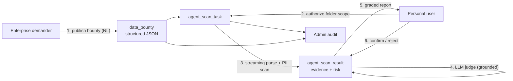

*Figure 1. End-to-end loop: bounty → authorization → scan → grounded judgment → human review → audit.*

### 2.2 Architecture

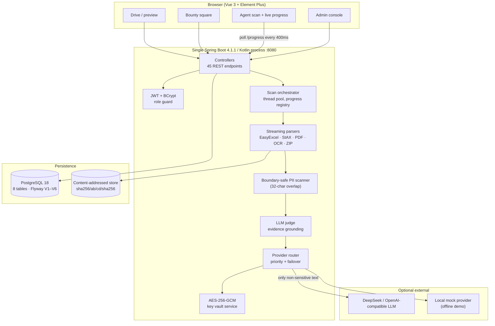

*Figure 2. Component view. Everything except the optional LLM call runs inside one JVM; the file store is content-addressed and shared by all users via `file_meta`.*

### 2.3 Data model

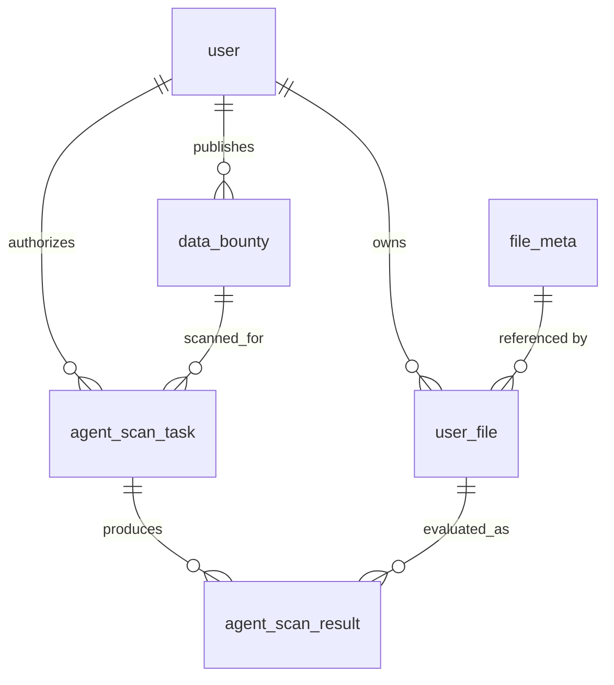

*Figure 3. Eight tables. `file_meta` (SHA-256 unique) deduplicates content across users; `ai_provider` stores only ciphertext, IV and GCM tag.*

| Layer | Technology | Note |
| --- | --- | --- |
| Backend | Spring Boot 4.1.1, Kotlin, Amper/Kotlin Toolchain | one process, port 8080 |
| Persistence | PostgreSQL 18, MyBatis 4.1.0, Flyway 13.12 | 6 versioned migrations |
| Files | Content-addressed local store + SHA-256 dedup | 5 MB chunks, resumable |
| Parsing | EasyExcel 4.0.3, StAX, custom PDF reader, Windows.Media.Ocr, java.util.zip | all streaming |
| LLM | DeepSeek / any OpenAI-compatible endpoint, JSON mode | pluggable per provider |
| Security | BCrypt, HS256 JWT, AES-256-GCM (12-byte IV, 128-bit tag) | keys never in DB plaintext |
| Frontend | Vue 3.5, Vite 6, Element Plus 2.9 | light/dark, 1440×900 |

---

## 3. Demo Scenarios and Features

The demo is a guided 3-minute tour with two browser windows (enterprise and personal), plus an optional console stop.

### S1 — Publish a bounty in natural language (30 s)
The enterprise user types free text ("*I want home-cooked recipe material you made yourself; documents, tables or photos are fine; no reposted influencer recipes*"). On submit, the LLM (or a rule fallback) converts it into a structured requirement — domain, accepted formats, match keywords, exclusion list, recency preference — shown as tags and stored in `structured_json`. The card in the bounty square displays a "parsed by LLM / by rules" provenance tag.

*Input:* free text up to 4k chars. *Output:* structured object + bounty card (Fig. 4).

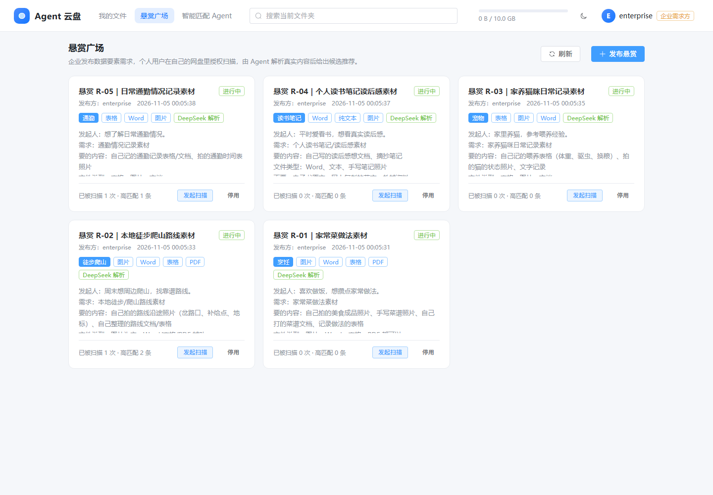

*Figure 4. Bounty square. Tags show the structured requirement and its provenance.*

### S2 — Authorize a scope (15 s)
The personal user opens **Agent**, picks the bounty, and ticks folders in a tree (e.g. *Personal / Snapshots*). Only ticked subtrees are traversed; the ticked node IDs are persisted as `auth_scope_json` and shown in the report as "scanned only: …".

### S3 — Watch the scan live (30 s)
Pressing **Start scan** returns immediately; the UI polls `GET /api/agent/tasks/{id}/progress` every 400 ms and renders: current stage (*parsing → semantic judging → writing results*), the file being parsed right now, processed/total, and a streaming event list with parse method and risk tag per file (Fig. 5).

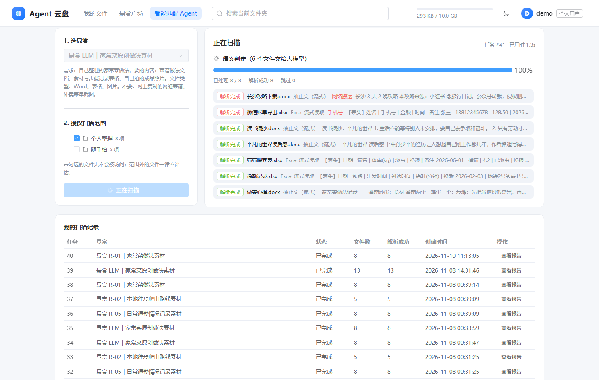

*Figure 5. Live scan. Each row appears as soon as its file is parsed: "抽正文（流式）" (streaming text), "Excel 流式读取" (row-streamed Excel), with 手机号 (phone) and 网络搬运 (reposted content) risk tags.*

### S4 — Read the graded report (40 s)
The report follows a fixed six-part template: (i) restated requirement, (ii) scope and coarse filtering, (iii) list of files *actually parsed* with the method used, (iv) graded recommendations (high/medium/low/not-recommended) with quoted evidence, (v) high-risk and excluded items, (vi) human-review reminders. Sensitive or reposted files are excluded from recommendations and listed with the reason.

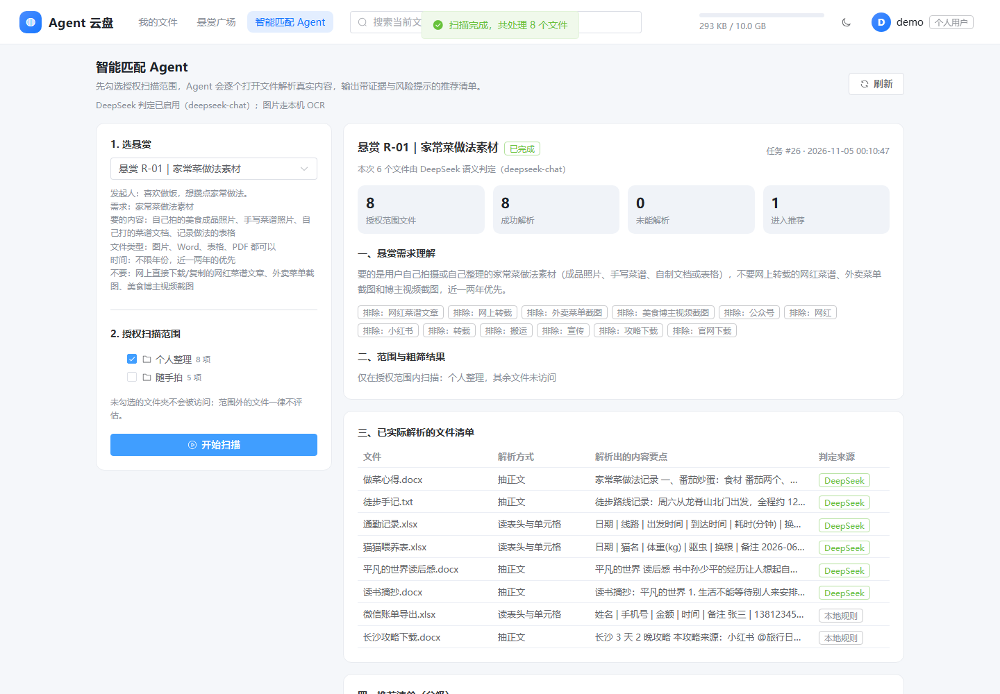

*Figure 6. Report header: counts, restated requirement, exclusion keywords, and the per-file parse-method table with judge provenance.*

### S5 — Preview parsed content (20 s)
Every row has **Preview**. Spreadsheets are re-rendered as a real table using the retained header and first 12 rows; documents show the extracted text; images show the original picture — each with its parse method and risk note (Fig. 7, Fig. 8).

| Table preview | Document preview |
| --- | --- |
| 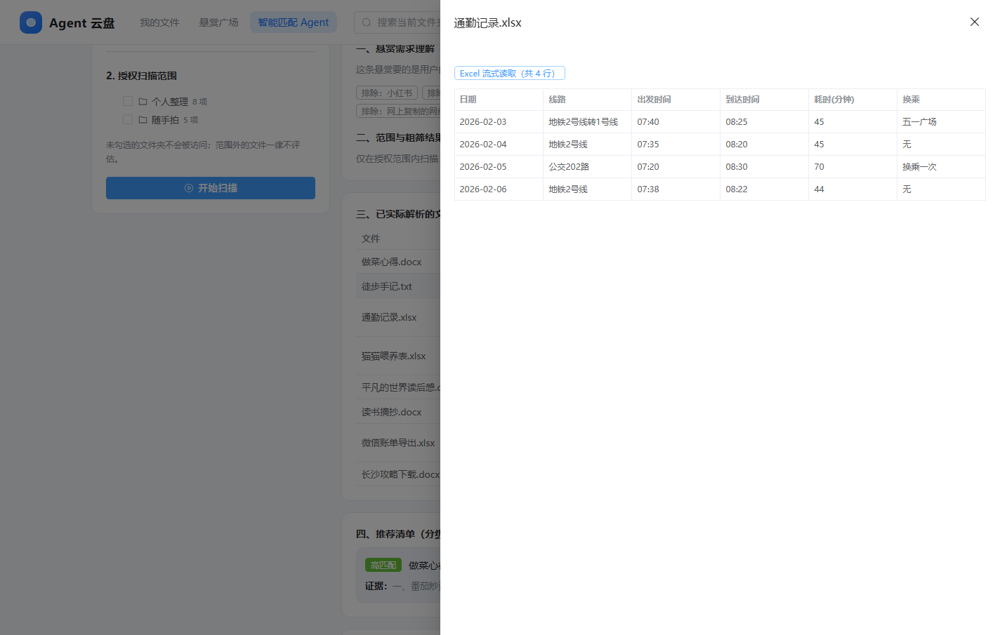 | 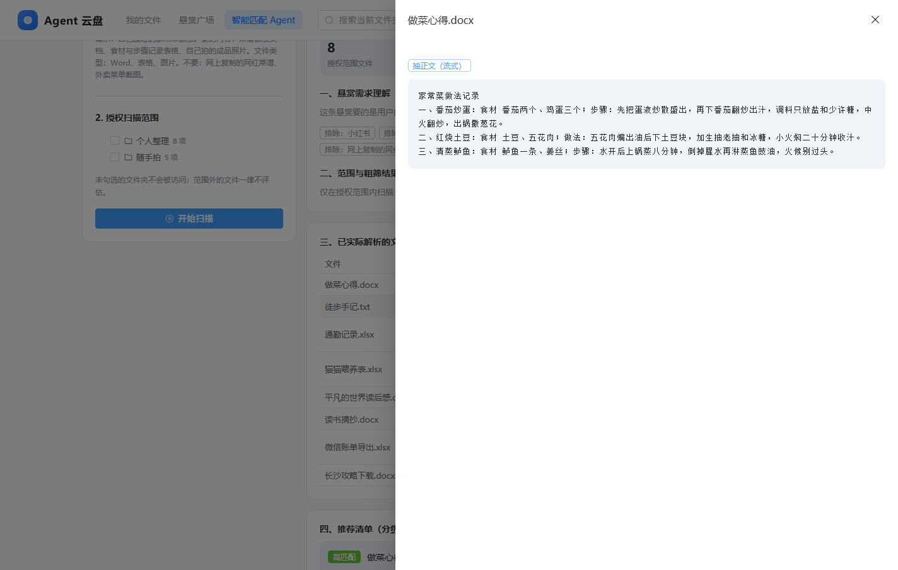 |

*Figure 7. Post-scan previews produced from the same streaming pass (header + 12 rows / extracted body).*

### S6 — Multi-provider console and failover (40 s, optional)
The admin registers two providers (e.g. a real cloud endpoint at priority 10 and an unreachable one at priority 1), runs **Test**, then triggers a scan: the first provider fails, the router fails over to the next within the same request, the failed provider is marked unhealthy and cooled down for 60 s, and the console shows the switch count. Keys are entered once, displayed only as `sk-****7a07`, and stored as ciphertext + IV + GCM tag (Fig. 9).

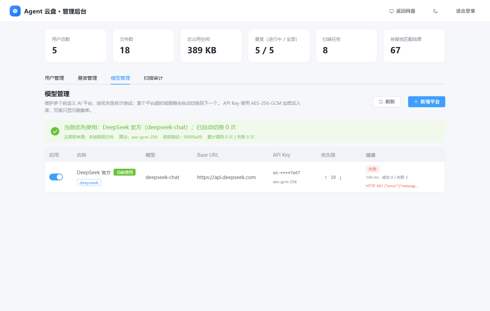

*Figure 8. Provider console: per-provider health, encrypted-key badge, priority ordering, one-click connectivity test.*

### S7 — Audit and review (20 s)
The personal user marks candidates *confirmed* / *rejected* with a note; the admin opens **Scan audit** to see every task's initiator, scope size, parse success/failure counts and timestamps.

### What the audience can touch
| Scenario | Audience action | Visible result |
| --- | --- | --- |
| S1 | type a bounty in their own words | structured tags appear in < 5 s |
| S2 | tick / untick folders | scope line in the report changes |
| S3 | start scan, watch | per-file events stream in; ~7 s for 9 files |
| S4 | read grading | evidence snippets + risk tags |
| S5 | click Preview | real table / text / image |
| S6 | break a provider | automatic failover, cooldown badge |
| S7 | review + audit | persisted decisions and audit rows |

---

## 4. Implementation and Deployment

### 4.1 Processing pipeline

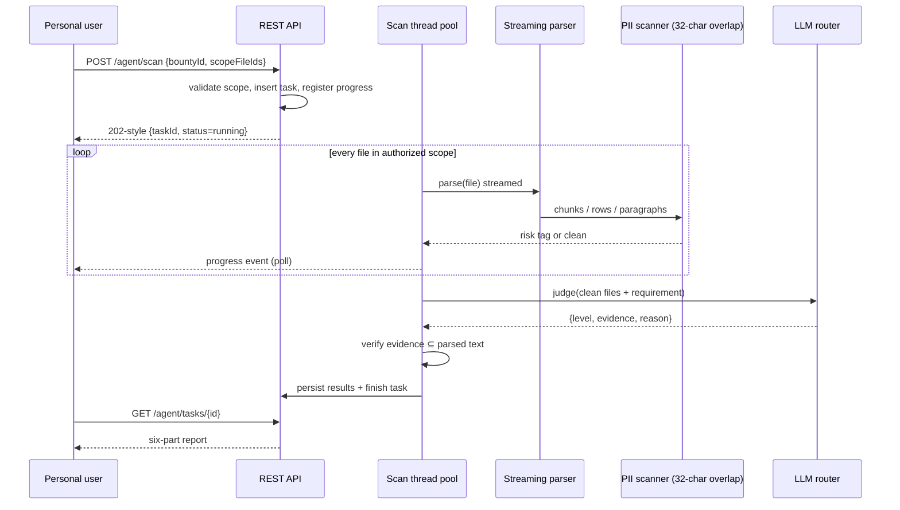

*Figure 9. Scan orchestration. Parsing never blocks the HTTP thread; the report is assembled from persisted rows.*

### 4.2 Streaming parsing and "in-flight" privacy filtering

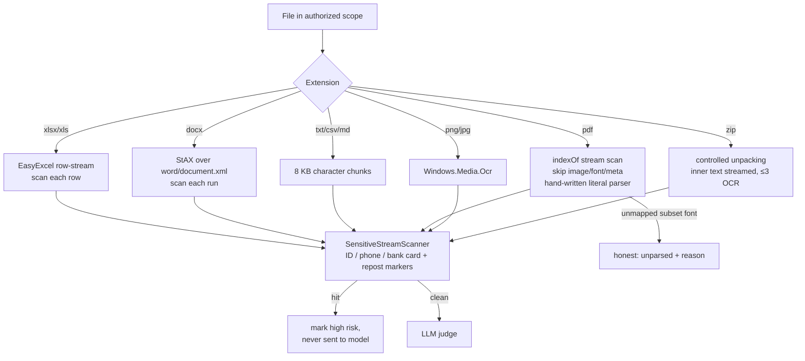

*Figure 10. Per-format streaming strategies and the single shared scanner.*

Key implementation notes that we will highlight on the poster:

- **Boundary-safe scanning.** The scanner keeps a 32-character tail so a 18-digit ID card or 11-digit phone split across two chunks is still matched; matched values are masked before display.
- **PDF without a regex.** An early version matched string literals with `\((?:[^()\\]|\\.)*\)` over *every* stream and died with `StackOverflowError` on a 1.9 MB PDF containing 380 KB/950 KB image streams. The shipped version locates `stream`/`endstream` by `indexOf`, skips binary streams, and parses literals with a hand-written loop (no regex, no recursion).
- **Refusing to judge garbage.** If a PDF uses embedded subset fonts without usable Unicode mapping, the extracted text is glyph codes; the system marks it *unparsed with a reason* rather than feeding noise to the model.
- **Evidence grounding.** LLM-returned evidence is normalized and substring-checked against the parsed text; unverifiable quotes are replaced by a local snippet, so every visible citation is traceable.

### 4.3 Provider routing and key protection

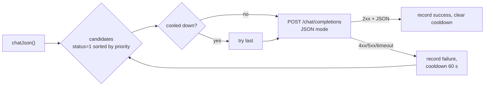

*Figure 11. Failover loop. Keys are decrypted in memory only for the duration of one request.*

Key handling follows the classic "no cloud KMS" pattern: a 32-byte master key comes from `APP_MASTER_KEY` (or a git-ignored local key file on a demo laptop), each encryption uses a fresh 12-byte IV, and ciphertext/IV/tag are stored in separate columns with `encrypt_algo = aes-gcm-256`. The API never returns plaintext.

### 4.4 Deployment for the conference booth

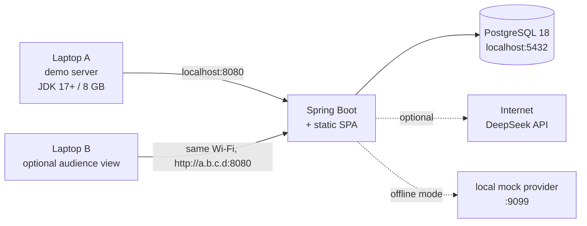

*Figure 12. Two-laptop booth setup; the LLC path (offline mock) removes any network dependency.*

| Item | Requirement | Notes |
| --- | --- | --- |
| Demo server | 1 laptop, 4 vCPU / 8 GB RAM, JDK 17+, PostgreSQL 16+ | everything on `localhost`; 1.2 GB disk with seed data |
| Client | any modern Chromium-based browser, ≥ 1280×800 (1440×900 recommended) | no plugin, no install |
| Network | **optional** | with Internet: real DeepSeek endpoint; without: bundled OpenAI-compatible mock on `:9099` |
| Ports | 8080 (app), 5432 (DB), 9099 (mock, optional) | all bound to loopback unless sharing to Laptop B |
| Startup | `createdb` → `./kotlin.bat run` (or the packaged JAR) | Flyway creates the 8 tables; seeder creates 3 accounts, 5 bounties, 13 sample files |
| Reset between visitors | one SQL script truncating `agent_scan_task/result` | < 1 s, keeps accounts and files |
| Accounts | `enterprise/ent12345`, `demo/demo1234`, `admin/admin123` | printed on a booth card |
| Fallbacks | if the network dies mid-demo, the router fails over to the mock in < 1 s and the UI tags judgments as "local rules" | rehearsed |

**Booth script (90 s):** publish bounty (S1) → tick folder (S2) → start scan and narrate the streamed events (S3) → open one table preview (S5) → mark one candidate confirmed (S7). The provider console (S6) is the "deep-dive" for reviewers who ask about reliability.

### 4.5 Verification

Rather than comparative experiments, we ship four scripted end-to-end suites that a reviewer can run at the booth:

| Suite | Coverage | Result |
| --- | --- | --- |
| `smoke-test` | auth, quota, chunked upload, dedup, recycle bin, admin | 27/27 |
| `agent-smoke-test` | roles, publish, scoped scan, OCR/PDF/ZIP parsing, risk exclusion, review, 403 isolation, audit | 29/29 |
| `ai-provider-smoke-test` | provider CRUD, key masking, connectivity test, failover, cooldown, validation | 29/29 |
| `scan-progress-test` | async task, live progress, previews, crash-free parsing, preview authorization | 19/19 |

Measured on the demo laptop with a cloud LLM: **9 mixed files in 6.8 s** (6 judged by the model) and **5 image-heavy files in 12.4 s** (OCR-bound). With the local mock, the same scopes finish in roughly half the time.

### 4.6 Ethics, privacy and compliance

- **Explicit, minimal authorization.** Nothing outside the ticked folders is opened; the scope is persisted with the task and echoed in the report. Registration is self-service and the demo dataset is synthetic.
- **Data minimisation towards third parties.** Files whose content already contains an ID card, phone number, bank card or repost markers are filtered **on the host**; only the remaining text (≤ 1 200 chars per file, ≤ 6 files per call) is sent to the model. The model never receives images, archives or full documents.
- **Traceability over fluency.** Quoted evidence is verified against parsed text; a model answer that cannot be grounded is downgraded to a local snippet. The system never auto-submits, auto-uploads or redistributes files — delivery remains a human decision after manual de-identification.
- **Secret handling.** API keys are encrypted with AES-256-GCM under a master key that lives outside the database and outside version control; the UI only shows a masked form.
- **LLM limitations are surfaced, not hidden.** Every report states whether judgments came from the model or local rules, and unparsable files are listed with a reason (unsupported format, garbled text layer, OCR failure) instead of being silently dropped or hallucinated.
- **Human oversight.** Recommendations are advisory; review decisions and notes are stored per result, and the admin audit trail records who scanned what, when, and with which provider.

---

## 5. Conclusion

AgentCloudDisk demonstrates that a cloud drive can become an auditable data-element marketplace participant without surrendering user content: streaming parsing plus in-flight privacy filtering decides *what may be shown* and *what may leave the host*, and an evidence-grounded LLM judge turns raw files into a graded, reviewable recommendation. The entire loop — bounty, authorization, live scan, preview, review, audit — runs on one laptop, with or without Internet. We invite WWW attendees to bring a folder of their own and watch the agent read it.

---

## References

[1] DeepSeek-AI, Aixin Liu, Bei Feng, et al. 2024. *DeepSeek-V3 Technical Report.* arXiv:2412.19437.

[2] DeepSeek-AI, Daya Guo, Dejian Yang, et al. 2025. *DeepSeek-R1: Incentivizing Reasoning Capability in LLMs via Reinforcement Learning.* arXiv:2501.12948.

[3] Bin Wang, Chao Xu, Xiaomeng Zhao, et al. 2024. *MinerU: An Open-Source Solution for Precise Document Content Extraction.* arXiv:2409.18839.

[4] Haoran Wei, Yaofeng Sun, and Yukun Li. 2025. *DeepSeek-OCR: Contexts Optical Compression.* arXiv:2510.18234.

[5] Brandon Smock, Rohith Pesala, and Robin Abraham. 2021. *PubTables-1M: Towards Comprehensive Table Extraction from Unstructured Documents.* arXiv:2110.00061.

[6] Ildikó Pilán, Pierre Lison, Lilja Øvrelid, et al. 2022. *The Text Anonymization Benchmark (TAB): A Dedicated Corpus and Evaluation Framework for Text Anonymization.* arXiv:2202.00443.

[7] Jian Pei. 2020. *A Survey on Data Pricing: From Economics to Data Science.* arXiv:2009.04462.

[8] Mengxiao Zhang, Fernando Beltran, and Jiamou Liu. 2023. *A Survey of Data Pricing for Data Marketplaces.* arXiv:2303.04810.

[9] Yunfan Gao, Yun Xiong, Xinyu Gao, et al. 2023. *Retrieval-Augmented Generation for Large Language Models: A Survey.* arXiv:2312.10997.

[10] Lei Wang, Chen Ma, Xueyang Feng, et al. 2023. *A Survey on Large Language Model based Autonomous Agents.* arXiv:2308.11432.

---

### Appendix A — Demo artifact checklist

| Item | Status |
| --- | --- |
| Runnable system (backend + frontend, single port) | ✅ |
| Seeded dataset (13 real files: DOCX/XLSX/PNG/ZIP/PDF) and 5 bounties | ✅ |
| Offline mode (local OpenAI-compatible mock) | ✅ |
| One-command reset between visitors | ✅ |
| Four executable test suites with printed pass/fail | ✅ |
| Screenshots and this paper (EN/ZH) | ✅ |
