# AgentCloudDisk：面向数据要素悬赏匹配的大模型 Agent 网盘系统（演示）

**演示论文 — WWW '26 Companion（Demo Track）**

> 为双盲评审隐去作者与单位信息。
> 联系：*demo@example.org* · 系统与数据：可运行系统 + 预置演示数据（录用后公开）

---

## 摘要（Abstract）

有价值的数据大量沉淀在个人与企业网盘里——业务台账、实验记录、表格、照片——而传统网盘只提供基于元数据的关键词检索。数据需求方因此以「悬赏」形式发布所需内容，网盘持有者却没有自动化手段判断自己的文件是否契合：人工逐条翻查效率低、易泄露隐私、漏检率高。本文演示 **AgentCloudDisk**：一个可运行的网盘系统，由大模型 Agent 在用户**授权的范围内**完成悬赏匹配。系统以流式方式真实解析文件内容（表格逐行流式读取、Word 走 StAX、PDF 用非递归手写解析器、图片用本机 OCR、压缩包受控解包），并在解析过程中同步做敏感信息检测（带 32 字符重叠窗口，跨块边界不漏），随后才把**已过滤**的正文交给 DeepSeek 类模型做相关性判定，且强制「证据接地」：模型引用的原文必须能在解析文本中逐字命中，否则回退为本地片段。含敏感信息的文件不出本机。现场观众可以实时看到扫描逐文件推进、查看证据与风险标签、预览解析出的表格/文档/图片，并完成人工复核；管理端可管理多家模型平台，API Key 以 AES-256-GCM 加密入库并支持故障自动切换。完整「悬赏→授权→扫描→推荐→复核」闭环可在单台笔记本上跑通。

**关键词：** 数据要素；网盘；大模型 Agent；悬赏匹配；隐私保护解析；文档理解

---

## 1. 引言（Introduction）

数据要素正在成为核心生产要素，数据市场普遍采用「数据需求方发布悬赏、说明业务场景/字段/时间范围/格式/合规约束」的形态征集数据。但供给侧并不是整理好的数仓：原始材料以异构文件的形式散落在普通**网盘**中——扫描件、手写菜谱照片、Excel 台账、Word 草稿、PDF 报告。

由此产生三个缺口：

1. **检索只到元数据层。** 现有网盘按文件名与类型匹配。当悬赏写着「你自己拍的家常菜素材」时，搜索关键词 `菜谱` 无法作答。
2. **必须读内容，但不允许把所有内容传出去。** 内容级匹配意味着要读文件；而把原始文档直接送给第三方模型，对个人与企业数据都不可接受。
3. **持有者需要授权、证据与审计。** 没有原文引用与风险提示的推荐无法决策；没有范围留痕的扫描无法审计。

本演示针对上述缺口给出的是**可运行系统**，而非界面原型。贡献如下：

- **C1 — 可跑通的完整闭环。** 网盘底座（账号、配额、分片上传与 SHA-256 秒传、回收站、预览）+ 悬赏发布、授权扫描、人工复核、后台审计，一套 Web 界面与 45 个 REST 接口。
- **C2 — 流式、跨块安全的内容解析。** 表格用 EasyExcel 逐行、Word 用 StAX、PDF 用「先过滤二进制流 + 手写字面量解析」，图片走本机 OCR，压缩包受控解包；解析与**敏感信息检测同一趟完成**，靠尾部重叠窗口保证被切开的号码仍能命中。
- **C3 — 证据接地、正文不出本机的模型判定。** 敏感文件在任何网络调用**之前**就被拦下；其余文件的模型输出必须给出逐字证据，服务端校验不通过即回退本地片段。
- **C4 — 数据平台真正需要的运维能力。** 多平台模型管理：Key 以 AES-256-GCM 密文入库、按优先级故障自动切换并带冷却；同时设有「文本不可信就不判定」的可靠性闸门。

**现场目标：** 观众以企业身份用自然语言发一条悬赏，再以个人身份勾选一个文件夹，实时看 Agent 扫描自己网盘里的样例文件，最后拿到一份带证据与风险提示的分级报告——全程 3 分钟内。

---

## 2. 系统概述与架构（System Overview）

### 2.1 角色与主流程

三类角色共用同一个 Spring Boot 部署：**个人用户**（持有文件、授权范围）、**企业需求方**（发布悬赏，只能看汇总统计）、**管理员**（用户与配额、悬赏启停、扫描审计）。企业用户永远读不到个人用户的文件与证据——跨角色访问直接返回 403。

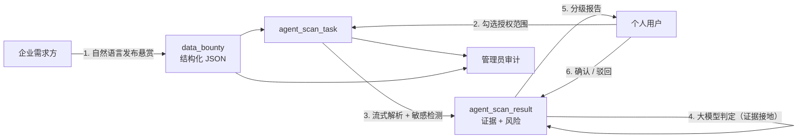

*图 1. 主闭环：悬赏 → 授权 → 扫描 → 接地判定 → 人工复核 → 审计。*

### 2.2 总体架构

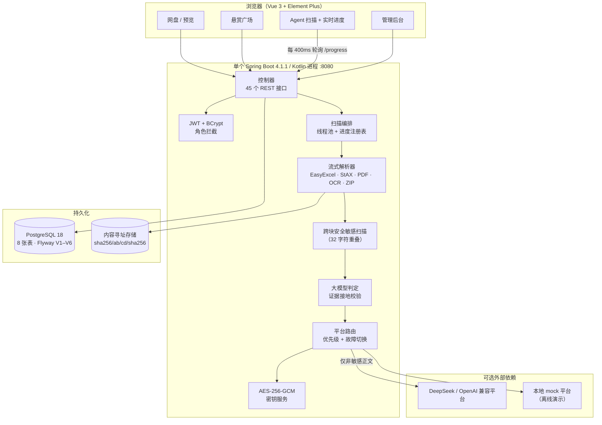

*图 2. 组件视图。除可选的大模型调用外，全部逻辑运行在一个 JVM 内；文件存储按内容寻址，多用户通过 `file_meta` 去重共享。*

### 2.3 数据模型

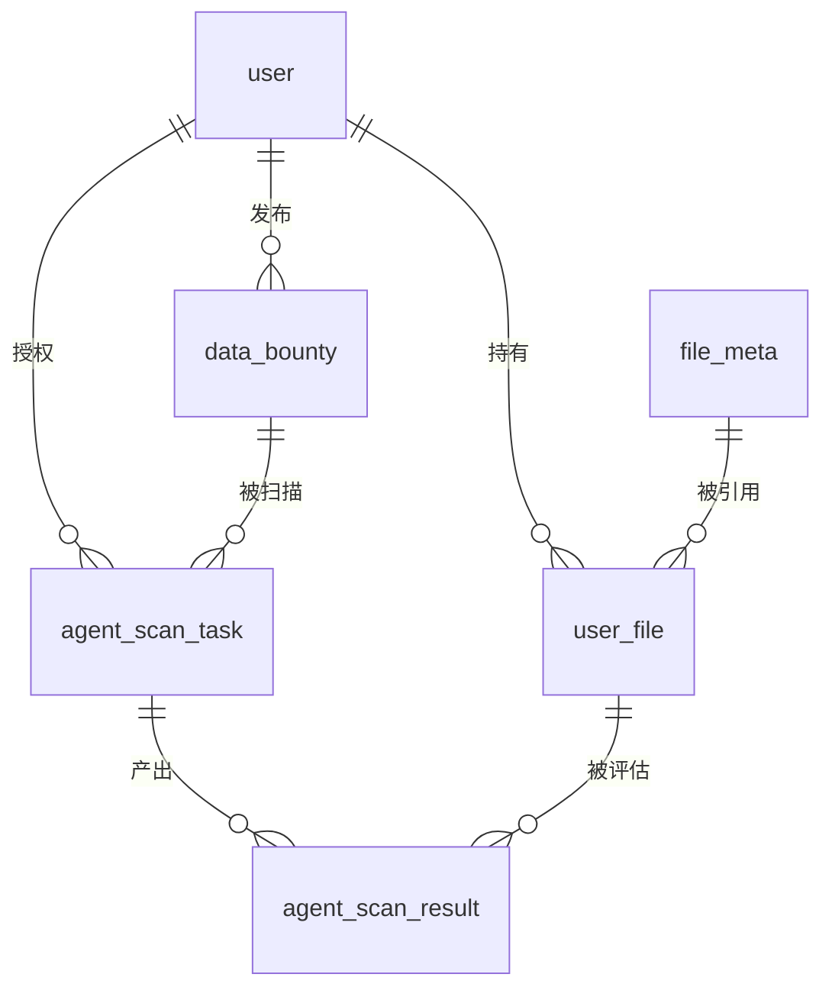

*图 3. 共 8 张表。`file_meta`（sha256 唯一）负责跨用户去重；`ai_provider` 只存密文、IV 与 GCM 标签。*

| 层次 | 技术 | 说明 |
| --- | --- | --- |
| 后端 | Spring Boot 4.1.1 + Kotlin（Amper/Kotlin Toolchain） | 单进程，端口 8080 |
| 持久化 | PostgreSQL 18 + MyBatis 4.1.0 + Flyway 13.12 | 6 个版本化迁移脚本 |
| 文件 | 本地内容寻址存储 + SHA-256 秒传 | 5MB 分片，断点续传 |
| 解析 | EasyExcel 4.0.3、StAX、自研 PDF 解析、Windows.Media.Ocr、java.util.zip | 全部流式 |
| 大模型 | DeepSeek / 任意 OpenAI 兼容端点，JSON 模式 | 平台可插拔 |
| 安全 | BCrypt、HS256 JWT、AES-256-GCM（12 字节 IV + 128 位 tag） | Key 不以明文入库 |
| 前端 | Vue 3.5 + Vite 6 + Element Plus 2.9 | 深浅色，1440×900 |

---

## 3. 演示场景与功能（Demo Scenarios）

现场是一条约 3 分钟的引导路线，两个浏览器窗口（企业、个人）加一个可选的运维环节。

### S1｜用自然语言发布悬赏（30 秒）
企业用户直接写一段话（如「*要你自己做的家常菜素材，文档、表格、照片都行，不要网上复制的网红菜谱*」）。提交后大模型（或规则兜底）把它解析成结构化需求——领域、可接受格式、匹配关键词、排除项、时效偏好——以标签形式呈现并写入 `structured_json`。悬赏卡片上标注「大模型解析 / 规则解析」来源。

*输入：*&nbsp;不超过 4k 字的自由文本。*输出：*&nbsp;结构化对象 + 悬赏卡片（图 4）。

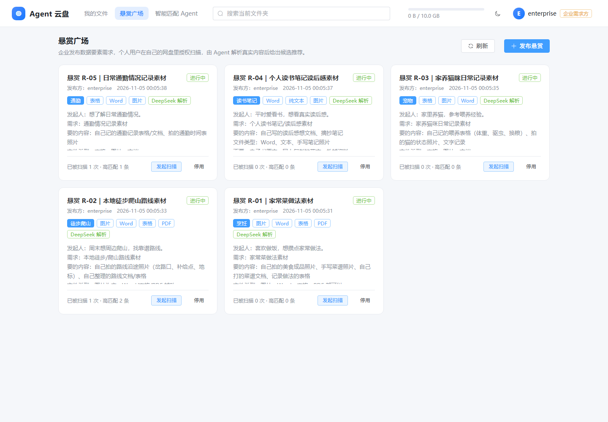

*图 4. 悬赏广场。标签展示结构化需求及其解析来源。*

### S2｜授权扫描范围（15 秒）
个人用户进入 **智能匹配 Agent**，选择悬赏后在文件夹树里勾选（例如「个人整理」「随手拍」）。只遍历勾选子树，勾选节点 ID 作为 `auth_scope_json` 落库，并在报告中回显「仅在授权范围内扫描：…」。

### S3｜实时观看扫描过程（30 秒）
点击 **开始扫描** 立即返回；前端每 400ms 轮询 `GET /api/agent/tasks/{id}/progress`，展示：当前阶段（*解析内容 → 语义判定 → 写入结果*）、**正在解析的文件名**、已处理/总数，以及逐文件事件流（含解析方式与风险标签）（图 5）。

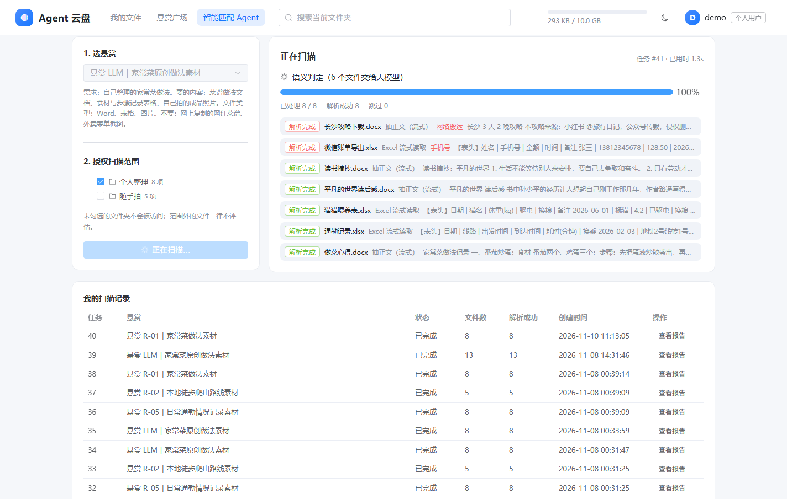

*图 5. 实时扫描。每个文件解析完就出现一行：「抽正文（流式）」「Excel 流式读取」，并标注「手机号」「网络搬运」等风险标签。*

### S4｜阅读分级报告（40 秒）
报告固定六段式：（一）需求复述；（二）范围与粗筛；（三）**实际解析的文件清单**及其解析方式；（四）分级推荐（高/中/低/不推荐）并附逐字证据；（五）高风险与排除说明；（六）人工复核提醒。含敏感信息或网络搬运的文件不进入推荐，单独列出并说明理由。

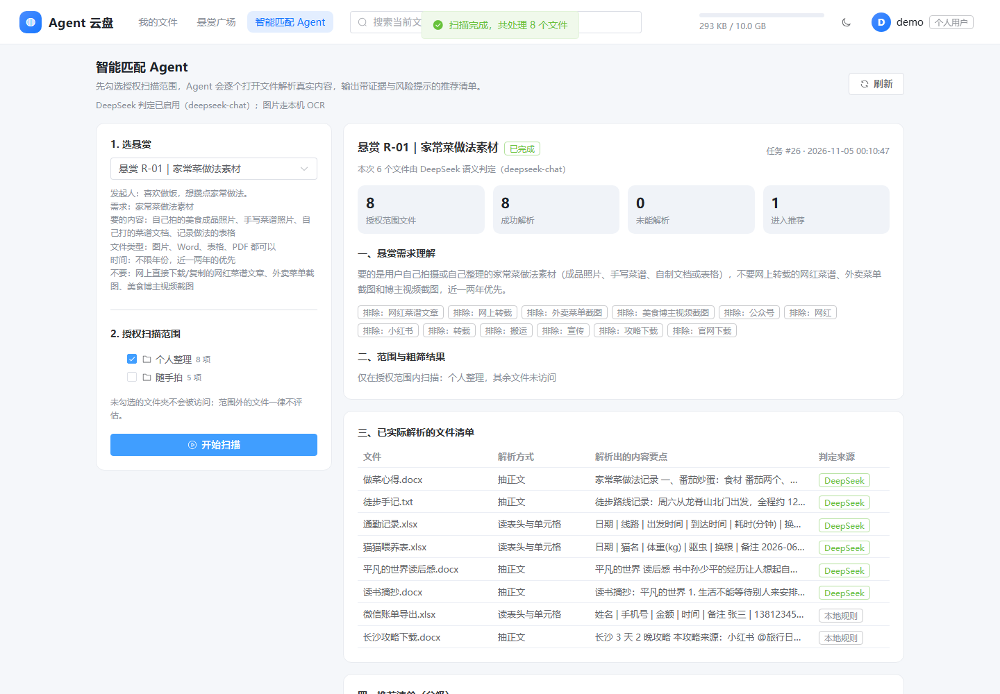

*图 6. 报告头部：统计、需求复述、排除词，以及逐文件解析方式与判定来源。*

### S5｜预览解析结果（20 秒）
每行都有 **预览**：表格用保留的表头 + 前 12 行还原成真实表格；文档显示流式抽取的正文；图片直接显示原图——并附解析方式与风险说明（图 7）。

| 表格预览 | 文档预览 |
| --- | --- |
| 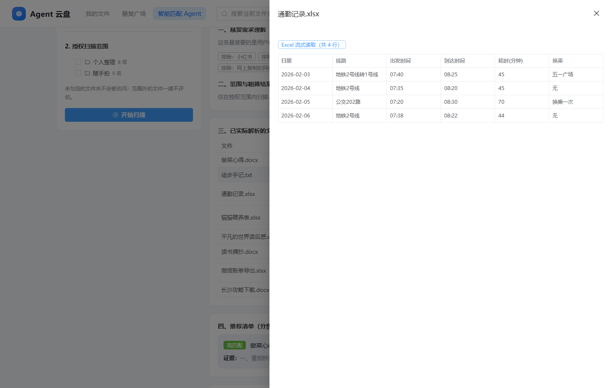 | 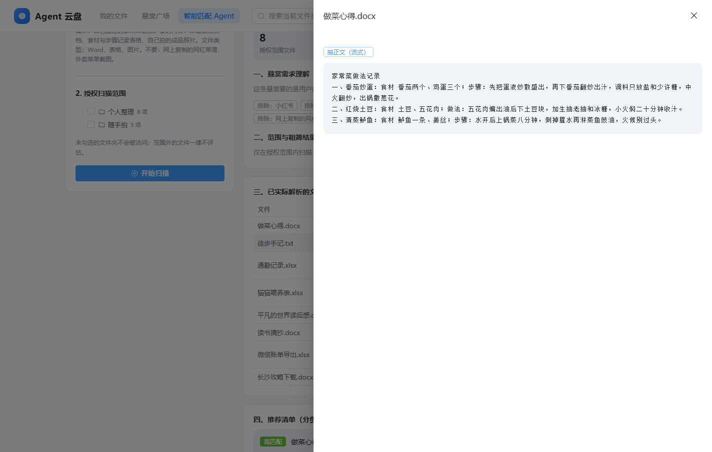 |

*图 7. 预览直接复用同一次流式解析的结果（表头 + 12 行 / 抽取正文）。*

### S6｜多平台控制台与故障切换（40 秒，可选）
管理员登记两个平台（一个真实云端地址，优先级 10；一个不可达地址，优先级 1），点 **测试** 后发起扫描：第一个平台失败，路由在同一次请求内切到下一个；失败平台被标记为不健康并冷却 60 秒，控制台显示切换次数。Key 只在录入时可见，页面永远显示 `sk-****7a07`，库里只存密文 + IV + GCM 标签（图 8）。

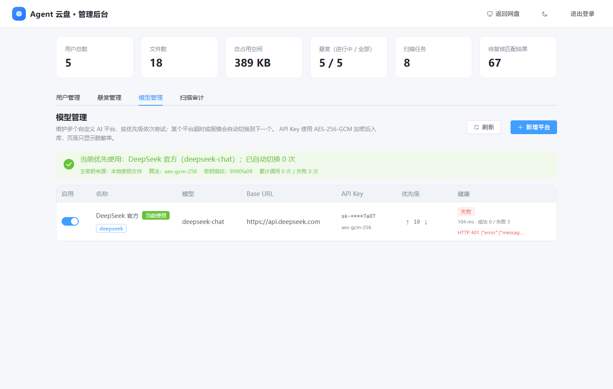

*图 8. 平台控制台：健康状态、加密标识、优先级排序、一键连通性测试。*

### S7｜复核与审计（20 秒）
个人用户把候选标记「确认可用 / 驳回」并写备注；管理员在 **扫描审计** 中看到每个任务的发起人、范围文件数、解析成功/失败数与时间戳。

### 观众可以动手的部分
| 场景 | 观众操作 | 可见结果 |
| --- | --- | --- |
| S1 | 用自己的话写一条悬赏 | 5 秒内出现结构化标签 |
| S2 | 勾选/取消文件夹 | 报告里的范围说明随之变化 |
| S3 | 开始扫描并观察 | 逐文件事件实时流入；9 个文件约 7 秒 |
| S4 | 读分级结论 | 逐字证据 + 风险标签 |
| S5 | 点预览 | 真实表格 / 正文 / 原图 |
| S6 | 故意弄坏一个平台 | 自动切换 + 冷却标识 |
| S7 | 复核并查看审计 | 决策与审计记录落库 |

---

## 4. 实现与部署（Implementation & Deployment）

### 4.1 处理流程

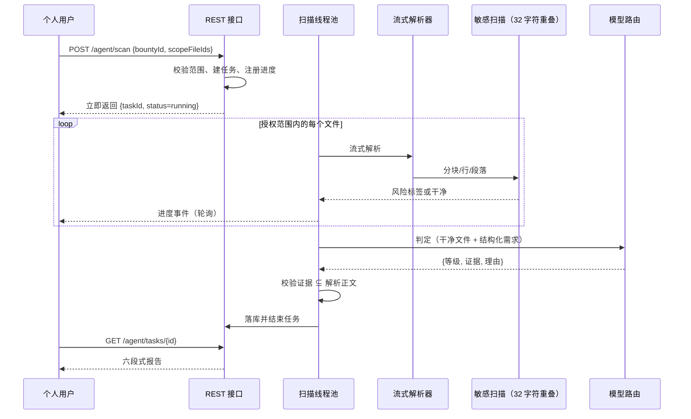

*图 9. 扫描编排。解析不占用 HTTP 线程；报告完全由落库结果组装。*

### 4.2 流式解析与「解析中即拦截」

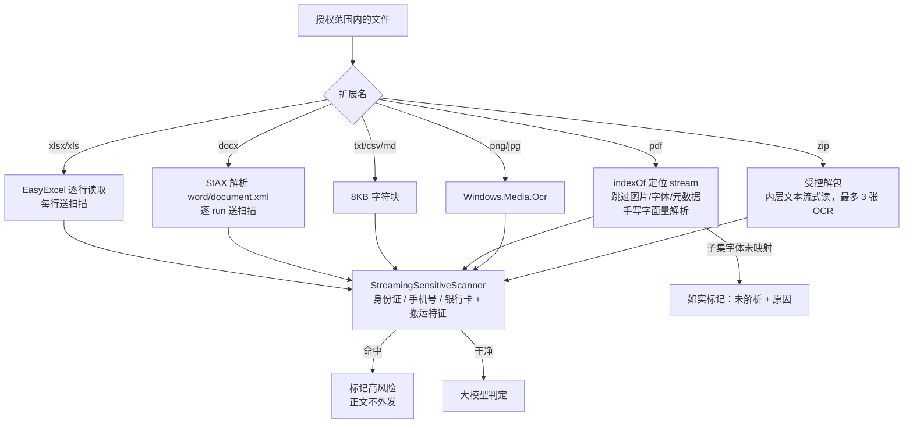

*图 10. 各格式的流式策略共用同一个扫描器。*

现场讲解的四个实现要点：

- **跨块安全。** 扫描器保留 32 字符尾部窗口，18 位身份证、11 位手机号被切在块边界也能命中；命中值展示前脱敏。
- **PDF 不靠正则。** 早期版本用 `\((?:[^()\\]|\\.)*\)` 扫**每个** stream，在一份 1.9MB、含 380KB/950KB 图片流的 PDF 上直接 `StackOverflowError`。现版用 `indexOf` 定位 `stream`/`endstream`、跳过二进制流、手写循环解析字面量（无正则、无递归）。
- **拒绝用乱码判定。** PDF 若使用嵌入子集字体且无可用 Unicode 映射，抽到的是字形码；系统会标记为「未解析并说明原因」，而不是把噪声喂给模型。
- **证据接地。** 模型返回的证据经归一化后与解析正文做子串校验，校验不过则替换为本地片段，保证界面上每一句引用都可追溯。

### 4.3 平台路由与密钥保护

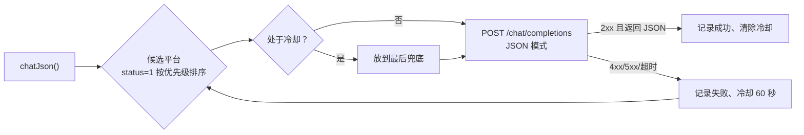

*图 11. 故障切换循环。Key 只在单次请求期间于内存中解密。*

密钥处理采用「不依赖云 KMS」的标准做法：32 字节主密钥来自 `APP_MASTER_KEY`（演示笔记本上退化为本地密钥文件，且已被 `.gitignore` 忽略）；每次加密使用全新 12 字节 IV；密文、IV、tag 分三列存储，并记录 `encrypt_algo = aes-gcm-256`。接口永不返回明文。

### 4.4 会议现场部署

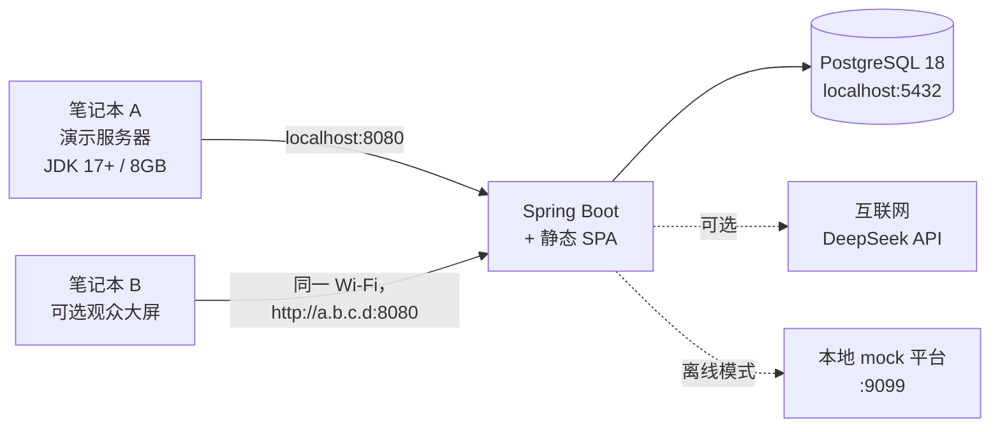

*图 12. 双笔记本展台方案；虚线为离线 mock 路径，可完全去掉网络依赖。*

| 项目 | 要求 | 说明 |
| --- | --- | --- |
| 演示服务器 | 1 台笔记本，4 vCPU / 8GB，JDK 17+，PostgreSQL 16+ | 全部 `localhost`；含种子数据约 1.2GB 磁盘 |
| 客户端 | 任意现代 Chromium 内核浏览器，≥1280×800（推荐 1440×900） | 免插件、免安装 |
| 网络 | **可选** | 有网走真实 DeepSeek；无网走自带的 OpenAI 兼容 mock（`:9099`） |
| 端口 | 8080（应用）、5432（数据库）、9099（mock，可选） | 默认只绑回环，共享给笔记本 B 时才放开 |
| 启动 | `createdb` → `./kotlin.bat run`（或打包 JAR） | Flyway 自动建 8 张表；播种 3 个账号、5 条悬赏、13 个样例文件 |
| 观众间重置 | 一条 SQL 清空 `agent_scan_task/result` | < 1 秒，保留账号与文件 |
| 演示账号 | `enterprise/ent12345`、`demo/demo1234`、`admin/admin123` | 印在展台小卡片上 |
| 兜底 | 现场断网时路由 1 秒内切到 mock，界面标注「本地规则判定」 | 已演练 |

**展台脚本（90 秒）：** 发布悬赏（S1）→ 勾选文件夹（S2）→ 开始扫描并讲解流式事件（S3）→ 打开一个表格预览（S5）→ 标记一条「确认可用」（S7）。平台控制台（S6）留给追问可靠性的评审。

### 4.5 验证方式

本演示不做对比实验，而是提供四套可现场执行、打印通过/失败的端到端脚本：

| 套件 | 覆盖内容 | 结果 |
| --- | --- | --- |
| `smoke-test` | 鉴权、配额、分片上传、秒传、回收站、后台 | 27/27 |
| `agent-smoke-test` | 角色限制、发布、授权扫描、OCR/PDF/ZIP 解析、风险排除、复核、403 隔离、审计 | 29/29 |
| `ai-provider-smoke-test` | 平台增删改查、Key 脱敏、连通性测试、故障切换、冷却、参数校验 | 29/29 |
| `scan-progress-test` | 异步任务、实时进度、预览、解析不崩溃、预览越权 | 19/19 |

演示笔记本 + 云端模型的实测：**9 个混合文件 6.8 秒**（其中 6 个由模型判定）；**5 个图片类文件 12.4 秒**（OCR 主导）。切到本地 mock 后同一范围大约再快一半。

### 4.6 伦理、隐私与合规

- **显式且最小的授权。** 未勾选的文件夹不会被打开；授权范围随任务落库并在报告中回显。注册为自助式，演示数据全部为合成数据。
- **对第三方的最小化外发。** 正文中已检出身份证、手机号、银行卡或搬运痕迹的文件在本机就被拦下；其余文本（每文件 ≤1200 字符、每次 ≤6 个文件）才发往模型。模型永远拿不到图片、压缩包或整份文档。
- **可追溯优先于流畅。** 引用证据会与解析正文校验；无法接地的模型结论降级为本地片段。系统不自动提交、不自动上传、不对外分发——脱敏与交付始终由人工决定。
- **密钥处理。** API Key 以 AES-256-GCM 加密，主密钥不进数据库、不进版本库；界面只显示脱敏串。
- **坦率暴露模型局限。** 每份报告都标注判定来自模型还是本地规则；解析不了的文件会列出原因（格式不支持、文本层乱码、OCR 无结果），既不静默丢弃，也不编造结论。
- **人工在环。** 推荐仅作建议；每条结果的复核结论与备注落库，管理员审计记录谁在何时用哪个平台扫描了什么。

---

## 5. 结论（Conclusion）

AgentCloudDisk 证明了普通网盘可以在不交出用户内容的前提下，成为可审计的数据要素市场参与者：流式解析 + 解析中隐私过滤决定了「什么能展示」「什么能出本机」，证据接地的大模型判定则把原始文件变成可复核的分级推荐。从悬赏、授权、实时扫描、预览、复核到审计的完整闭环，全部跑在一台笔记本上，有网无网都能演示。欢迎 WWW 现场观众带一个自己的文件夹，看 Agent 读它。

---

## 参考文献（References）

[1] DeepSeek-AI, Aixin Liu, Bei Feng, et al. 2024. *DeepSeek-V3 Technical Report.* arXiv:2412.19437.

[2] DeepSeek-AI, Daya Guo, Dejian Yang, et al. 2025. *DeepSeek-R1: Incentivizing Reasoning Capability in LLMs via Reinforcement Learning.* arXiv:2501.12948.

[3] Bin Wang, Chao Xu, Xiaomeng Zhao, et al. 2024. *MinerU: An Open-Source Solution for Precise Document Content Extraction.* arXiv:2409.18839.

[4] Haoran Wei, Yaofeng Sun, and Yukun Li. 2025. *DeepSeek-OCR: Contexts Optical Compression.* arXiv:2510.18234.

[5] Brandon Smock, Rohith Pesala, and Robin Abraham. 2021. *PubTables-1M: Towards Comprehensive Table Extraction from Unstructured Documents.* arXiv:2110.00061.

[6] Ildikó Pilán, Pierre Lison, Lilja Øvrelid, et al. 2022. *The Text Anonymization Benchmark (TAB): A Dedicated Corpus and Evaluation Framework for Text Anonymization.* arXiv:2202.00443.

[7] Jian Pei. 2020. *A Survey on Data Pricing: From Economics to Data Science.* arXiv:2009.04462.

[8] Mengxiao Zhang, Fernando Beltran, and Jiamou Liu. 2023. *A Survey of Data Pricing for Data Marketplaces.* arXiv:2303.04810.

[9] Yunfan Gao, Yun Xiong, Xinyu Gao, et al. 2023. *Retrieval-Augmented Generation for Large Language Models: A Survey.* arXiv:2312.10997.

[10] Lei Wang, Chen Ma, Xueyang Feng, et al. 2023. *A Survey on Large Language Model based Autonomous Agents.* arXiv:2308.11432.

---

### 附录 A — 演示交付清单

| 项目 | 状态 |
| --- | --- |
| 可运行系统（前后端一体、单端口） | ✅ |
| 预置数据集（13 个真实文件：DOCX/XLSX/PNG/ZIP/PDF）与 5 条悬赏 | ✅ |
| 离线模式（本地 OpenAI 兼容 mock） | ✅ |
| 观众间一键重置 | ✅ |
| 四套可执行测试，直接打印通过/失败 | ✅ |
| 截图与本论文（中英双语） | ✅ |
