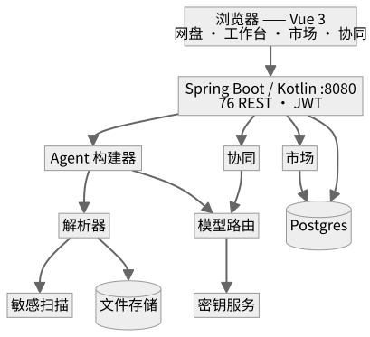
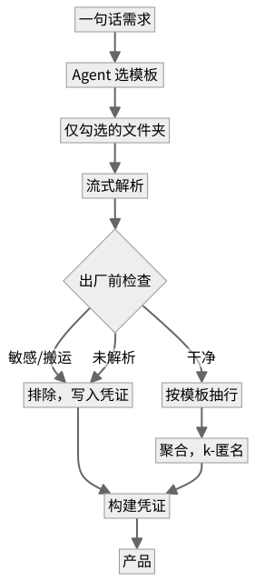

# AgentCloudDisk：用协同式大模型 Agent 把网盘文件变成可交易数据产品

**演示论文 — WWW '26 Companion（Demo Track）**

> 为双盲评审隐去作者与单位信息。
> 联系：*demo@example.org*

## CCS Concepts

• **Information systems** → *Data management systems*; *Data exchange*.
• **Computing methodologies** → *Knowledge representation and reasoning*; *Information extraction*.
• **Security and privacy** → *Data anonymization and sanitization*.
• **Human-centered computing** → *Interactive systems and tools*.

## Keywords

数据要素；网盘；大模型 Agent；多 Agent 协同；隐私保护数据发布；数据市场

## ACM Reference Format

Anonymous Author(s). 2026. AgentCloudDisk: Turning Cloud-Drive Files into Tradeable Data Products with Collaborative LLM Agents. In *Companion Proceedings of the ACM Web Conference 2026 (WWW Companion '26)*, April 13–17, 2026, Dubai, United Arab Emirates. ACM, New York, NY, USA, 4 pages.

## 摘要

有潜在价值的数据长期沉睡在个人与企业网盘里——通勤记录、菜谱笔记、喂养表格、读书摘录——而传统网盘只提供元数据检索，持有者无法把这些材料变成任何可交易之物。本文演示 **AgentCloudDisk**：一个可运行的网盘系统，由大模型 Agent 代表每位持有者行事——用户用一句自然语言说明想要什么，Agent 便选择聚合模板，用流式解析器读取其已授权的文件，聚合成满足 k-匿名 的数据产品，并上架到数据市场，由买方发布需求、市场匹配推送。演示另有两条主线：一是**多 Agent 协同**——持有者凭一段短的协同号与协同密码加入联合产品，产品随成员加入而增长；二是**本机内闭环的隐私保护**——敏感文件在任何模型调用之前就被过滤，离开成员网盘的永远只是分组统计。观众可以在单台笔记本上，用自己的文件夹描述出一个产品，再用一个协同号看着联合产品长大。

## 1 引言

数据要素已成为生产要素，数据市场也普遍让需求方发布*需求*、供给方上架*产品*。但真实的供给侧并不是整理好的数仓：原始材料以异构文件的形式躺在普通**网盘**中——通勤表格、手写菜谱照片、喂养日志、PDF 报告。

由此产生三个缺口：

1. **网盘止步于元数据。** 「把我的通勤时间按线路聚合一下」这类请求无法靠文件名检索作答，网盘也没有任何「变成产品」的能力。
2. **变成产品必须读懂内容，但不是把内容传出去。** 基于内容的聚合意味着要读文件；而把原始文档送给第三方，对个人数据不可接受。
3. **单人网盘太小而不值钱，但粗暴协同会泄露。** 一个人的通勤记录太单薄；合并多人的记录才有统计意义，但简单合并要交换原始记录，易受交叉比对攻击。

本演示用**可运行的系统**（而非界面原型）回答这三个缺口。贡献如下：

- **C1 — Agent 产出的是产品，不是检索结果。** 每位持有者的 Agent 把授权文件加工成聚合型*数据产品*，带字段模式、覆盖区间、质量分、脱敏样例与可复现的构建凭证。
- **C2 — 自然语言即可定义产品。** 用户用一句话描述需求，Agent 选择模板、给出置信度与理由，并回显将产出哪些字段。
- **C3 — 基于协同号的多 Agent 协同。** 发起方创建联合项目后得到一段**协同号**与**协同密码**；其他持有者凭两者加入，只贡献分组统计，联合产品随成员加入而增长。
- **C4 — 本机内闭环且可验证的隐私保护。** 敏感内容在任何网络调用前于本机过滤；市场只暴露聚合描述；每个产品的构建凭证把产品与源文件哈希绑定。

**现场目标：** 观众应当能用平实语言描述出一个产品、看着 Agent 解析并聚合，再用一个协同号加入联合项目并看到产品变大——全程不超过 3 分钟。

## 2 系统设计与实现

## 2.1 总体架构

*图 1. 卖方侧主闭环。持有者的 Agent 产出产品；市场始终只见描述，不见文件内容。*

AgentCloudDisk 分为三层（图 2）。**浏览器层**是一个 Vue 3 单页应用，含网盘、卖方工作台、数据市场与协同四个界面。**服务层**是单个 Spring Boot / Kotlin 进程，在 JWT 鉴权之下暴露 76 个 REST 接口。**Agent 内核**实现本演示真正关心的两项能力——产品构建与协同——并把存储、模型访问与密钥管理交给基础设施模块。

*图 2. 组件视图。除可选的模型调用外，全部逻辑运行在一个 JVM 内。*

持久化使用 PostgreSQL 18，19 张表由 9 个 Flyway 迁移管理；文件内容存放在以 SHA-256 为键的内容寻址存储中，因此不同持有者上传的相同文件只存一份，通过 `file_meta` 共享。

*图 3. 19 张表中的核心关系。file_meta 负责跨持有者去重；collab_member 记录每个成员的授权范围与贡献量。*

## 2.2 卖方 Agent：从文件到产品

卖方 Agent 是观众最先接触的部分。它提供的不是模板下拉框，而是**自然语言定义**入口：持有者输入「把我记录的通勤时间整理成按线路的平均耗时」，500 毫秒防抖后，Agent 在表单内直接返回理解结果——模板、置信度、一句话理由，以及将产出哪些字段。

模板选择分两遍进行。**规则匹配**按关键词与线索为每个内置模板打分，这一遍永远给出结果，所以没配模型时演示也能跑通。当模型可用时，**大模型判定**会拿到用户的句子与模板目录，返回模板键、`[0,100]` 的置信度、理由，以及可选的「还缺什么信息」。只有当返回的键能落到真实模板时才采纳模型结果，否则以规则结果为准。当前内置四个模板：通勤时效统计、家常菜谱库、宠物喂养记录、读书笔记主题。模板固定是刻意的——产品之间必须可比、可核对。

*图 4. 卖方侧流水线。产品只含聚合结果，因此上架不可能泄露个体记录。*

构建随后作为流水线执行（图 4）。每个文件用与其格式相配的流式读取器打开——表格用 EasyExcel 逐行、Word 用 StAX 读 `word/document.xml`、PDF 用手写字面量解析器、图片用本机 OCR、压缩包受控解包——每一块数据都送入**跨块安全的敏感信息扫描器**，它保留 32 字符尾部窗口，因此被切在块边界上的证件号依然能命中。命中扫描器的文件在任何模型调用之前就被排除，并带原因记录在凭证里。

存活的行按模板的分组维度聚合，组内样本少于 `k`（默认 3）的分组被丢弃。因此产品只含分组级统计；个体的任何一行都不会被写进产品、上架记录或协同载荷。

## 2.3 协同：凭协同号产出联合产品

单个持有者的记录往往太单薄，不值上架。协同让多个持有者合并统计而不合并文件（图 5）。

*图 5. 基于协同号的协同流程。只有发起方可以上架；成员可查看并扩展自己的范围。*

发起方像单人流程一样描述联合产品、勾选文件夹，随后拿到一个 8 位**协同号**与 6 位**协同密码**。协同号取自去掉 `0/O/1/I` 的字母表，可以电话口述或写在展台卡片上；唯一性由数据库索引保证，密码以 BCrypt 哈希存储且只显示一次。

同伴兑换这两项之后，**在提交任何数据之前**先看到**邀请预览**：标题、发起人、当前成员，以及产品将包含哪些字段。加入时同伴勾选自己的文件夹，其 Agent 在本地聚合，只上传得到的分组统计。合并采用**并集**：只要任一方覆盖该分组就保留，并用 `sources` 字段记录该分组有几方支撑——这正是产品随成员加入而变大、而不是收缩为交集的原因。

*图 6. 协同状态机。上架是终态：一旦上架，后续加入会被拒绝。*

上架权归发起方且是终态：上架后会话不再接受成员，产出产品以 `source_kind = joint` 标记，买方可以据此看出它由多方数据汇集而成。这样既让上架记录的责任始终落在一个主体上，又允许多方贡献数据。

## 2.4 市场与交付

市场一侧刻意做薄，因为本演示的贡献在 Agent 侧。买方用自然语言发布需求；市场把它解析成与产品相同的结构化表示，按关键词与品类硬过滤在架货源，再对存活项按关键词重合、时间覆盖、质量与价格打分，最后把 Top-N 连同可读的命中理由一起推送，例如「命中关键词：通勤、耗时；覆盖截至 2026-03」。货源详情展示字段、覆盖区间、质量、脱敏样例与构建凭证——绝不展示源文件名。

交付是三状态握手：买方申请、卖方受理、卖方标记已交付。不传数据体，与演示定位一致。

## 3 演示场景

展台动线约 3 分钟，跨三个页面、使用两个账号；每个账号都是双向的。

**S1｜一句话描述产品（30 秒）.** 持有者输入一句话，看着理解结果出现在表单旁。*输入：* 不超过 200 字。*输出：* 模板、置信度、理由与字段清单。四个内置模板都能由自然表述命中；像「我想卖点数据」这样的模糊输入也仍能落定，只是置信度较低并标注了假设。

**S2｜看 Agent 解析与聚合（30 秒）.** 持有者勾选文件夹并开始构建。弹窗逐文件流式显示事件——已解析、Excel 流式读取、跳过——最后给出产品卡，报告分组数、贡献文件数与质量分，并附四行聚合结果预览。5 行表格约 4.5 秒成产品。若描述与所选文件不匹配，卡片会明确说明，而不是给出一个空白产品。

**S3｜用协同号加入联合产品（45 秒）.** 讲者创建联合项目并把协同号递给观众，观众兑换、查看邀请预览、勾选自己的文件夹并加入。分组数立即增长，双方都能看到；成员之后还可以追加文件夹继续做大。发起人与成员的界面恰在该不同处不同：只有发起人看到上架按钮。

**S4｜市场匹配与推送（30 秒）.** 买方发布需求；市场返回带理由的排序推送。观众可以检查货源里确实没有出现任何原始文件名。

**S5｜最小化交付握手（15 秒）.** 买方申请、卖方受理、卖方标记已交付。

## 4 验证与伦理考量

## 4.1 脚本化端到端验证

我们不做离线基准，而是随产物提供六套可在真实系统上执行的脚本（表 1）。每套都在 REST 面上断言用户可见行为，因此一次通过的运行意味着所演示的流程确实可用。

**表 1：随产物提供的脚本化端到端测试套件。**

| 套件 | 覆盖范围 | 检查项 |
| --- | --- | --- |
| `collab-code-test` | 协同号与密码格式、邀请预览、错误密码、加入后产品增大、重复加入幂等、非发起方上架被拒、上架后禁止加入、非成员隔离 | 29 |
| `market-smoke-test` | 含源文件哈希的构建凭证、上架下架与推送失效、需求匹配与命中理由、交付状态、联合产品来源标记 | 37 |
| `seller-intent-test` | 四种自然语言表述映射到预期模板、模糊输入仍能落定、由描述直接建产品、默认开启模型 | 11 |
| `smoke-test` | 鉴权、配额、分片上传、秒传、回收站、后台管理 | 27 |
| `scan-progress-test` | 异步构建、实时进度、预览、解析不崩溃、预览鉴权 | 18 |
| `ai-provider-smoke-test` | 平台增删改查、Key 脱敏、连通性测试、故障切换与冷却 | 28 |

**实测行为.** 在演示笔记本加云端模型上，5 行表格端到端成产品（解析、聚合、描述）耗时 **4.5 秒**；联合产品在第二位成员加入后 1 秒内即显示首次增长。模型平台之间的故障切换在 1 秒内完成，之后界面会标注判定为规则结果，而不是静默降级。

## 4.2 隐私与伦理考量

**显式且最小的授权.** 只有勾选的文件夹会被打开；授权范围按成员持久化，并在协同页回显。账号为自助注册，全部演示数据为合成数据。

**构造上就是聚合.** 产品只含分组级统计，并用 k-匿名 丢弃稀疏分组。个体的行永远不会写进产品、上架记录或协同载荷，因此即便买方带有对抗意图，上架也不可能泄露某条记录。

**对第三方最小化外发.** 正文里已含身份证、手机号、银行卡或搬运特征的文件在本机就被过滤；只有剩余文本（每文件至多 1200 字符、每次至多 6 个文件）或用户显式要求的图片才会发给模型。模型不会收到未被要求的图片、压缩包或整份文档。

**可追溯优先于流畅.** 模型返回的证据必须在解析正文中逐字出现，校验不过就替换为本地片段。构建凭证把每个产品与源文件哈希绑定并展示给买方，因此上架内容可以与实际读取的内容核对。

**密钥处理.** 平台 Key 采用 AES-256-GCM 加密，主密钥放在数据库与版本库之外。协同密码以 BCrypt 哈希保存、只显示一次，并通过专门的视图对象从所有响应中剥离——有自动化断言检查任何响应都不含密码哈希。

**人工在环与坦率暴露局限.** Agent 只做建议与组装；联合产品的上架权仅归发起方，交付是人工握手。每个产品都会说明模型是否参与，解析不了的文件会列出原因，而不是静默丢弃。

## 4.3 与已有系统的关系

**表 2：AgentCloudDisk 与其所借鉴的三类系统的对比。**

| 系统类型 | 数据在哪 | 产出形态 | 可多方协同 | 原始文件是否离开持有者 |
| --- | --- | --- | --- | --- |
| 消费级网盘 | 用户网盘 | 文件 | 否 | 是（在服务端） |
| 商业数据市场 | 已整理数仓 | 数据集 | 否 | 是 |
| 联邦学习平台 | 持有者设备 | 模型更新 | 是 | 否 |
| **AgentCloudDisk** | 用户网盘 | 聚合数据产品 | 是（协同号） | 否（仅聚合结果） |

表 2 给出系统的定位。相对于消费级网盘，它增加了*产品*这层抽象，以及一个能用一句话把产品建出来的 Agent。相对于商业数据市场，它去掉了「供给方必须已经持有整理好的数仓」这一前提：供给方就是普通持有者，整理工作由 ta 的 Agent 完成。相对于联邦学习，它面向的是另一种产物——不是模型，而是非专业买方在付费前就能查看的分组统计数据。表中没有任何一行能单独表达我们认为的贡献所在：能构建产品的 Agent、能引入协作者的短协同号，以及让买方可以同时核对这两者的一份凭证。

## 4.4 局限性

有三点局限值得直接说明。第一，模板集是封闭的：若请求的产品类型落在四个内置模式之外，系统只会以较低置信度落到最接近的模板，而不会生成新的抽取规则，因此当前出售的是聚合*表格*，而非任意数据产品。第二，并集合并是务实的做法而非形式化的隐私保证：它阻止了原始记录交换并丢弃稀疏分组，但如果某成员用重叠但略有不同的授权范围反复加入，理论上仍可能通过差分把分组收窄——这正是我们计划改用差分隐私估计量的原因。第三，协同会话是单发起方、一次性的：目前没有轮换泄露密码的入口，也无法把一次会话分叉成第二个产品，只能从头新建。

## 5 结论

AgentCloudDisk 表明，普通网盘可以在不交出内容的前提下参与数据要素市场：流式解析加本机隐私过滤决定了「什么能展示、什么能离开这台机器」，大模型 Agent 把授权文件按一句话请求变成 k-匿名产品，而一段短协同号让多个持有者把各自的统计汇总成随成员增长的联合产品。从描述、构建、协同、上架、匹配到交付的完整闭环，全部跑在一台笔记本上，有网无网都能演示。后续工作我们打算开放模板层，让持有者自定义聚合模式，并把并集合并替换为差分隐私估计量，使联合产品在更强形式化保证下依然有用。

## 参考文献

[1] DeepSeek-AI, Aixin Liu, Bei Feng, et al. 2024. DeepSeek-V3 Technical Report. arXiv:2412.19437.

[2] Bin Wang, Chao Xu, Xiaomeng Zhao, et al. 2024. MinerU: An Open-Source Solution for Precise Document Content Extraction. arXiv:2409.18839.

[3] Haoran Wei, Yaofeng Sun, and Yukun Li. 2025. DeepSeek-OCR: Contexts Optical Compression. arXiv:2510.18234.

[4] Brandon Smock, Rohith Pesala, and Robin Abraham. 2021. PubTables-1M: Towards Comprehensive Table Extraction from Unstructured Documents. arXiv:2110.00061.

[5] Ildikó Pilán, Pierre Lison, Lilja Øvrelid, et al. 2022. The Text Anonymization Benchmark (TAB): A Dedicated Corpus and Evaluation Framework for Text Anonymization. arXiv:2202.00443.

[6] Jordi Soria-Comas. 2013. Improving Data Utility in Differential Privacy and k-Anonymity. arXiv:1307.0966.

[7] Jian Pei. 2020. A Survey on Data Pricing: From Economics to Data Science. arXiv:2009.04462.

[8] Mengxiao Zhang, Fernando Beltran, and Jiamou Liu. 2023. A Survey of Data Pricing for Data Marketplaces. arXiv:2303.04810.

[9] Khanh-Tung Tran, Dung Dao, Minh-Duong Nguyen, et al. 2025. Multi-Agent Collaboration Mechanisms: A Survey of LLMs. arXiv:2501.06322.

[10] Lei Wang, Chen Ma, Xueyang Feng, et al. 2023. A Survey on Large Language Model based Autonomous Agents. arXiv:2308.11432.

[11] Yunfan Gao, Yun Xiong, Xinyu Gao, et al. 2023. Retrieval-Augmented Generation for Large Language Models: A Survey. arXiv:2312.10997.

[12] Zicun Cong, Xuan Luo, Jian Pei, et al. 2021. Data Pricing in Machine Learning Pipelines. arXiv:2108.07915.
