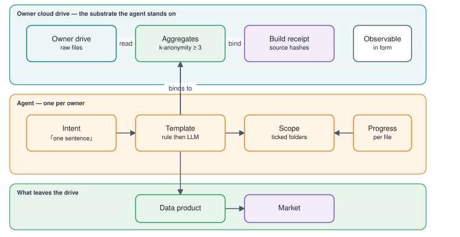
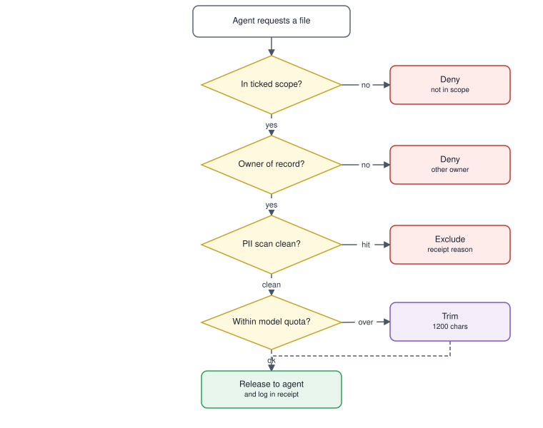

# AgentCloudDisk：把大模型 Agent 绑定到个人网盘以构建数据产品

**演示论文 — WWW '26 Companion（Demo Track）**

> 为双盲评审隐去作者与单位信息。
> 联系：*demo@example.org*

## CCS Concepts

• **Information systems** → *Data management systems*; *Data exchange*. • **Computing methodologies** → *Knowledge representation and reasoning*; *Information extraction*. • **Security and privacy** → *Data anonymization and sanitization*. • **Human-centered computing** → *Interactive systems and tools*.

## Keywords

网盘；大模型 Agent；Agent 与网盘的绑定；受限数据访问；多 Agent 协同；数据产品

## ACM Reference Format

Anonymous Author(s). 2026. AgentCloudDisk: Binding an LLM Agent to a Personal Cloud Drive for Data-Product Construction. In *Companion Proceedings of the ACM Web Conference 2026 (WWW Companion '26)*, April 13–17, 2026, Dubai, United Arab Emirates. ACM, New York, NY, USA, 4 pages.

## 摘要

网盘存着个人的数据，却读不懂其中任何一份：它能按文件名取回文件，却不能按语义给出一个事实。大模型 Agent 恰恰读得懂内容，但把一个 Agent 摆在网盘旁边，它既没有可循的方式去够到该读的文件，也无法证明自己读了什么、并把其余部分留在原地。我们认为真正值得做的问题既不是造网盘、也不是造 Agent，而是把两者绑定起来，即给 Agent 一个受限、可归因、可撤销的视图。本文演示 AgentCloudDisk，一个把该绑定落到三个面上的可运行系统：权责面把 Agent 限制在持有者勾选过的文件夹内，并限制为该持有者的身份；暴露面让文件字节与其归约都留在网盘所在主机上，因此模型只收到有界摘录、买方只收到 k-匿名聚合；溯源面为每个产品附一份凭证，把它绑定到读过的源文件哈希与被它拒绝的文件。该绑定还能跨持有者组合：一段短协同号让多个网盘各自贡献分组统计而非文件，联合产品随成员加入而增大。观众可以用一句话从自己的文件夹描述出产品、观察 Agent 的受限读取，并用一个协同号加入联合产品。

## 1 引言

个人与企业网盘承载着世界上相当大比例的数据，但它们始终是被动的存储。网盘知道路径、大小和时间戳，只要报出文件名它就会交出文件，但它不知道表格的某一列记的是通勤耗时、某个相册是一叠票据，也不知道十二个文件合起来描述的是某段习惯。大语言模型（LLM）恰好懂得这些，而近期关于 LLM Agent 的研究表明，这类模型能够规划、调用工具并代表用户行动 [10]。因此把 Agent 放到网盘旁边是很自然的一步，本文的问题也从这里开始。

一个对网盘拥有不受限访问权的 Agent 是负担：它会读到一切、留存一切，并把摘录转发给模型服务商。一个毫无访问权的 Agent 则毫无用处。现有系统对这一张力采取的是隐式而非显式的处理方式。文件助手继承网盘自身的权限模型，而那套模型是为「分享给人」设计的，不是为「委托给一个会调用第三方服务的进程」设计的。数据市场系统假设已经存在整理好的数仓，从而绕开了「数仓如何形成」这一问题。联邦学习回应了暴露问题 [13]，但它产出的是模型，而非可核查的产品。于是「不受限」与「无用」之间的设计空间长期未被充分探索，我们把它刻画为网盘-Agent 系统必须显式回答的三个问题：Agent 能打开哪些文件、代表谁、为期多久；究竟什么东西越过了网盘边界；以及事后能否有人核验 Agent 读到了什么、丢弃了什么。

为回答这些问题，我们提出 AgentCloudDisk，其贡献是一个 Agent 与单个网盘之间的绑定层，而非「网盘加挂 Agent 功能」。该绑定由三个面构成。权责面以按持有者持久化的授权范围来定义访问，并逐文件复核，因此范围之外一律被拒绝，而不是被降级处理。暴露面把解析、去标识与聚合放在网盘所在主机内执行，因此模型只看到按字数限定的摘录，市场只看到聚合结果。溯源面产出构建凭证，把产品绑定到源文件哈希、聚合参数与排除记录。最后，同一份绑定可以跨持有者组合：一段协同号引入协作者，各自运行自己的受限绑定，只交换分组统计而非文件。

我们以可运行的演示系统而非界面原型来实现这一设计，并用六套脚本化测试套件在 REST 接口上断言用户可见行为。本文的贡献可概括如下：

• 我们把 Agent 与网盘的绑定识别为「把网盘内容变成数据产品」这一问题的核心设计问题，并将其分解为权责、暴露与溯源三个面。

• 我们在一个可运行系统中实现了该绑定：默认情况下模型不会收到任何文件字节，且每个产品都带有买方无需访问网盘即可核查的凭证。

• 我们证明该绑定可以跨持有者组合，使多个网盘共同贡献于同一个联合产品，而没有任何文件离开其持有者的机器。

后文依次介绍系统的设计与实现（第 2 节）、演示流程（第 3 节）、实现要点与伦理考量（第 4 节）、验证（第 5 节）、局限（第 6 节）与结论（第 7 节）。

## 2 系统设计与实现

## 2.1 三个绑定面

网盘是底座，Agent 站在其上，三个面把两者连接起来，如图 1 所示。权责面是持有者看到的那一层：一句描述目标产品的话（Agent 把它转成模板选择），以及一棵可勾选的文件夹树。Agent 得到的不是路径前缀，而是一份按持有者持久化的范围记录，每次打开文件都要与该记录核对。暴露面由网盘自身承担：解析、敏感信息扫描与聚合都在网盘主机内执行，于是模型收到的是有界摘录，买方收到的是聚合结果。溯源面是凭证，它随 Agent 的工作逐步写入，并与产品一同发布。

*图 1. 一个 Agent 与一个网盘之间的绑定有三个面，其中只有暴露面与溯源面会在网盘之外产生可观察物。*

## 2.2 Agent 究竟需要网盘的什么

值得精确说明哪些网盘原语与 Agent 相关，因为这解释了绑定为何不能简单复用分享链接。如图 2 所示，文件树对应受限读取，内容字节对应流式读取，持有者身份对应归属，分享链接对应受众控制。

*图 2. 网盘原语投影到 Agent 需求上：文件树变成受限读取，内容字节变成流式读取，持有者身份变成归属，分享链接变成受众控制。*

文件树对应受限读取，因为 Agent 必须只枚举被授予的子树，并且要能确信枚举行为不会把该子树撑大。内容字节对应流式读取，因为 Agent 必须处理超过内存的文件，以及模型无法直接吞下的格式。持有者身份对应归属，因为每个产品都要能追溯到一个可问责的主体，这正是联合产品的发布权必须留给发起方的原因。分享链接对应受众控制：链接给人的是某个文件的宽泛访问，而 Agent 需要的是对某个计算结果的窄访问。因此本系统不向 Agent 暴露分享链接，也不暴露路径前缀，只给它一份范围记录、一个流式读取器和一支写凭证的笔。

## 2.3 访问生命周期

图 3 追踪一次请求在五条泳道上的流转。Agent 先绑定到一个范围，向模型询问模板，然后严格在范围内读取。每一块数据都要先过主机侧扫描器才可使用，命中扫描器的文件被排除，原因写入凭证。存活的行被聚合，只有聚合结果离开网盘。随后 Agent 解绑，范围被释放，凭证关闭。

*图 3. 一次请求在五条泳道上的访问生命周期。网盘只在绑定范围内打开字节，模型从不接收字节，凭证写在网盘一侧。*

这个生命周期有两点对演示很重要。第一，模型不在数据通路上：它为模板选择提供建议、协助描述结果，但默认没有任何文件内容经过它。第二，凭证写在数据所在之处，因此不会被被审计方改写。

## 2.4 守住边界

只有当检查是显式的而非涌现的，绑定才可信，因此我们把它实现为一条守卫链，如图 4 所示。打开文件的请求在以下情形被拒绝：落在勾选范围之外、调用者不是记录上的持有者、或主机侧扫描发现标识信息。通过扫描但超出单次模型预算的文件会被裁剪而不是丢弃，裁剪同样被记录。每个分支都写下结果，使被拒绝的读取与成功的读取一样可见。

*图 4. 每次打开文件前都要经过的守卫链。拒绝与排除都会被记录，而非静默发生。*

## 2.5 暴露边界

图 5 以显式清单的形式陈述这条边界。左列永远不离开网盘，包括原始文件、图片与压缩包、完整文档、明文密钥、个体的每一行，以及任何本身已带标识信息的文件。右列是可以越界的部分，即持有者的那句话、按字数限定的摘录、持有者显式要求的图片、分组聚合以及凭证。

*图 5. 什么留在网盘内、什么可以离开。这条分界线源于设计，而非源于配置。*

有界摘录值得单独说明，因为它是唯一可能把源自文件的文本送到模型处的通道。该通道上限为每文件 1200 字符、每次调用 6 个文件；正文已含身份证号、手机号、银行卡或搬运特征的文件会在任何调用发出之前被过滤，因此该上限作用于已经干净的文本。

## 2.6 把绑定扩展到多个持有者

单个持有者的网盘常常不足以支撑一个值得上架的产品，因此同一份绑定可以横向组合，如图 6 所示。多个持有者各自保留自己的范围、各自执行主机侧归约，只交换分组统计。发起方得到一个 8 位协同号与 6 位协同密码，其字母表刻意去掉了 `0`、`O`、`1`、`I`，以便口述；兑换两者的协作者在提交任何数据之前会先看到邀请预览。合并是在分组键上取并集，每个分组都附带一个记录支撑网盘数量的字段，这正是联合产品能随成员加入而变大的原因。

*图 6. 协同就是把同一份绑定按持有者各做一遍。每个网盘在本地归约，中心只观察到分组统计。*

发布权仍归发起方，因为即使数据来自多方，归属也必须落在一个可问责的主体上。因此市场把联合产品与单方产品同等对待，仅以溯源标记与凭证中的贡献者列表区分。

## 3 演示

演示围绕绑定的三个面组织，观众无需离开浏览器即可从一个面走到下一个面。

## 3.1 描述产品

观众从权责面开始，输入诸如「把我记录的通勤时间整理成按线路的平均耗时」这样一句话。Agent 回以模板、置信度、一句话理由，以及它打算产出的字段。模板选择分两遍进行：规则匹配器按关键词重合度为每个内置模板打分，并总能给出答案；当配置了模型时，再由大模型对候选重新排序。系统内置四个模板，分别是通勤时效统计、家常菜谱库、宠物喂养记录与读书笔记主题。固定模板集是刻意的，因为产品之间必须保持可比。

## 3.2 受限读取

观众随后勾选一个或多个文件夹并开始构建，此时暴露面变得可观察。弹窗逐文件流式显示事件，例如读取、解析、跳过、带原因排除，最后给出产品卡，报告分组数、参与文件数与质量分，并附四行聚合预览。正文带标识信息的文件在任何模型调用之前即被排除，卡片上用平实语言陈述这条隐私规则。若描述与勾选的文件夹不一致，卡片会报告这一不一致，而不是给出一个空白产品。

## 3.3 协同

为演示跨持有者的绑定，讲者创建一个联合产品，并把 8 位协同号连同密码递给一位观众。在提交任何数据之前，该观众会看到邀请预览，列出标题、发起方、当前成员以及产品将包含的字段。勾选文件夹并加入后，分组数立即上升且双方都能看到，而只有发起方的界面带有发布控件。

## 3.4 边界核查

买方用自然语言发布需求，市场返回带可读理由的排序推送。随后观众可以打开一个货源，核对其中没有源文件名、没有个体行，并且其凭证记录的哈希与卖方贡献的文件一致。最后以三状态握手收尾：买方申请交付、卖方受理、卖方标记为已交付，全程不传数据体。

## 4 实现与伦理

该绑定实现在单个 Spring Boot 与 Kotlin 进程内，上述各个面对应的是模块而非部署单元。

有三处实现选择塑造了这一设计。范围以记录而非路径前缀的形式保存：授权范围按持有者、按协同成员持久化，并在协同页回显，这多花一张表，却让撤销与审计变得简单，并允许从成员自己的范围重算其贡献。流式读取是主机侧归约可行的前提：表格逐行读、Word 通过流式 XML 拉解析器读、PDF 通过手写字面量解析器读、图片通过本机光学字符识别读、压缩包受控解包。敏感扫描器在块边界之间保留 32 字符尾部窗口，因此被切在两次读取之间的证件号依然会被检出，而这个细节之所以重要，正是因为读取是流式的。最后，凭证充当产品的契约：它记录源文件哈希、聚合参数、若咨询过模型则记录模型版本，以及每条带原因的排除，使买方可以在不访问网盘的前提下用证据核对一个上架内容。

全部演示数据为合成数据；系统设计为只打开勾选的子树，授权范围被持久化并回显给持有者。聚合满足 k-匿名，默认 k 为 3。正文已带个人标识的文件在任何模型调用之前于主机侧被过滤；模型返回的证据必须在解析正文中逐字出现，否则替换为本地片段。平台密钥以 AES-256-GCM 加密，主密钥置于数据库之外；协同密码以哈希保存、只显示一次，且任何接口都不会返回。

## 5 验证

我们不做离线基准，而是提供六套可在真实系统上执行的脚本，汇总于表 1。每套脚本都在 REST 接口上断言用户可见行为，因此一次通过的运行意味着所演示的流程端到端可用。

**表 1：随产物提供的脚本化端到端测试套件。**

| 套件 | 覆盖范围 | 检查项 |
| --- | --- | --- |
| `collab-code-test` | 协同号与密码格式、邀请预览、错误密码、加入后产品增大、重复加入幂等、非发起方发布被拒、发布后关闭、外部人员隔离 | 29 |
| `market-smoke-test` | 含源文件哈希的凭证、上架与下架、需求匹配与理由、交付状态、联合产品的溯源 | 37 |
| `seller-intent-test` | 四种自然语言表述映射到预期模板、模糊输入仍能落定、由描述直接建产品 | 11 |
| `drive-smoke-test` | 鉴权、配额、断点续传上传、去重、回收站 | 27 |
| `scan-progress-test` | 异步构建、实时进度、解析不崩溃、预览鉴权 | 18 |
| `ai-provider-test` | 平台管理、Key 脱敏、连通性、带冷却的故障切换 | 28 |

在演示笔记本加云端模型上实测：5 行表格端到端成产品耗时 4.5 秒；联合产品在第二位成员加入后 1 秒内显示首次增长；守卫链因为作用于已缓冲的数据块，未带来可测延迟。

## 6 局限

有三点局限值得直接说明。模板集是封闭的，落在四个内置模式之外的请求只会以较低置信度落到最接近的模板，而不会生成新的抽取规则，这意味着系统出售的是聚合表格，而非任意数据产品。并集合并是务实做法而非形式化隐私保证：它阻止了记录交换并丢弃稀疏分组，但若有对手用重叠范围反复加入，理论上仍可能通过差分把分组收窄，这正是我们计划改用差分隐私估计量的动因。最后，绑定是按请求而非持续的：Agent 在一次构建期间持有范围，随后释放，因此既没有常设授权，也没有「长期观察某个文件夹」的 Agent 概念。

## 7 结论与未来工作

本文论证了有意思的工程位于网盘与 Agent 之间，而不在其中任何一侧。我们展示了网盘只需借给 Agent 三样东西，即受限的权责、主机侧归约边界与凭证，就足以让它读取个人文件、跨网盘协同并发布可审计的产品，而任何文件都不离开其持有者的机器。未来工作方面，我们计划开放模板层使持有者可以定义自己的聚合模式，把并集合并替换为差分隐私估计量，并研究「持续绑定」，即 Agent 在常设授权下长期观察某个文件夹。

## 参考文献

[1] DeepSeek-AI, Aixin Liu, Bei Feng, et al. 2024. DeepSeek-V3 Technical Report. arXiv:2412.19437.

[2] Bin Wang, Chao Xu, Xiaomeng Zhao, et al. 2024. MinerU: An Open-Source Solution for Precise Document Content Extraction. arXiv:2409.18839.

[3] Haoran Wei, Yaofeng Sun, and Yukun Li. 2025. DeepSeek-OCR: Contexts Optical Compression. arXiv:2510.18234.

[4] Brandon Smock, Rohith Pesala, and Robin Abraham. 2021. PubTables-1M: Towards Comprehensive Table Extraction from Unstructured Documents. arXiv:2110.00061.

[5] Ildikó Pilán, Pierre Lison, Lilja Øvrelid, et al. 2022. The Text Anonymization Benchmark (TAB): A Dedicated Corpus and Evaluation Framework for Text Anonymization. arXiv:2202.00443.

[6] Jordi Soria-Comas. 2013. Improving Data Utility in Differential Privacy and k-Anonymity. arXiv:1307.0966.

[7] Jian Pei. 2020. A Survey on Data Pricing: From Economics to Data Science. arXiv:2009.04462.

[8] Mengxiao Zhang, Fernando Beltran, and Jiamou Liu. 2023. A Survey of Data Pricing for Data Marketplaces. arXiv:2303.04810.

[9] Khanh-Tung Tran, Dung Dao, Minh-Duong Nguyen, et al. 2025. Multi-Agent Collaboration Mechanisms: A Survey of LLMs. arXiv:2501.06322.

[10] Lei Wang, Chen Ma, Xueyang Feng, et al. 2023. A Survey on Large Language Model based Autonomous Agents. arXiv:2308.11432.

[11] Yunfan Gao, Yun Xiong, Xinyu Gao, et al. 2023. Retrieval-Augmented Generation for Large Language Models: A Survey. arXiv:2312.10997.

[12] Zicun Cong, Xuan Luo, Jian Pei, et al. 2021. Data Pricing in Machine Learning Pipelines. arXiv:2108.07915.

[13] Di Chai, Leye Wang, Liu Yang, et al. 2023. A Survey for Federated Learning Evaluations: Goals and Measures. arXiv:2308.11841.
