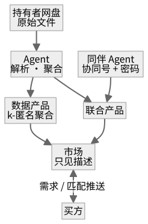
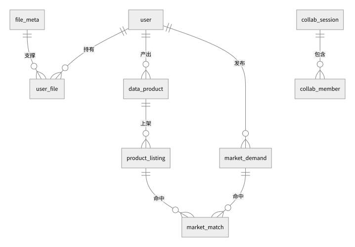
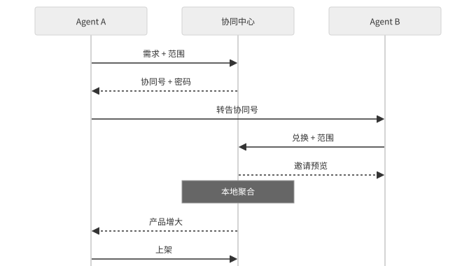
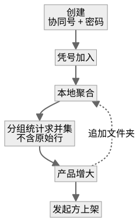

# AgentCloudDisk：把个人数据变成可交易数据产品的多 Agent 网盘系统（演示）

**演示论文 — WWW '26 Companion（Demo Track）**

> 为双盲评审隐去作者与单位信息。
> 联系：*demo@example.org* · 系统与数据：可运行系统 + 预置演示数据（录用后公开）

---

## 摘要（Abstract）

有潜在价值的数据长期沉睡在个人与企业网盘里——通勤记录、菜谱笔记、喂养表格、读书摘录——而传统网盘只提供元数据检索，持有者无法把这些材料变成任何可交易之物。本文演示 **AgentCloudDisk**：一个可运行的网盘系统，由大模型 Agent 代表每位持有者行事——用户用一句自然语言说明想要什么，Agent 便选择聚合模板，用流式解析器读取其**已授权**的文件（表格逐行流式读、Word 走 StAX、PDF 用非递归手写解析、图片用本机 OCR、压缩包受控解包），聚合成满足 k-匿名 的数据产品，并上架到数据市场，由买方发布需求、市场匹配推送。演示另有两条主线：一是**多 Agent 协同**——持有者凭一段短的协同号与协同密码加入联合产品，产品随成员加入单调增大；二是**本机内闭环的隐私保护**——敏感文件在任何模型调用之前就被过滤，模型给出的证据要与解析正文逐字校验，且离开成员网盘的永远只是分组统计。观众可以在单台笔记本上，用自己的文件夹描述出一个产品，再用一个协同号看着联合产品长大。

**关键词：** 数据要素；网盘；大模型 Agent；多 Agent 协同；隐私保护数据发布；数据市场

---

## 1. 引言（Introduction）

数据要素已成为生产要素，数据市场也普遍让需求方发布*需求*、供给方上架*产品*。但真实的供给侧并不是整理好的数仓：原始材料以异构文件的形式躺在普通**网盘**中——通勤表格、手写菜谱照片、喂养日志、PDF 报告。

由此产生三个缺口：

1. **网盘止步于元数据。** 「把我的通勤时间按线路聚合一下」这类请求无法靠文件名检索作答，网盘也没有任何「变成产品」的能力。
2. **变成产品必须读懂内容，但不是把内容传出去。** 基于内容的聚合意味着要读文件；而把原始文档送给第三方，对个人数据不可接受。
3. **单人网盘太小而不值钱，但粗暴协同会泄露。** 一个人的通勤记录太单薄；合并多人的记录才有统计意义，但简单合并要交换原始记录，易受交叉比对攻击。

本演示用**可运行的系统**（而非界面原型）回答这三个缺口。贡献如下：

- **C1 — Agent 产出的是产品，不是检索结果。** 每位持有者的 Agent 把授权文件加工成聚合型*数据产品*，带字段模式、覆盖区间、质量分、脱敏样例与可复现的构建凭证。
- **C2 — 自然语言即可定义产品。** 用户用一句话描述需求，Agent 选择模板、给出置信度与理由，并回显将产出哪些字段——用户无需理解任何模板术语。
- **C3 — 基于协同号的多 Agent 协同。** 发起方创建联合项目后得到一段**协同号**与**协同密码**；其他持有者凭两者加入，只贡献分组统计，联合产品随成员加入而增长。
- **C4 — 本机内闭环且可验证的隐私保护。** 敏感内容在任何网络调用前于本机过滤；市场只暴露聚合描述；每个产品的构建凭证把产品与源文件哈希绑定。

**现场目标：** 观众应当能用平实语言描述出一个产品、看着 Agent 解析并聚合，再用一个协同号加入联合项目并看到产品变大——全程不超过 3 分钟。

---

## 2. 系统概述与架构（System Overview and Architecture）

### 2.1 角色与主闭环

每个账号都是双向的（既买也卖）；管理员负责模型、用户与审计。图 1 给出主闭环：持有者的 Agent 把授权文件加工成产品；多个持有者可把各自的统计汇总成联合产品；市场用描述与买方需求做匹配。

*图 1. 卖方侧 Agent 产出产品；市场始终只见描述，不见文件内容。*

### 2.2 总体架构

*图 2. 组件视图。除可选的模型调用外，全部逻辑运行在一个 JVM 内。*

| 层次 | 技术 |
| --- | --- |
| 后端 | Spring Boot 4.1.1 + Kotlin（Amper/Kotlin Toolchain） |
| 持久化 | PostgreSQL 18 + MyBatis 4.1 + Flyway 13.12 —— 9 个迁移、19 张表 |
| 文件 | 内容寻址存储 + SHA-256 秒传，5MB 分片续传 |
| 解析 | EasyExcel 4.0.3、StAX、自研 PDF 解析、Windows.Media.Ocr、java.util.zip —— 全部流式 |
| 大模型 | DeepSeek / 任意 OpenAI 兼容端点，JSON 模式，带故障切换 |
| 安全 | BCrypt、HS256 JWT、AES-256-GCM（12 字节 IV + 128 位 tag） |
| 前端 | Vue 3.5 + Vite 6 + Element Plus 2.9，深浅色 |

### 2.3 数据模型

*图 3. 19 张表中的核心关系。file_meta 负责跨持有者去重；collab_member 记录每个成员的授权范围与贡献量。*

---

## 3. 演示场景与功能（Demo Scenarios and Features）

现场动线约 3 分钟，跨三个页面，使用两个账号。

### S1｜一句话描述一个产品（30 秒）

持有者输入「把我记录的通勤时间整理成按线路的平均耗时」。500 毫秒防抖后，Agent 在表单内直接作答：**模板＝通勤时效统计，置信度 98%**，一句话理由，并回显将产出哪些字段（线路、出发时间、到达时间、耗时、换乘）。即使没有配置模型，规则兜底也保证一定给出结果。

*输入：* 不超过 200 字的自由文本。*输出：* 模板 + 置信度 + 理由 + 字段清单。

### S2｜看着 Agent 解析与聚合（30 秒）

持有者勾选文件夹，只有勾选的子树会被读取。构建弹窗逐文件流式显示事件（「已解析」「Excel 流式读取」「跳过」），结束后给出产品卡：*N 组 · M 个文件 · 完整度分数*，并附四行聚合结果预览表。含身份证号或手机号的文件在任何模型调用之前就被排除，卡片上用平实语言说明隐私规则。

### S3｜用协同号加入联合产品（45 秒）

持有者 A 创建联合项目，弹窗返回 8 位**协同号**（如 `XPRZ98NB`）与 6 位**协同密码**，带复制按钮且只显示一次。持有者 B 输入两者，**在确认之前**先看到邀请卡（标题、发起人、当前成员、将产出哪些字段），再勾选自己的文件夹加入。联合产品的组数立即增长；成员之后还可以「增加我的文件夹」继续做大（图 4）。

*图 4. 基于协同号的协同流程。只有发起方可以上架；成员可查看并扩展自己的范围。*

### S4｜市场匹配与推送（30 秒）

买方用自然语言发布需求。市场先把它解析成结构化需求，按关键词与品类做硬过滤，再对存活项打分（关键词重合、时间覆盖、质量、价格），最后把 Top-N 连同**可读的命中理由**一起推送（「命中关键词：通勤、耗时；覆盖截至 2026-03」）。货源详情展示字段、覆盖区间、质量、脱敏样例与构建凭证——但绝不展示原始文件名。

### S5｜最小化交付握手（15 秒）

买方申请交付 → 卖方受理 → 卖方标记已交付。三个状态，不传数据体，与演示定位一致。

### 观众可以动手的部分

| 场景 | 观众操作 | 可见结果 |
| --- | --- | --- |
| S1 | 用自己的话写一句 | 1 秒内出现理解结果 |
| S2 | 勾选文件夹并开始构建 | 逐文件事件；5 行表格约 4.5 秒 |
| S3 | 兑换讲者递出的协同号 | 联合产品实时变大 |
| S4 | 发布一条需求 | 带理由的排序推送 |
| S5 | 申请交付 | 三状态握手 |

---

## 4. 实现（Implementation）

### 4.1 加工流水线

*图 5. 卖方侧流水线。产品只含聚合结果，因此上架不可能泄露个体记录。*

内置四个模板（通勤时效统计、家常菜谱库、宠物喂养记录、读书笔记主题）。模板固定，产品之间才可比、可核对；自然语言层只负责把请求映射到模板上。

### 4.2 协同协议

*图 6. 协同状态机。上架是终态：一旦上架，后续加入会被拒绝。*

值得在展台讲解的实现要点：

- **协同号可以口述。** 8 位字符取自去掉 `0/O/1/I` 的字母表，唯一性由数据库索引保证；密码 6 位，只显示一次，以 BCrypt 哈希存储。
- **只有聚合过线。** 成员的贡献是一个分组统计的 JSON 数组；并集合并意味着只要任一方覆盖该分组就保留，并用 `sources` 字段记录该分组有几方支撑。
- **跨块安全的敏感扫描。** 扫描器保留 32 字符尾部窗口，被切在块边界上的身份证号依然能命中。
- **PDF 不靠正则。** 早期实现用正则扫描每一个 stream，在一份含大体积图片流的 1.9MB PDF 上栈溢出；现版用 `indexOf` 定位 `stream`/`endstream`，跳过二进制流，手写循环解析字面量。
- **证据接地。** 模型返回的证据要与解析正文做子串校验，校验不过就替换为本地片段。
- **密钥不出服务端。** 平台 Key 用 AES-256-GCM 加密，主密钥放在数据库与版本库之外；协同密码哈希通过专门的视图对象从所有响应中剥离，并有自动化断言守护。

### 4.3 验证方式

本演示不做对比实验，而是提供六套可在现场执行的端到端脚本：

| 套件 | 覆盖内容 | 结果 |
| --- | --- | --- |
| `collab-code-test` | 协同号与密码格式、邀请预览、错误密码 403、未知协同号 404、加入使产品增大、重复加入幂等、成员追加文件夹、非发起方禁止上架、上架、上架后禁止加入、非成员 403 | 29/29 |
| `market-smoke-test` | 构建与源文件哈希凭证、上架下架与推送失效、需求匹配与命中理由、三状态交付、协同产出的联合产品、权限隔离 | 37/37 |
| `seller-intent-test` | 四种自然语言场景映射到预期模板、模糊输入仍能落定、用描述直接建产品、默认开启模型 | 11/11 |
| `smoke-test` | 鉴权、配额、分片上传、秒传、回收站、后台 | 27/27 |
| `scan-progress-test` | 异步任务、实时进度、预览、解析不崩溃、预览鉴权 | 18/18 |
| `ai-provider-smoke-test` | 平台增删改查、Key 脱敏、连通性测试、故障切换、冷却 | 28/28 |

在演示笔记本 + 云端模型上实测：5 行表格从解析到聚合成产品端到端 **4.5 秒**；联合产品在第二位成员加入后 1 秒内即可看到规模增长。

### 4.4 伦理、隐私与合规

- **显式且最小的授权。** 只有勾选的文件夹会被打开；授权范围按成员持久化，并在协同页回显。注册为自助式，演示数据全部为合成数据。
- **构造上就是聚合。** 产品只含分组级统计，并用 k-匿名（默认 k=3）丢弃稀疏分组。个体行永远不会写进产品、上架记录或协同载荷。
- **对第三方最小化外发。** 正文里已含身份证、手机号、银行卡或搬运特征的文件在本机就被过滤；只有剩余文本（每文件至多 1200 字符、每次至多 6 个文件）或用户显式要求的图片才会发给模型。
- **可追溯优先于流畅。** 模型证据必须在解析正文中逐字出现；构建凭证把产品与源文件哈希绑定，市场会把凭证展示给买方。
- **密钥处理。** 平台 Key 用 AES-256-GCM 加密，主密钥在数据库之外；协同密码以 BCrypt 哈希保存、只显示一次，且任何接口都不会返回（由自动化断言守护）。
- **人工在环。** Agent 只做建议与组装；联合产品的上架权仅归发起方，交付是人工握手。系统不会自动提交或对外分发内容。
- **坦率暴露模型局限。** 每个产品都会说明模型是否参与；解析不了的文件会列出原因，而不是静默丢弃。

---

## 5. 结论（Conclusion）

AgentCloudDisk 表明，普通网盘可以在不交出内容的前提下参与数据要素市场：流式解析加本机隐私过滤决定了「什么能展示、什么能离开这台机器」，大模型 Agent 把授权文件按一句话请求变成 k-匿名产品，而一段短协同号让多个持有者把各自的统计汇总成随成员增长的联合产品。从描述、构建、协同、上架、匹配到交付的完整闭环，全部跑在一台笔记本上，有网无网都能演示。欢迎 WWW 现场观众带一个文件夹和一段协同号来。

---

## 参考文献（References）

[1] DeepSeek-AI, Aixin Liu, Bei Feng, et al. 2024. *DeepSeek-V3 Technical Report.* arXiv:2412.19437.

[2] Bin Wang, Chao Xu, Xiaomeng Zhao, et al. 2024. *MinerU: An Open-Source Solution for Precise Document Content Extraction.* arXiv:2409.18839.

[3] Haoran Wei, Yaofeng Sun, and Yukun Li. 2025. *DeepSeek-OCR: Contexts Optical Compression.* arXiv:2510.18234.

[4] Brandon Smock, Rohith Pesala, and Robin Abraham. 2021. *PubTables-1M: Towards Comprehensive Table Extraction from Unstructured Documents.* arXiv:2110.00061.

[5] Ildikó Pilán, Pierre Lison, Lilja Øvrelid, et al. 2022. *The Text Anonymization Benchmark (TAB): A Dedicated Corpus and Evaluation Framework for Text Anonymization.* arXiv:2202.00443.

[6] Jordi Soria-Comas. 2013. *Improving Data Utility in Differential Privacy and k-Anonymity.* arXiv:1307.0966.

[7] Jian Pei. 2020. *A Survey on Data Pricing: From Economics to Data Science.* arXiv:2009.04462.

[8] Mengxiao Zhang, Fernando Beltran, and Jiamou Liu. 2023. *A Survey of Data Pricing for Data Marketplaces.* arXiv:2303.04810.

[9] Khanh-Tung Tran, Dung Dao, Minh-Duong Nguyen, et al. 2025. *Multi-Agent Collaboration Mechanisms: A Survey of LLMs.* arXiv:2501.06322.

[10] Lei Wang, Chen Ma, Xueyang Feng, et al. 2023. *A Survey on Large Language Model based Autonomous Agents.* arXiv:2308.11432.

[11] Yunfan Gao, Yun Xiong, Xinyu Gao, et al. 2023. *Retrieval-Augmented Generation for Large Language Models: A Survey.* arXiv:2312.10997.

[12] Zicun Cong, Xuan Luo, Jian Pei, et al. 2021. *Data Pricing in Machine Learning Pipelines.* arXiv:2108.07915.
