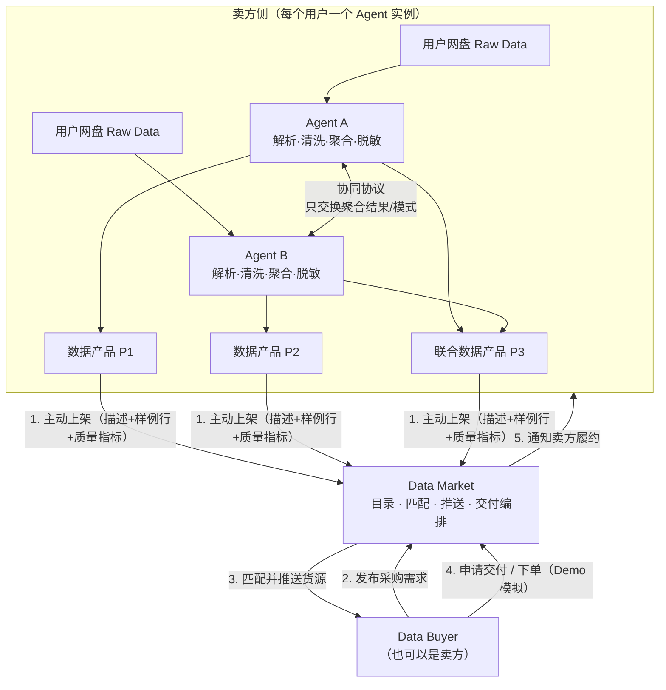
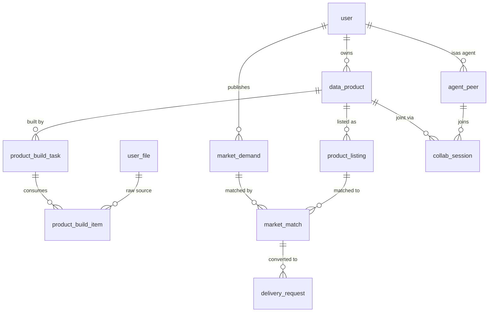
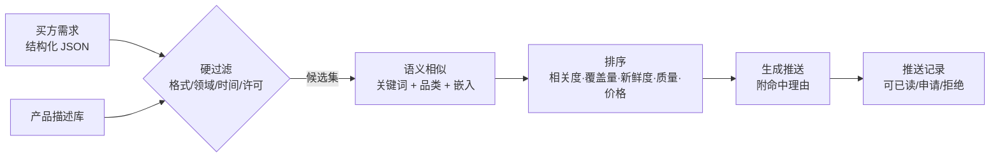

# 从「悬赏匹配」改造为「卖方 Agent + 数据交易市场」

> 评审对象：当前代码库 `AgentCloudDisk`（9 张表 / 45 个接口 / 后端 5620 行 Kotlin / 前端 2098 行）
> 本文只做可行性判断与改造设计，**不含代码改动**。

---

## 0. 一句话结论

**可行，但当前系统的"匹配"方向是反的，必须重构核心链路；外壳（网盘、解析、隐私、审计、模型路由）几乎可以全部复用。**

新模型里，**Agent 的产物是"数据产品"本身，市场匹配的是产品描述而不是原始文件**。这决定了三件事必须重做：领域模型、匹配发生的位置、以及卖方 Agent 的产出物。其余（分片上传、流式解析、PII 拦截、证据接地、多平台模型、异步任务与进度、审计）原样可用。

---

## 1. 两个模型到底差在哪

| 维度 | 旧模型（已实现） | 新模型（目标） | 影响 |
| --- | --- | --- | --- |
| 触发方 | 企业发布悬赏 → 触发个人扫描 | 卖方主动产出产品 → 主动上架 | 链路方向反转 |
| Agent 产出 | 一份**扫描报告**（推荐清单 + 证据） | 一个**数据产品**（可交易制品 + 描述） | 产物形态变化 |
| 匹配位置 | 在**卖方网盘内**、按需求即时计算 | 在**市场侧**、按产品描述匹配 | 匹配引擎要独立 |
| 买方可见内容 | 只看统计，不能看文件 | 看**产品描述/样例行/质量指标**，不能看原文件 | 需要"分层披露"设计 |
| 角色 | 固定三角色（个人/企业/管理员） | **买卖双向**，同一用户两种身份 | 角色模型要改 |
| 协同 | 无 | Agent 之间**联合生成产品** | 全新模块 |
| 交易 | 只到"推荐" | 上架 → 匹配 → 推送 → 交付（Demo 内模拟） | 需要交易/交付骨架 |

**核心洞察**：旧模型里"匹配"是一次性查询；新模型里"匹配"是一个**双边市场**，需要持续维护卖方库存、买方需求、以及两者之间的推送关系。

---

## 2. 目标流程（照你给的图细化）



关键设计决策：**市场只见"产品描述"，不见"产品内容"**。描述里包含：字段模式、覆盖量、时间范围、质量指标、样例（脱敏/合成）、许可条款、价格。真实数据留在卖方侧，交付阶段再点对点授权。

---

## 3. 可行性分解

### 3.1 技术可行性：高

现有能力与新模型的对应关系（这是能快速改造的根本原因）：

| 现有能力 | 位置 | 在新模型中的用途 |
| --- | --- | --- |
| 内容寻址存储 + SHA256 秒传 | `StorageService` / `file_meta` | 产品构建的**可复现凭证**（产品 → 原料哈希集合） |
| 流式解析（EasyExcel/StAX/PDF/OCR/ZIP） | `FileContentParser` | 从 Raw Data 抽取结构化字段 |
| 跨块 PII 扫描 | `StreamingSensitiveScanner` | 产品**出厂前的合规闸门**（不合格不许上架） |
| 证据接地 LLM 判定 | `LlmMatchJudge` | 生成**产品描述的语义标签**（供市场召回） |
| 多平台模型 + 故障切换 | `LlmClient` / `ai_provider` | 卖方侧 Agent 的算力底座，原样复用 |
| 异步任务 + 进度注册表 | `ScanProgressRegistry` / `scanExecutor` | 产品构建任务、市场匹配任务的执行框架 |
| 审计表 | `agent_scan_task/result` | 改造为**产品构建流水**（谁、用哪些原料、何时、什么模型） |
| 用户/配额/JWT/管理后台 | 底座 | 直接复用 |

也就是说：**不需要引入任何新的基础设施**，PostgreSQL + 本地内容寻址存储 + 一个 JVM 仍然够用。

### 3.2 数据可行性：中

需要新建的是"产品"这一层。这是真正的增量工作，但它比旧模型简单——旧模型要"按任意需求即时评估任意文件"，新模型只需要"在一个**已定义的产品模板**下产出结构化结果"，搜索空间小得多。

### 3.3 隐私与合规可行性：中偏高，但有硬约束

新模型把风险从"扫描"转移到"**交付**"，必须显式设计：

1. **分层披露**：产品目录只放描述；申请交付后才按协议放数据（Demo 内以"模拟交付"收尾）。
2. **联合产品交叉泄露**：两个卖方的数据按下标对齐（同一主键 join）会泄露个体。对策：联合产品**只允许聚合类产物**（≥k 条的分组统计，k 默认 5），不允许行级拼接。
3. **可撤回**：卖方下架/撤回后，已推送的匹配必须失效。
4. **可复现**：产品必须记录原料哈希 + 构建参数 + 模型版本，否则买方无法判断"我买到的和看到的是不是同一个东西"。

### 3.4 工程可行性：高（单进程多租户模拟）

你图里"每个卖方部署自己的 Agent"。Demo 阶段建议**单进程多租户**：一个 JVM，每个用户一个逻辑 Agent（有独立身份、密钥、原料范围、审计），协同走内部 HTTP/服务调用。真正分布式部署留作后续（接口已按"Agent 身份"设计，拆出去时只需把服务调用换成 HTTP）。

### 3.5 演示可行性：高，且比旧模型更好演示

旧模型演示是"一个人被扫描"；新模型演示是"**两个用户各自出产品 → 联合出一款产品 → 买方搜索 → 被推送 → 申请交付**"，故事完整、双边可见、时长可控（约 3 分钟）。

---

## 4. 四个硬问题（必须先定，否则会返工）

### H1. 买方凭什么相信产品？（信任问题）

买方看不到原数据，只能靠描述决策。若描述由卖方 Agent 自己生成，存在夸大动机。

**建议**：产品描述拆成两层——
- **可复现指标**：行数、字段名、时间范围、缺失率、唯一值数（可由市场侧对"脱敏样例"重算校验）；
- **模型生成的语义标签**：供召回，标注"由模型生成，仅供参考"。

并强制每个产品附带 `build_receipt`（原料哈希集合 + 构建参数 + 模型版本），市场侧只校验其**自洽性**，不校验内容。

### H2. 匹配在哪儿算？（架构问题）

如果匹配在卖方侧，买方每发一次需求，所有卖方的 Agent 都要跑一遍——N×M 放大，且买方需求会泄露给所有卖方。

**建议**：**双边都在市场侧留描述**。卖方上架时提交产品描述（已脱敏），买方发布需求时市场解析成结构化需求（复用现有 `BountyStructureParser`），匹配在市场侧用"描述 × 需求"完成，**卖方的原始数据和 Agent 不参与匹配过程**。这也让推送变得可行（离线批量匹配）。

### H3. 联合产品怎么协同且不泄露？（协议问题）

**建议**：定义最小协同协议（4 步）：
1. **Invite**：A 向 B 发起协同邀请，声明产品模板与所需字段；
2. **Agree**：B 同意，各自在自己网盘内按同一模板**本地聚合**（只产出分组统计）；
3. **Exchange**：双方只交换**聚合结果**（附 k-匿名检查，少于 k 的分组丢弃）；
4. **Merge**：任一方（或市场）合并成联合产品，双方各自确认后才可上架。

全程不传原始行，天然规避交叉泄露。

### H4. 角色双向怎么建模？（产品问题）

**建议**：删掉固定"企业用户"角色。改为**能力开关**：每个用户默认同时可买可卖，前端提供"买方视图 / 卖方视图"切换。管理员保留（审核 + 审计）。

---

## 5. 改造方案

### 5.1 领域模型（新增 7 张表，改造 2 张）



| 表 | 作用 | 关键字段 |
| --- | --- | --- |
| `data_product` | 数据产品主表 | `owner_id`, `title`, `template_key`, `schema_json`, `row_count`, `coverage_start/end`, `quality_json`, `record_count`, `pii_status`, `license`, `status`(草稿/待审/已上架/已下架), `build_receipt` |
| `product_build_task` | 一次产品构建（复用原扫描任务框架） | `product_id`, `user_id`, `scope_json`, `status`, `total/success/fail`, `model`, `ai_enabled` |
| `product_build_item` | 构建用料（原料溯源） | `task_id`, `user_file_id`, `file_sha256`, `parse_method`, `rows_contributed`, `risk_tag` |
| `product_sample` | 脱敏样例（市场可见） | `product_id`, `sample_json`, `synthetic`(是否合成), `masked` |
| `product_listing` | 上架记录（可多次上下架） | `product_id`, `price`, `currency`, `license_terms`, `listed_at`, `delisted_at` |
| `market_demand` | 买方需求（**由 `data_bounty` 迁移而来**） | `buyer_id`, `title`, `raw_desc`, `structured_json`, `budget`, `status` |
| `market_match` | 匹配结果 / 推送记录 | `demand_id`, `listing_id`, `score`, `reasons_json`, `pushed_at`, `read_at`, `state`(推送/已读/已申请/已拒绝) |
| `collab_session` | Agent 协同会话 | `template_key`, `initiator_agent`, `partner_agent`, `state`(邀请/同意/构建中/待确认/已合并/已取消), `k_threshold` |
| `collab_contribution` | 协同各方贡献的聚合结果 | `session_id`, `agent_id`, `aggregate_json`, `suppressed_groups`, `approved` |
| `agent_peer` | Agent 身份（每用户一个） | `user_id`, `agent_name`, `public_key`, `status`, `last_seen_at` |
| `delivery_request` | 交付申请（Demo 内模拟履约） | `match_id`, `buyer_id`, `seller_id`, `status`, `note` |

**迁移策略**：
- `data_bounty` → 改名/复制为 `market_demand`，字段基本不变（`publisher_user_id` → `buyer_id`，补 `budget`）；
- `agent_scan_task` / `agent_scan_result` → 保留结构，语义改为 `product_build_task` / `product_build_item`（推荐新建表 + 数据迁移，保留旧表只读，避免破坏已有审计）；
- `ai_provider`、`user`、`file_meta`、`user_file`、`upload_task` → **完全不动**。

### 5.2 后端模块划分

```
agent/
  ProductTemplateRegistry      产品模板（菜谱库/通勤统计/宠物喂养/读书笔记…），定义字段与聚合口径
  ProductBuilder               原料 → 产品（复用 FileContentParser + PII 扫描 + LLM 打标）
  ProductDescriptorService     生成市场可见的描述（schema + 质量指标 + 脱敏样例 + 语义标签）
  CollabCoordinator            Agent 间协同协议（邀请/同意/交换/合并）
  CollabAggregator             聚合与 k-匿名检查
  MarketMatchEngine            需求 × 产品描述 的三阶段匹配（硬过滤 → 语义 → 排序）
  MatchPushService             推送、已读、失效（下架联动）
  DeliveryService              交付申请与（模拟）履约
  AgentIdentityService         每用户一个 Agent 身份
```

复用（不改逻辑）：`FileContentParser`、`StreamingSensitiveScanner`、`RiskDetector`、`LlmClient`、`OpenAiCaller`、`LlmMatchJudge`（改用途：生成产品语义标签）、`ScanProgressRegistry`、`scanExecutor`、`AesGcmCrypto`、`StorageService`。

### 5.3 匹配算法（市场侧，三阶段）



- **硬过滤**：格式、领域、时间重叠、许可类型、PII 等级（买方可设"只要已脱敏"）；
- **语义**：优先用已有 `matchKeywords` 机制（快、可解释）；有嵌入则加一路；
- **排序**：`score = w1·语义相关 + w2·覆盖量 + w3·新鲜度 + w4·质量指标 − w5·价格归一`，权重可配置；
- **推送**：写入 `market_match`，前端轮询/未读红点；卖方下架时批量置失效。

### 5.4 API 规划（新增约 22 个接口）

**卖方（产品）**
```
GET    /api/seller/templates                 可用产品模板
POST   /api/seller/products                  创建产品（选模板 + 授权范围）
POST   /api/seller/products/{id}/build       触发构建（异步，返回 taskId）
GET    /api/seller/products/{id}/build/progress
GET    /api/seller/products                  我的产品列表
GET    /api/seller/products/{id}             产品详情（含构建凭证）
POST   /api/seller/products/{id}/list        上架（价格/许可）
POST   /api/seller/products/{id}/delist      下架
DELETE /api/seller/products/{id}             删除产品
```

**协同**
```
POST   /api/collab/invitations               发起协同邀请
GET    /api/collab/invitations               收到的邀请
POST   /api/collab/{id}/accept | /reject
POST   /api/collab/{id}/contribute           本地方聚合贡献
POST   /api/collab/{id}/merge                合并为联合产品（需双方确认）
GET    /api/collab/{id}                      会话详情与各方贡献
```

**买方/市场**
```
GET    /api/market/products                  产品目录（搜索/筛选）
GET    /api/market/products/{id}             产品详情（描述 + 样例）
POST   /api/market/demands                   发布采购需求
GET    /api/market/demands                   我的需求
POST   /api/market/demands/{id}/match        触发匹配（或定时）
GET    /api/market/pushes                    我的推送（未读优先）
POST   /api/market/matches/{id}/read
POST   /api/market/matches/{id}/request      申请交付
GET    /api/seller/deliveries                卖方待履约
```

管理员沿用 `/api/admin/*`，新增：`/api/admin/products`（审核上架）、`/api/admin/collab`（协同审计）。

### 5.5 前端页面改造

| 现有页面 | 处置 | 新页面 |
| --- | --- | --- |
| `LoginView` / `DriveView` / `RecycleView` | **保留不动** | — |
| `BountiesView`（悬赏广场） | **改造** → 采购需求 + 市场目录（买方视图） | `MarketView.vue` |
| `AgentView`（扫描 + 报告） | **改造** → 卖方产品构建（选模板 → 授权范围 → 构建进度 → 产品卡） | `SellerStudioView.vue` |
| — | 新增 | `CollabView.vue`（协同：邀请/贡献/合并/联合产品） |
| — | 新增 | `PushesView.vue`（推送收件箱）或并入 `MarketView` |
| `AdminView` / `AdminAiProviders` | 保留 + 加"产品审核 / 协同审计"两个 Tab | — |
| 顶部导航 | 改为 **买方 / 卖方** 双语视图切换（同一用户双向） | — |

页面骨架（卖方）：

```
我的数据产品
├── [+ 新建产品] → 选择模板（通勤统计 / 菜谱库 / 宠物喂养 / 读书笔记）
│                   → 勾选授权文件夹（沿用现有树）
│                   → 设置是否启用大模型（沿用现有开关）
│                   → 审核样例 → 上架（价格 / 许可）
├── 产品卡：名称 / 行数 / 覆盖时间 / 质量分 / 状态 / 上架 / 下架 / 删除
└── 构建记录：用料文件哈希 + 解析方式 + 模型版本（可复现凭证）

数据市场（买方）
├── 搜索/筛选：品类 · 时间 · 格式 · 只要脱敏 · 价格区间
├── 产品详情：字段模式 + 质量指标 + 脱敏样例 + 许可 + 卖方信誉
├── [发布采购需求] → 结构化解析（复用现有）
└── 我的推送：匹配理由 + [申请交付] / [不感兴趣]
```

### 5.6 分阶段落地

| 阶段 | 目标 | 范围 | 估时 |
| --- | --- | --- | --- |
| **P0（可演示最小闭环）** | 卖方出产品 → 上架 → 买方搜索 → 推送 → 申请交付（模拟） | 新表 6 张（不含 collab）、卖方 9 接口、买方 8 接口、前端 2 页 | 3–4 人日 |
| **P1（联合产品）** | Agent 协同产出联合产品（聚合 + k-匿名） | 新增 `collab_*` 2 表 + 6 接口 + 1 页 | 2–3 人日 |
| **P2（可信与运营）** | 产品审核、卖方信誉、推送失效联动、构建凭证校验 | 管理端 2 Tab + 校验逻辑 | 2 人日 |
| **P3（可选）** | 真实分布式 Agent（拆成独立服务/HTTP） | 抽 `agent_peer` 为服务边界 | 3–5 人日 |

**建议先做 P0**，它已经能完整讲清你图里的主干流程（含"主动推送"），协同作为 P1 加分项。

---

## 6. 复用 / 改造 / 废弃清单（决策依据）

| 现有资产 | 处置 | 理由 |
| --- | --- | --- |
| `FileContentParser` / `StreamingSensitiveScanner` / `PdfTextExtractor` / `OcrService` | **原样复用** | 从原始文件抽字段的能力与触发方无关 |
| `LlmClient` / `ai_provider` / 多平台切换 / AES-GCM | **原样复用** | 卖方 Agent 的算力与密钥底座 |
| `LlmMatchJudge`（证据接地） | **改用途** | 用于生成"产品语义标签 + 构建理由"，不再做"文件×悬赏"判定 |
| `ScanProgressRegistry` / 线程池 / 进度接口 | **原样复用** | 产品构建也是长任务 |
| `data_bounty` 相关（BountyService/BountyController/BountiesView） | **改造** | 语义从"悬赏"变"采购需求"，字段 80% 可留 |
| `agent_scan_task/result`（扫描任务 + 结果） | **改造/新建** | 语义从"匹配结果"变"构建用料与产物"，建议新表 + 迁移 |
| `Roles.ENTERPRISE`（企业角色） | **删除** | 买卖双向，不再有固定企业身份 |
| `ScanRequest.aiEnabled`（大模型开关） | **原样复用** | 卖方构建产品时同样需要"是否让模型参与" |
| `AgentDemoSeeder` | **重写** | 演示数据要改成"两个卖方各一套原料 + 一个买方需求" |

---

## 7. 主要风险与对策

| 风险 | 影响 | 对策 |
| --- | --- | --- |
| 产品描述可信度不足，买方不敢下单 | 高 | 描述分层（可复现指标 + 模型标签）+ 构建凭证 + 卖方信誉 |
| 联合产品交叉泄露 | 高 | 只允许聚合产物、k-匿名、双方确认后上架 |
| 匹配质量差（描述太少） | 中 | 强制最低描述字段；模板化保证结构一致；关键词 + 品类双路召回 |
| 双边冷启动（无产品/无需求） | 中 | 种子目录 + 种子需求（Demo 必须预置） |
| 改造破坏已有审计/测试 | 中 | 新表并存 + 旧表只读；保留现有 5 套测试中的 4 套 |
| "每个卖方一个 Agent"被理解成真分布式 | 低 | 文档明确"单进程多租户模拟"，接口按身份设计，P3 再拆 |

---

## 8. 验收标准（P0）

1. 卖方 A 在 `通勤统计` 模板下，勾选「个人整理」完成构建，得到产品：行数/覆盖时间/字段模式/质量分 均非空；
2. 产品上架后，出现于产品目录，**买方看不到任何原始文件名**；
3. 买方发布"要本地通勤时效数据"需求，市场解析成结构化需求，并**主动推送**该产品，附命中理由；
4. 买方点「申请交付」，卖方看到待履约记录（状态流转正确）；
5. 卖方下架后，目录不再返回、推送记录标记失效；
6. PII 文件（体检单）在构建阶段就被排除，产品 `pii_status` 为"已通过"，且构建凭证里能看到被排除的文件；
7. 关闭大模型开关时，产品描述无模型标签，且**市场侧明确标注"未经过模型加工"**；
8. 现有 `smoke-test` / `agent-smoke-test`（网盘与解析部分）继续通过。

---

## 9. 需要你确认的四个决策

1. **产品模板**：Demo 先做哪 2–3 个模板？（建议：通勤统计、菜谱库、宠物喂养）
2. **交付形态**：Demo 是否做"文件下载"级的交付，还是只到"申请-同意-标记已交付"？
3. **联合产品**：是否必须进 P0？（会显著增加工作量，建议 P1）
4. **价格与许可**：是否需要真实价格区间与许可条款字段，或先做占位？

> 这四点确定后即可直接进入 P0 编码；表结构与接口清单已在上文冻结，改动面可控。
